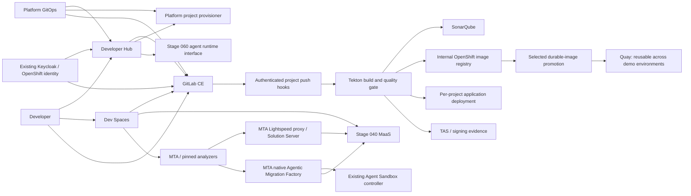

# Stage 070 upgrade and GitLab migration plan

**Status, 2026-10-14:** implemented and deployed. The fresh authenticated GitLab/Developer Hub/delivery/Dev Spaces journey passed at `4349a5d6`; native MTA controller startup and shared SSO passed in the later `42d21753` / `78a14254` / `1c4afd87` corrections. The approved security/deployment corrections are installed at `5c16b8c9`, with a completed native operation and Synced/Healthy read-back; the official MTA operator is now 8.3.1. Optional Solution Server is disabled pending its vendor dependency fix. Models remain stopped; full Stage 070 qualification is partial. [Current qualification](../../BACKLOG.md#stage-070-live-qualification) is the release-status authority. **Original assessment date:** 2026-10-13; the design sections below retain that assessment's observations and proposals.

**Review correction, 2026-10-14:** the reviewed security/deployment package and approved follow-ups are published and deployed. Safe Secret writes, seven explicit rotations, realm-scoped provisioning identities, terminal bootstrap cleanup, immutable deployment verification and bounded ingress policies are live. All 43 security checks pass. Earlier pipeline results remain prior-release evidence; post-rotation checks are separately identified in the current qualification. See the [operations procedure](../OPERATIONS.md#stage-070-security-review-follow-up) and current backlog. The Solution Server recommendation in the original design below is superseded: native Agents and Lightspeed remain configured independently; optional Solution Server stays disabled pending its vendor fix.

**MTA revision, 2026-10-13:** the deployment target is now the latest available **8.3.x**, with Developer Lightspeed, the LLM proxy, Solution Server and native Agentic Migration Factory configured in this release. The earlier 8.2-first recommendation is withdrawn. Section 5.8 records the deeper component review and implementation decisions.

This plan supersedes the **Gitea recommendation** in [the earlier SCM proposal](070-developer-platform-and-scm-plan.md). GitLab becomes the proposed SCM. The latest requested integration review adds a staged cutover of our owned repositories, including a proposed platform-repository cutover subject to the pending scope confirmation; see Appendix C. Tekton remains the CI engine.

## Implementation status

**Chart deployment policy:** all chart-based additions in this release are converted into ordinary checked-in manifests under component `generated/` directories and composed with Kustomize. Helm is required only to regenerate/verify source. Secret generation, supported-version checks and migrations use explicit Argo CD hooks; generated credentials stay out of Git. Canonical GitLab templates remain fully GitOps-owned. The bootstrap writes separate runtime ConfigMaps derived from the current templates, Route and bucket claims; canonical config is not hidden by ignoreDifferences.

Implementation began from platform `c10e131c` on 2026-10-13. The integrated release and security corrections are published, and the final native deployment is Synced/Healthy. The correction resource validator reports 74 PASS, 0 FAIL and 1 WARN, and 191 authoring tests pass on published/deployed 5c16b8c9. Its final full native reconciliation preserved the rotated credentials. The exact broker logout callback is qualified, including rejection of a foreign callback. Native OAuth renewal followed by one normal workspace stop/start restored private Git access without changing its UID/PVC/images/specification or clean source. Uninterrupted credential hot refresh remains unqualified. Both demo personas have signed in across the six tested developer tools; validation-artifact signing/attestation and exact-identity checks passed without model use. Native MTA controller startup is resolved; the optional Solution Server defect remains deferred, not repaired. Subsequent non-model checks rendered TechDocs and restored the scheduled GitLab database and eight repository bundles in isolation. Full service/object-store recovery and signed delivery remain unqualified. Historical observations below are not fresh release evidence.

| Work package | Implemented source | Remaining qualification |
|---|---|---|
| GitLab CE | Native Kustomize resources from chart 10.4.2 / CE 19.4.2; six scoped NooBaa OBCs; dedicated PostgreSQL/Valkey; migration/version checks and retained credentials; OIDC and subject-bound demo-user memberships | Install/migrations, user login, private repositories and scheduled backup creation passed. The 02:00 UTC archive restored its PostgreSQL 17.6 database and eight Git bundles in isolation. That archive predates the new validation project and skips object-store contents. Full service recovery and off-cluster encryption-secret escrow remain unqualified |
| Repository and factory integrations | Private owned imports; normal fast-forward platform mirror; goldens from the exact platform revision; pinned catalog/template/TechDocs bundle; scoped publisher, catalog, clone, enrollment and delivery credentials; GitLab OAuth and registered first-commit enrollment | Real import, template publication, first-commit enrollment, private clone and webhook authentication/dedup passed. Platform root Applications still bootstrap from GitHub; root cutover remains separate |
| Internal registry and GitOps delivery | Immutable Buildah/git-init images; dedicated image-builder identity; documented non-root user-namespace build settings; memory-only auth, CA trust and token refresh; exact clone; scan gate; atomic digest promotion into delivery Git and Argo/deployment read-back | Initial six-Task pipeline passed without retry for the fresh project; exact digest/delivery/HTTP readback and negative Sonar gate passed. Long-term retention and byte-reproducible builds are not demonstrated |
| Dev Spaces and workspaces | 3.30.2 selection, per-workspace 20Gi gp3, source allowlist/OAuth, canonical workspace naming and existing migration identities preserved | Fresh private IDE checkout, normal tool initialization and same-UID reopen passed with models stopped. No AI task was invoked |
| Developer Hub | 1.10.5 selection, existing realm, scoped GitLab readers, one coherent catalog bundle, digest-pinned Tekton package with explicit UI mount | Both-persona SSO, served application template, private catalog, CI, Topology, Kubernetes and rendered TechDocs passed. The validation component has no CD tab; Argo plugin UI qualification remains blocked. The documentation index now uses source links for pages outside the published TechDocs tree |
| SonarQube | Native resources from Community Build 26.9 / chart 2026.5.1002, separate PostgreSQL and existing idempotent gate/token configuration | Actual passing scan and stricter-gate refusal of image promotion passed; restore remains unqualified |
| MTA with AI | 8.3.1 operator/Tackle; native agentic feature and Gateway separated from the proxy and deferred Solution Server; scoped OpenShift VPA for controller memory; separate MaaS subscription/owner key lifecycle; existing Stage 060 Sandbox controller reused | Solution Server is disabled pending its vendor greenlet fix, with database retained. Native controller startup uses the documented OpenShift VPA Recreate path; the admitted1Gi pod is Ready with zero restarts. This does not qualify inference. Inference, solved-example persistence and native agent workflow remain unqualified. Lightspeed/Solution Server/IDE agent loop are Technology Preview; Hub Agents are Developer Preview |
| TAS | 1.5.0 selection, persistent Securesign services and shared-realm issuer/client | Validation-blob signing, attestation and exact identity/issuer/digest checks passed with vendor cosign 3.0.4. The custom predicate URI is checked explicitly; the CLI type flag alone did not reject a mismatch. Image-pipeline signing, roots/service recovery and blocking signed promotion remain unqualified |
| Workspace tools | Shared candidate published to Quay; verified MTA CLI/archive and four VSIX packages; Hermes stamp preserved; checked-in build/staging/verifier sources | Full application analysis, editor installation and AI migration remain to be tested |

**Initial workspace artifact record:** `quay.io/rhoai3-coding-demo/rhoai3-ws-080@sha256:e4ac365b3818773ea1d8f67202200011a95089d05ee53ca2652efa353de968e0`. At that initial checkpoint only the image was published; subsequent platform deployment and workflow qualification are recorded above.

**Validation:** focused authoring tests exercise real Task shell scripts and real Git histories, with fake registry/GitLab/cluster providers where stated. Both full and slim Kustomize overlays render. The pinned chart renderer is separately reproduced with `--check`. Product-schema checks cover both migration Devfiles, MTA's native Gateway and the configured TAS schema subset. Tackle's actual downstream CRD preserves unknown fields: it cannot prove that an arbitrary parameter is implemented by the operator. The selected downstream image's actual defaults and proxy template were extracted and checked; the OpenAI provider/model/Secret/base-URL mapping renders correctly. An unsupported `rwo_storage_class` parameter was removed; deployment checks that gp3-csi is the default for the operator's RWO claims. This is source/configuration evidence, not live operand reconciliation.

**Live tool qualification:** a disposable CPU-only Pod ran the published image, Java 21 and MTA 8.3.0 on a minimal Java fixture. Both the builtin and Java-field rules produced measured incidents. The first test mistakenly used a variable-declaration location for a field; its failure is preserved beside the corrected passing test. The provider also logged a canceled prepare-progress stream, but its evaluate call returned `err=null` and the expected incident; no broad claim about full-source behavior is made. The namespace was retired. No model call or migration was launched. Local verification of the published candidate also passed all CLI/VSIX hashes, Java 21, Node and the unchanged Hermes stamp.

Evidence is in `tmp/stage070-implementation/review/` and `tmp/stage070-implementation/live/`. The initial root-store image push failed on an existing cached-layer integrity error. Rebuilding in the fresh rootless store succeeded; neither store was repaired or pruned. Retain that failed log as build evidence.

Before deployment, the human must review the full feature diff, source pins, RBAC and data lifecycle. Then publish the selected platform source and install through the Stage Application. Resource readiness, user workflow, signed delivery, recovery and model-dependent checks must be reported separately. Keep models stopped until the operator authorizes the final AI checks. Existing runs and historical workspaces remain unchanged.

## 1. Recommendation and scope

Modernize Stage 070 as one integrated developer platform, then prove one application through portal creation, private repository access, workspace development, analysis, build, quality gate and deployment. Porting each operator independently will not resolve the current GitHub-specific integration contracts.

**Original 2026-10-13 inventory (superseded by the deployment status above): Stage 070 was not installed on the inspected cluster.** No Stage 070 Argo CD Application, Dev Spaces, RHDH, Pipelines, TAS, MTA or GitLab installation was found. The repository retains the older implementation. Accordingly, most work is a **fresh deployment of upgraded configuration**, followed by migration of selected GitHub workload repositories. There is no observed Gitea installation to export, and there is no observed Stage 070 database to upgrade in place. If an older environment or backup is later introduced, use the data-migration branches in this plan; do not assume those databases are empty.

Recommended architecture decisions:

1. Deploy **GitLab Community Edition**, using manifests rendered from the pinned official chart and managed by Kustomize/Argo CD. Use private workload repositories, HTTPS Git, scoped credentials and project webhooks. Keep GitLab CI runners and GitLab's container registry out of the first deployment.
2. Reuse the **existing Keycloak instance in namespace `keycloak`**, adding only the Stage 070-owned realm/clients. Do not deploy the source's second RHBK instance in `rhbk`.
3. Target **Dev Spaces 3.30.2** and **RHDH 1.10.5**. Qualify the actual DevWorkspace Operator, workspace images and plugin packages delivered by those releases.
4. Use **Pipelines 1.24.0** and **TAS 1.5.0 as upgrade candidates**, subject to their exact release compatibility and rendered API checks. Both appear in the live catalog, but that is not sufficient qualification. The retained 1.22/1.4 lines provide comparison baselines, not an automatic fallback.
5. Deploy MTA directly on the **latest available 8.3.x** and configure its AI components in the same Stage 070 release. Currently the catalog/CLI release is 8.3.0 and the published IDE components are 8.3.1. Enable Developer Lightspeed, its authenticated LLM proxy and Solution Server, and the native Agentic Migration Factory, all using governed MaaS inference. Update analyzer consumers and qualify the new contracts as part of this upgrade; no intermediate 8.2 deployment or later AI-enablement campaign.
6. Replace the unidentified custom SonarQube image with a pinned **SonarQube Community Build** and its official OpenShift chart configuration, after checking database and kernel requirements.
7. Keep platform resource provisioning in the platform repository. Keep Stage 060 agent runtime ownership distinct from Stage 070 portal/IDE ownership. Preserve MaaS as the model access control point.
8. Publish environment-local Tekton outputs to the **internal OpenShift image registry**. Use Quay only for explicitly selected images that must persist across or be reused in multiple demo environments. GitLab's integrated registry remains disabled.

The first slice must not install the reference workshop's entire application stack. GitLab, the developer tools and their actual dependencies are sufficient. Kafka, Jira, a new Vault deployment, a second object-store platform, GitLab Runner and a second registry are outside this migration.

## 2. Evidence and current state

### Source and reference identities

| Evidence | Identity / boundary |
|---|---|
| Project checkout inspected | `8e1e0a7e3c22391ecbeda28b204dcba0f4d67807` |
| Source stage | `gitops/stages/070-advanced-app-platform/`, `stages/070-advanced-app-platform/` |
| Reference repository | `rhpds/ocp-dev-days-rdshw-gitops` |
| Reference commit inspected | `c850fe185bca75a889188985e1d957be380e5fd8`, committed 2026-10-08 |
| Local reference copy / rendered source | `tmp/stage070-migration-20261013/` |
| Source render | Stage 070 base rendered successfully with Kustomize; this does not establish admission or runtime correctness |
| Live access | Guarded, read-only OpenShift inspection; no Secret values read |

The target API was `https://api.<cluster-domain>:6443`, not the older `grnl8` cluster referenced in historical migration records. Historical README success claims were treated as historical evidence, not current installation status.

### Live prerequisites

| Component | Observed live state | Consequence |
|---|---|---|
| OpenShift | 4.22.14 | Choose releases supporting the current platform, not the old workshop baseline |
| OpenShift GitOps | 1.21.5 | Retain; introduce one Stage 070 owner after checking legacy ownership |
| cert-manager | 1.20.1 | Reuse for GitLab where required; do not install a second cert-manager |
| RHBK | 26.4.16-opr.1, `stable-v26.4`, namespace `keycloak` | Reuse the Ready `keycloak/keycloak` instance; its operator is namespace-scoped |
| Keycloak endpoint | `sso.apps.<cluster-domain>` | Add Stage 070 clients to the existing service; preserve existing `sso` and `openshell` realm ownership |
| Keycloak database | PostgreSQL 16; one ready instance | Not the source stage's proposed PostgreSQL 15 database; no replacement is required for this migration |
| RHOAI / RHCL | 3.5.1 / 1.4.3 | Reconcile old MaaS paths with the newer gateway implementation |
| ODF / MCG | 4.22.5-rhodf | Object-store capability exists, but a bucket still needs explicit provisioning and testing |
| Filesystem StorageClasses | `gp2-csi`, `gp3-csi`; expansion enabled; reclaim policy Delete | RWO storage is available. No RWX/CephFS class was observed |
| Object storage class | `openshift-storage.noobaa.io` | Candidate for scoped GitLab buckets; not a substitute for a filesystem RWX volume |
| Argo applications | Foundation, infrastructure, serving, MaaS and Stage 060 sub-applications are present | Do not disturb their owners. Stage 050 was Synced/Suspended; do not claim the whole environment is Healthy |

### Component and version inventory

“Catalog candidate” means an available package version, not an installed or tested release.

| Capability | Retained source | Proposed target / qualification |
|---|---|---|
| Identity | Second RHBK, channel `stable-v26`; `platform-rhbk`; PostgreSQL 15 `latest`; realm configuration jobs | Existing RHBK 26.4 instance, Stage 070-owned realm and clients only |
| Dev Spaces / DWO | `stable`, Automatic; `CheCluster/v2`; per-user PVC; three concurrent workspaces; GitHub trusted sources | Catalog 3.30.2; per-workspace `gp3-csi`; qualified DWO behavior and OAuth integration |
| Workspace tools | UDI 3.29.1 digest; custom migration/agent images; MaaS bootstrap, model profiles and native hooks | Rebuild only images that need the new editor/tool baseline; retain validated runtime pins and interfaces |
| RHDH | `fast-1.9`, Automatic; `Backstage/v1alpha5`; mixed bundled and OCI plugins | `fast-1.10`, catalog 1.10.5; explicit compatible plugin inventory |
| Pipelines / Triggers | `pipelines-1.22`, Automatic; shared dispatcher; per-project Tasks | Catalog 1.24.0 candidate; current 1.22.6 is the retained-line comparison point |
| TAS | `stable-v1.4`, Automatic; operator subscription | Catalog 1.5.0 candidate; provision actual signing services separately from operator readiness |
| SonarQube | `quay.io/kenmoini/sonarqube:34b8fd8`; PostgreSQL 15 `latest`; custom jobs | Official Community Build chart, pinned build/chart/digests; dedicated PostgreSQL 16 candidate |
| MTA | `stable-v8.2`, Automatic; authenticated Tackle; Kai/LLM proxy disabled; 8.2.0 IDE pins and explicit GenAI disable | Latest `stable-v8.3`: catalog/CLI 8.3.0; IDE pack/core/Java 8.3.1; proxy, Solution Server and native factory enabled |
| Coolstore | Existing Inventory application; mutable `:latest`; GitHub source and catalog annotations | GitLab workload source; internal-registry digest deployment; preserve application behavior |
| SCM | GitHub integrations and provisioning; Gitea only proposed | New GitLab CE; pinned chart rendered into native Kustomize resources |

The selected GitLab source is chart **10.4.2 / CE 19.4.2**. Its archived source and every consumed image are pinned in `scripts/platform/stage070-charts.lock.json`. The user's 2026-10-13 deployment decision supersedes the Operator proposal: Helm renders offline during authoring, and Argo CD consumes only checked-in Kustomize resources. The GitLab Operator and its chart-bearing CR are removed from this implementation. This is a GitLab/community application on OpenShift, not an asserted Red Hat-supported application. [Chart version mappings](https://docs.gitlab.com/charts/installation/version_mappings/).

Dev Spaces 3.30.2 has a published September 2026 patch release. RHDH's current lifecycle matrix includes OCP 4.22 support for 1.10. Read the exact chosen release notes before freezing plugin and image pins. [Dev Spaces patch notes](https://docs.redhat.com/en/documentation/red_hat_openshift_dev_spaces/3.30/whats_new-dev_spaces_3_30_patch_release_september_30__2026), [RHDH support policy](https://access.redhat.com/support/policy/updates/developerhub).

For Pipelines 1.24 and TAS 1.5, catalog availability was verified, but the complete version-specific compatibility material was not established in this review. Do not represent those candidates as a qualified combination. Resolve their release/API compatibility in work package P0; report any rejected candidate and the reason. MTA 8.3 has since received the deeper review in section 5.8 and is the selected target, with its deployment checks included in this release.

## 3. How to use the reference implementation

Use the reference as executable examples of integration patterns, not as a supported version matrix or a package to deploy wholesale. All links below are pinned to the inspected commit.

| Reference example | Reuse / adapt | Do not carry forward |
|---|---|---|
| [GitLab values](https://github.com/rhpds/ocp-dev-days-rdshw-gitops/blob/c850fe185bca75a889188985e1d957be380e5fd8/cluster/gitlab/values.yaml) and [GitLab deployment](https://github.com/rhpds/ocp-dev-days-rdshw-gitops/blob/c850fe185bca75a889188985e1d957be380e5fd8/cluster/gitlab/templates/deploy-gitlab.yaml) | Routes, application dependencies and initialization sequencing illustrate the workshop topology | GitLab 17.11.7 custom image, misleading chart `appVersion`, PostgreSQL 14/Redis 6.2.6, privileged pods and broad SCC grants |
| [GitLab initialization](https://github.com/rhpds/ocp-dev-days-rdshw-gitops/blob/c850fe185bca75a889188985e1d957be380e5fd8/cluster/gitlab/templates/cm-gitlab-init.yaml) | Idempotent creation of users/groups/projects and SCM OAuth application | Shared root PAT as ongoing provisioning identity, public-by-default repositories, blanket unprotecting of `main`, internal GitLab file patching |
| [Dev Spaces instance](https://github.com/rhpds/ocp-dev-days-rdshw-gitops/blob/c850fe185bca75a889188985e1d957be380e5fd8/cluster/devspaces/devspaces-instance/templates/checluster.yaml) and [SCM OAuth Secret](https://github.com/rhpds/ocp-dev-days-rdshw-gitops/blob/c850fe185bca75a889188985e1d957be380e5fd8/cluster/devspaces/devspaces-instance/templates/es-gitlab-oauth.yaml) | `gitServices.gitlab`, server URL, Secret metadata and per-workspace storage | Automatic adoption of its Vault/ExternalSecrets transport or unrelated AI/Kafka settings |
| [RHDH configuration](https://github.com/rhpds/ocp-dev-days-rdshw-gitops/blob/c850fe185bca75a889188985e1d957be380e5fd8/cluster/developer-hub/templates/configmap-app-config.yaml) | GitLab integration, GitLab catalog provider, Keycloak users/groups, tenant selection and permission examples | Argo administrator credentials or assuming UI label filters enforce Kubernetes authorization |
| [RHDH dynamic plugins](https://github.com/rhpds/ocp-dev-days-rdshw-gitops/blob/c850fe185bca75a889188985e1d957be380e5fd8/cluster/developer-hub/templates/configmap-dynamic-plugins.yaml) and [Backstage CR](https://github.com/rhpds/ocp-dev-days-rdshw-gitops/blob/c850fe185bca75a889188985e1d957be380e5fd8/cluster/developer-hub/templates/backstage-cr.yaml) | GitLab modules and declarative plugin configuration; operator-managed Backstage instance | Copying Backstage 1.45.3 plugin builds into RHDH 1.10; global `NODE_TLS_REJECT_UNAUTHORIZED=0`; model paths bypassing MaaS |
| [Pipelines values](https://github.com/rhpds/ocp-dev-days-rdshw-gitops/blob/c850fe185bca75a889188985e1d957be380e5fd8/cluster/openshift-pipelines/values.yaml) and [tenant bootstrap](https://github.com/rhpds/ocp-dev-days-rdshw-gitops/tree/c850fe185bca75a889188985e1d957be380e5fd8/tenant/bootstrap) | Separate platform bootstrap from application-owned GitOps; label-driven visibility and reproducible installation | 1.22.4 as an upgrade target; granting interceptor permissions to all ServiceAccounts; broad workshop cleanup jobs |
| [SonarQube values](https://github.com/rhpds/ocp-dev-days-rdshw-gitops/blob/c850fe185bca75a889188985e1d957be380e5fd8/cluster/sonarqube/values.yaml) | Password/token setup and quality-gate sequencing | The same unidentified `34b8fd8` image is used here; this is not evidence of an upgraded SonarQube |

No top-level LICENSE/COPYING file was found in the inspected reference tree. Public availability alone is not permission to redistribute its code. Before copying implementation text, verify the relevant files' license or obtain permission. Referencing patterns and independently authoring configuration against documented interfaces can proceed. Use GitLab CE and review the licenses of any additional operators/plugins; “Free tier” is not the same statement as “all components are open source.” [GitLab CE deployment option](https://gitlab.com/gitlab-org/charts/gitlab/-/blob/master/doc/installation/deployment.md).

## 4. Ownership and target topology



This diagram shows responsibilities, not completed integration. Dev Spaces can continue using OpenShift OAuth for IDE login; its GitLab OAuth application is a separate SCM authorization flow. RHDH and MTA use their own OIDC clients. Do not conflate SCM tokens with OpenShift access tokens.

| Owner | Authority | Must remain outside its authority |
|---|---|---|
| Platform GitOps | Operators, shared services, trusted catalog/template bundle, provisioner and credential policy | Workload repository content and arbitrary user-issued cluster changes |
| GitLab workload project | Application source and approved application manifests | Cluster-scoped RBAC, platform bootstrap and provisioner identity |
| RHDH scaffolder | Create a project through scoped API permissions; register it; submit trusted provisioning request | Accepting user-controlled destinations/namespace names without validation |
| Tekton project identity | Checkout, scan, build, push and approved deployment in that project's namespace | Another project's Secrets, platform resources or arbitrary pipeline definitions |
| Dev Spaces worker | Developer/agent work in its intended repository | Recreating control records, granting permissions, or acting as a platform provisioner |
| Stage 060 runtime | Agent session/board/runtime lifecycle and its defined project association | Silent duplication of a workspace-local worker writing the same tree |

Keep one Stage 070 Argo Application owner. Do not introduce a legacy `060-advanced-app-platform` owner against the same resources, or use cascade deletion to rename an Application. Review generated project Applications too: the retained trigger currently adds an Argo resources finalizer, so deleting a catalog entry or project Application must not inadvertently delete databases/PVCs.

## 5. Component plans

### 5.1 Identity: adopt the existing RHBK service

**Current implementation:** a second operator/instance/database under `base/identity`, with platform realm import and a PostSync reconciliation job. This conflicts with the live baseline's already Ready, namespace-scoped RHBK installation.

**Target:** keep `keycloak/keycloak` and its current 26.4 operator/image. Add a separately owned `platform` realm, or reuse it only after establishing its current owner. Configure distinct RHDH, MTA, GitLab and signing-service clients with explicit redirect URIs. Broker OpenShift identity where appropriate. Preserve the existing `sso` and `openshell` realms and Stage 060 client configuration.

Implementation sequence:

1. Split identity consumption/reconciliation from operator installation. Remove the second installation from the future Stage 070 render; do not delete the existing Keycloak.
2. Make the identity job consume the actual issuer/base URL and the scoped administration mechanism. Reconcile only named clients/mappers/groups; never import a whole realm over an existing realm blindly.
3. Derive redirect URIs from actual Route status, including ingress fallback, and register exact callbacks. Verify browser login and logout for each consumer, plus token issuer/audience validation.
4. Restrict shared application identities. Replace RHDH's Argo admin/password consumption with a read-only Argo account/token and preserve Kubernetes CA validation.

**Data / rollback:** export the affected realm configuration and retain client credentials securely before changes. Roll back the Stage 070 client delta without reverting unrelated realm changes or the live Keycloak database. If upgrading Keycloak later, use a separate release and its database compatibility plan.

**Acceptance:** existing Stage 060 login still works; Stage 070 logins work with the intended identities; catalog user/group mapping and application authorization are demonstrated; redirects cannot target arbitrary hosts. No duplicate RHBK/PostgreSQL deployment appears.

### 5.2 GitLab: new workload SCM deployment

**Target deployment:** GitLab CE, using the official chart as an authoring source for checked-in native resources. Argo CD owns the Kustomize deployment; no Helm release, runtime chart inflation, GitLab Operator or `GitLab.spec.chart` remains. `scripts/platform/render-stage070-charts.py --check` verifies reproduction against the locked chart archives and renderer version. Retain the upstream MIT license alongside the converted manifests.

The selected chart/application/image set is recorded in the chart lock. GitLab 19.4.2 requires PostgreSQL 17 or newer within the supported range; choose a pinned PostgreSQL 17 release. Use a separately managed compatible Valkey release, with 7.2 as the documented compatibility baseline, and explicit object storage. Do not copy the reference's PostgreSQL 14 or Redis 6.2.6. [GitLab requirements](https://docs.gitlab.com/install/requirements/), [Redis removal / Valkey compatibility](https://docs.gitlab.com/update/deprecations/?removal_miles=), [external cache configuration](https://docs.gitlab.com/charts/advanced/external-redis/).

Deployment choices:

- Use the existing OpenShift router and documented GitLab Route configuration for the first slice. Use HTTPS Git; SSH needs a separately designed TCP exposure. Gateway API is GitLab's recommended alternative, but do not add another gateway/controller merely to serve this first HTTPS-only deployment. Do not patch the cluster's default ingress controller to accommodate the reference chart. [Ingress options](https://docs.gitlab.com/operator/openshift_ingress/).
- Retain the official OpenShift approach with namespace-scoped SCC-use bindings to the three named GitLab service accounts only. Application pods use `nonroot-v2`; validate the selected release's precise bindings and applied UIDs. Do not promise arbitrary-UID compatibility or copy `privileged`/namespace-wide `anyuid` grants. [GitLab SCC guidance](https://docs.gitlab.com/operator/security_context_constraints/).
- Reuse cert-manager and platform trust distribution. Keep TLS checks enabled in Git clients, RHDH readers, webhook callers and pipelines.
- Allocate dedicated PostgreSQL, cache and Gitaly persistence. Use `gp3-csi` for RWO filesystem storage and scoped NooBaa/S3-compatible buckets for attachments, LFS and backups. Validate endpoint/path-style/CA behavior; the mere existence of MCG does not qualify GitLab object storage.
- Use the existing OpenShift internal registry for environment-local build outputs; retain Quay only for selected cross-environment images. Disable unneeded bundled GitLab registry, Runner and monitoring duplicates in the rendered configuration. Retain required GitLab services; do not remove components based only on their names.

The following is an **illustrative values fragment**, not an installable manifest or the complete pinned chart values. It expresses the selected edition and external services; validate keys against the frozen chart:

```yaml
global:
  edition: ce
  hosts:
    domain: apps.example.com
    gitlab:
      name: gitlab.apps.example.com
  psql:
    host: gitlab-postgresql.gitlab.svc
    password:
      secret: gitlab-database
      key: password
  redis:
    host: gitlab-valkey.gitlab.svc
gitlab-runner:
  install: false
registry:
  enabled: false
```

`global.edition` defaults to EE, so CE must be explicit. The real values must also carry external object storage, authentication, persistence, ingress and service configuration. [Chart options](https://docs.gitlab.com/charts/installation/command-line-options/), [object storage configuration](https://docs.gitlab.com/charts/advanced/external-object-storage/).

**Identity and credentials:** use the platform identity service for human login, with verified claim-to-user mapping and restricted signup. Provision separate identities for publishing, catalog reads, pipeline checkout and workspace Git. Do not use a shared root PAT as the ongoing integration identity. Restrict publisher permissions to the workload group and enforce destination/path validation even if the GitLab token needs a broad API scope. Keep branch protection; allow the explicitly approved publisher/automation path instead of globally unprotecting `main`.

**Repository migration:** enumerate repositories and refs actually required by Stages 110/120/130. Mirror selected branches/tags into GitLab and validate commit IDs, LFS objects and submodules. An ordinary Git mirror does not migrate issues, releases or all hosting metadata; import those only where needed. Freeze legacy/source evidence at its recorded commit. Archive old targets only after the new consumers pass. Do not rewrite historical migration receipts to point at the new host.

**Backup / rollback:** retain repositories/Gitaly data, database, object data, Rails encryption Secrets and integration configuration. Store backups outside the instance's own failure domain and demonstrate a restore before migrating the only copy of a repository. GitLab chart backup procedures require additional object-store configuration; a healthy PVC or a PostgreSQL dump alone is insufficient. [Backup and restore](https://docs.gitlab.com/charts/backup-restore/).

### 5.3 Dev Spaces, workspace images and MaaS bootstrap

The detailed platform configuration comparison is in [Appendix A](#appendix-a-dev-spaces-comparison-with-the-reference-project); workspace definitions, Devfile alignment and lifecycle decisions are in [Appendix B](#appendix-b-workspace-definitions-and-devfile-alignment).

**Upgrade:** use the catalog's Dev Spaces 3.30.2 after checking its OCP support and actual DWO version. Existing comments about old DWO behavior are not proof of the new release. Keep the operator-managed CheCluster API and test the workspace extensions against the delivered editor/UDI images.

**Storage decision:** choose per-workspace PVCs on `gp3-csi` for this fresh deployment. The source's per-user PVC plus three concurrent workspaces can create RWO attachment conflicts across nodes. No RWX class was observed. If old workspaces are recovered later, stop and back up them before changing the storage strategy; a configuration edit does not migrate files.

**SCM integration:** register a distinct GitLab OAuth application for Dev Spaces and use its documented SCM Secret metadata and CheCluster GitLab configuration. Restrict trusted factory sources to the GitLab workload group, plus explicitly retained GitHub legacy/golden sources. Do not allow all external Git URLs just to remove trust dialogs. Test clone, commit and push with a non-admin user and private repository.

Reference-backed Secret shape, with placeholders only:

```yaml
metadata:
  labels:
    app.kubernetes.io/part-of: che.eclipse.org
    app.kubernetes.io/component: oauth-scm-configuration
  annotations:
    che.eclipse.org/oauth-scm-server: gitlab
    che.eclipse.org/scm-server-endpoint: https://gitlab.apps.example.com
type: Opaque
data:
  id: <base64-client-id>
  secret: <base64-client-secret>
```

Adapt the [reference OAuth Secret](https://github.com/rhpds/ocp-dev-days-rdshw-gitops/blob/c850fe185bca75a889188985e1d957be380e5fd8/cluster/devspaces/devspaces-instance/templates/es-gitlab-oauth.yaml); the credential transport need not be ExternalSecrets/Vault. Do not commit actual values.

**MaaS correction required before launch:** the retained `maas-api-key-provisioning.yaml` still validates credentials through the retired `maas-api.redhat-ods-applications.../internal/v1/api-keys/validate` path. Replace it with the current owner-authenticated public API/key-ID flow. Align endpoint discovery and egress policy with Stage 040's current gateway. Keep model profile pins and quota semantics; this migration does not authorize a sampling/model change.

**Preserve workspace controls:** per-run worker identity, pod override selection, ephemeral replacement kubeconfig, read-only control records, model profile pinning, source protection, canonical names and duplicate-workspace admission. Check each against the delivered DWO rather than restoring operator-owned RBAC by patching it. Reconcile OAuth credentials independently from the worker's API permissions.

**Tooling and runtime:** inventory Kilo/Continue/OpenCode/Hermes/MTA versions separately from Dev Spaces. Preserve old image names where externally referenced; rebuild with new base digest only when required and verify the tools actually execute. Stage 060 remote agent clients must use its supported interface, with one stable project association and no concurrent writes from a second local worker into the same checkout. Local IDE assistance may remain local.

**Editor and extension delivery:** retain the public Open VSX endpoint initially; a private registry is a separate availability/supply-chain choice, not a required dependency of GitLab. Pin required VSIX/editor artifacts and verify the extension installation path on the delivered Che Code version. Reconcile the namespace editor ConfigMaps and per-workspace extension lists together so migration extensions are not installed in every workspace. The source disables workspace trust globally for platform-provisioned repositories; do not silently extend that assumption to arbitrary GitLab projects. Restrict the factory inputs and explicitly qualify the intended trust behavior. Keep ConsoleLink destinations and editor/model defaults consistent with the current Routes and model profile.

**Acceptance:** one canonical workspace; reopen returns to it; private Git operations work; the declared runtime/tools start; MaaS access works through the governed endpoint; no token appears in logs; stopping/restarting preserves the project and does not renew its run budget. Use a bounded startup/integration check, not another full cross-run isolation campaign.

### 5.4 Developer Hub, catalog, templates and authorization

**Upgrade:** change the future subscription to `fast-1.10` and qualify 1.10.5. `Backstage/v1alpha5` is already in the source; do not invent an API migration where none is needed. Back up the portal database and persisted docs/configuration before an in-place upgrade if an older instance is recovered.

RHDH 1.10 changes the underlying Backstage/Node baseline and removes or changes packaging for several bundled plugins. Inventory every currently enabled package, then classify it as supported bundled, supported OCI, community OCI or removed. Particularly check Tekton, Quay and Argo scaffolder/frontend components. Do not reuse the reference's older Backstage-specific OCI tags unchanged. [RHDH 1.10 release notes](https://docs.redhat.com/en/documentation/red_hat_developer_hub/1.10/html-single/red_hat_developer_hub_release_notes/index).

**GitLab integration:** enable compatible GitLab publishing and catalog modules; add a host-scoped GitLab reader. Keep human portal OIDC independent from service-to-GitLab credentials. A representative app-config fragment is:

```yaml
integrations:
  gitlab:
    - host: gitlab.apps.example.com
      baseUrl: https://gitlab.apps.example.com
      apiBaseUrl: https://gitlab.apps.example.com/api/v4
      token: ${GITLAB_CATALOG_TOKEN}
```

Use the [reference app-config](https://github.com/rhpds/ocp-dev-days-rdshw-gitops/blob/c850fe185bca75a889188985e1d957be380e5fd8/cluster/developer-hub/templates/configmap-app-config.yaml) to shape the provider, with a namespace/group filter and explicit branch behavior. Choose one ownership route for generated workload entities: deliberate registration plus narrowly configured discovery, not competing generators that re-add retired entries.

**Catalog/template bundle:** preserve the source's content-addressed bundle containing the renderer, catalog, templates and all skeletons. Publish it atomically from one revision. Update both `app-migration` and `agentic-quarkus-scaffold`: publisher action, `repoUrl` host/namespace, repository reader, callback URLs, annotations, Dev Spaces factory link, provisioning request and cleanup. The platform catalog remains trusted even when workload catalog files live in GitLab.

**Authorization:** replace `dangerouslyAllowSignInWithoutUserInCatalog` with reconciled users/groups and explicit permission policy. Qualify `ai-developer` and administrative personas. Use read-only Kubernetes/Argo credentials and keep CA verification. Label filters improve presentation; they do not restrict what a shared backend identity can query. Test actual permission decisions, not only hidden tabs.

**TechDocs:** local publishing may remain for the first slice if its persistence is explicit. Moving to object storage is useful for durability/multiple replicas, but should use a separate bucket/credential and be validated independently. Do not claim HA because a portal replica count was increased.

**Portal database and rollout:** make the operator's local-database/persistence choice explicit in the new release record; the retained CR relies on defaults here. Keep the source's single-migrator rollout protection until the 1.10 operator's generated Deployment has been checked. Do not discard `maxSurge: 0` merely as historical clutter: the source records a first-boot database migration race. If choosing an external database later, move catalog/scaffolder/permission plugin state with a supported backup and one writer, rather than booting an empty portal and claiming migration complete.

**Acceptance:** log in; create one GitLab-backed component from each supported template; one entity appears; topology/Tekton/Argo links resolve; only permitted actions are enabled; repeated sync/restart does not duplicate projects/entities; deleting a template does not delete workload data.

### 5.5 Pipelines, webhooks, project provisioning and deployment

[Appendix C](#appendix-c-github-to-gitlab-integration-and-gitops-delivery-migration) contains the complete integration inventory, reference trace, event/provisioning contract and GitOps deployment cutover. Its namespace-scoped project listeners and digest promotion into a deployment repository refine the earlier shared-dispatcher design.

**Upgrade:** validate the 1.24.0 candidate's release compatibility and APIs before freezing it. Source subscriptions, console activation, pruner, task resolver, Triggers and Chains settings all need review. Do not equate an installed operator with configured Results, Chains or successful builds. The retained 1.22 documentation is a comparison baseline only. [Pipelines 1.22 release notes](https://docs.redhat.com/en/documentation/red_hat_openshift_pipelines/1.22/html-single/release_notes/index), [Pipelines 1.24 documentation](https://docs.redhat.com/en/documentation/red_hat_openshift_pipelines/1.24/html/about_openshift_pipelines/about-pipelines).

**Webhook adapter:** replace GitHub payload/topic/initial-push filters with a small GitLab-specific adapter using the supported GitLab interceptor. Authenticate `X-Gitlab-Token`, then validate event type, project numeric ID, registered repository URL, allowed ref and nonzero checkout SHA. Derive a namespace from the trusted project registration, not arbitrary payload strings. GitLab's push shape differs from GitHub; this is not a rename of one header. [Webhook events](https://docs.gitlab.com/user/project/integrations/webhook_events/).

Use project hooks. Group hooks require Premium/Ultimate and are not a CE baseline. Reconcile one hook per project, preserving/rotating its secret coherently. Allow narrowly required internal webhook destinations rather than disabling GitLab's outbound network protections globally. [Webhook tiers](https://docs.gitlab.com/user/project/integrations/webhooks/), [webhook security](https://docs.gitlab.com/security/webhooks/).

**Initial-commit race: choose an explicit contract.** The reference includes a separate initial-build Job; borrow that explicit initialization pattern, with stronger identity/replay checks. It does not justify keeping this project's first-push assumption: RHDH can publish the repository's first commit before a project hook exists. Therefore:

1. Scaffolder publishes the project and first commit, then submits an authenticated platform provisioning request with GitLab project ID, canonical name, commit SHA and run declaration identity.
2. Platform validates the repository's first commit and the trusted template/defaults relationship, provisions the project resources, and reconciles its hook.
3. Platform starts exactly one initial build for that commit. Later project pushes use the webhook route. Retries/replayed deliveries converge on the same project and build identity.
4. Reconciliation repairs a missing hook or resumes an incomplete provisioning transaction without resetting the repository, replacing credentials or generating a second workspace.

This remains the existing platform provisioner architecture with provider-specific input handling; it is not a new orchestration platform. Separate project registration/provisioning from run initiation. Preserve first-commit run declaration, full canonical name, task ID, immutable deadline and source SHA contracts.

**Private checkout:** replace `raw.githubusercontent.com` assumptions in the migration-run provisioner with an authenticated, allowlisted GitLab repository-file API/checkout at the exact commit. Do not expose its token through task parameters or logs. Retain GitHub only for declared upstream dependencies or temporary cutover reads; owned active sources/goldens move through the registration map in Appendix C. Use a project-read credential for builds; do not copy a broad publisher token into every namespace.

**Build Tasks:** qualify Maven/Sonar/OpenJDK images and the delivered Buildah/git-clone Tasks against the new Pipelines release. Pin task bundles or declared Task versions rather than silently following mutable cluster task implementations. Validate rootless image building on the intended SCC; do not expand worker permissions to solve a build issue. Keep the quality gate blocking image promotion/deployment.

**Deployment decision:** propagate the build's **image digest result**, not just its SHA-shaped tag. The retained deploy Task uses a revision tag, while Coolstore's GitOps Deployment still references `:latest`. The new GitLab integration uses a reviewed deployment repository: Tekton commits the digest, Argo reconciles it, and delivery checks the applied revision/rollout. This supersedes the earlier option to retain direct deployment. Do not have Argo self-heal one image while Tekton writes another. Keep M5's candidate/PipelineRun/digest/deployed-image relationship intact; Appendix C specifies the promotion and evidence chain.

**Project lifecycle:** protect data-bearing resources from incidental Argo Application deletion; cleanup must require the registered project identity and explicit retirement. Keep Secrets and database lifecycle platform-owned. Revisit the InstallPlan approval hook so it cannot approve unrelated shared-namespace operators on behalf of Stage 070.

**Acceptance:** initial provisioning yields one namespace, one pipeline identity and one initial build; replayed hook and reconciler events yield no duplicates; later valid push builds exactly once; forged token/project/ref is refused; private checkout works; a failing Sonar gate prevents deploy; a successful build deploys its exact digest and reports it through portal/M5 evidence.

### 5.6 Trusted Artifact Signer and signing evidence

The source subscribes to TAS but does not demonstrate a configured signing service. Treat Fulcio, Rekor, TUF/root material, OIDC integration, persistence and pipeline signing/verification as work to implement, not features already delivered.

Qualify the catalog's 1.5.0 candidate and exact operator/Securesign API against its product release material. Reuse the existing identity service and object/storage primitives. Configure distinct signing clients and persist roots/keys/log data according to the supported deployment mode. Do not share GitLab's database or application object-store credentials with signing services. [TAS deployment guide](https://docs.redhat.com/en/documentation/red_hat_trusted_artifact_signer/1/html-single/deployment_guide/deployment_guide).

First prove that a pipeline signature/attestation verifies the expected identity and exact image digest. Then enable any blocking promotion policy. If signing is not part of the first delivery contract, show it as explicitly incomplete; do not count operator readiness as signing success. Backup/restore must preserve trust roots and required service state. Failed identity/digest verification must prevent the declared signed-release path.

### 5.7 SonarQube quality service

The source and reference use the same custom image tag `34b8fd8`. Its actual SonarQube application version was not established. A Git commit-shaped tag is not an application version, and the reference is not evidence that this service is upgraded.

Render the official SonarQube Community Build chart into checked-in Kustomize resources with `OpenShift.enabled=true` and `community.enabled=true`, a pinned `community.buildNumber`, pinned chart and image digests, and an external PostgreSQL database. Select the exact build after rendering it and checking the supported database/JDK/kernel requirements. PostgreSQL 16 is the proposed dedicated database baseline; do not migrate an old database simply by changing `postgresql:15` to `:16`. [Official OpenShift chart configuration](https://docs.sonarsource.com/sonarqube-community-build/server-installation/on-kubernetes-or-openshift/installing-helm-chart), [database requirements](https://docs.sonarsource.com/sonarqube-community-build/server-installation/installing-the-database).

Check Elasticsearch node prerequisites without privileged init containers or globally disabling bootstrap checks. If node tuning is necessary, declare the smallest supported platform change separately. Retain startup probes, realistic memory allocation and Recreate/upgrade behavior for the selected edition. Community Build does not imply paid branch/MR analysis; match the demo to its available features.

Keep authentication enabled and provision scoped scanning credentials. Idempotently rotate/bootstrap the administrator credential, scanner tokens and quality gate without invalidating a currently running pipeline. Preserve the current fail-on-new-issue intent, but verify it using the selected release's metric names and actual scan results. The portal should use its own minimal read token where possible.

**Data migration:** if an older database is recovered, determine its application version first, consult that release's supported upgrade path and required intermediate stops, back up the database, and rehearse a restore. Preserve project keys, quality profiles, gates and token references. Rollback after schema migration means restoring the matching database/application pair, not changing only the Deployment image. For a fresh service, migrate desired gate/profile settings, not an imaginary historical database.

**Acceptance:** one clean scan passes; a deliberate new issue fails the gate and stops deployment; scanner/portal credentials have their intended permissions; service survives restart; restore recovers a selected project's gate/settings.

### 5.8 MTA 8.3.x with its AI components

#### Deployment decision and verified versions

Install directly from **`stable-v8.3`**, selecting its latest available patch at release freeze. On 2026-10-13, a guarded catalog read returned default channel `stable-v8.3`, CSV **`mta-operator.v8.3.0`** and version **8.3.0**. The official CLI download is also 8.3.0. Open VSX reports **8.3.1** for `redhat.mta-vscode-extension`, `redhat.mta-core` and `redhat.mta-java`. These are independently versioned products; do not force all versions to the same number. [Official downloads](https://developers.redhat.com/products/mta/download), [extension pack metadata](https://open-vsx.org/api/redhat/mta-vscode-extension/8.3.1), [core metadata](https://open-vsx.org/api/redhat/mta-core/8.3.1), [Java metadata](https://open-vsx.org/api/redhat/mta-java/8.3.1).

Recheck only the 8.3 channel and published 8.3-compatible extension/CLI releases at freeze, select the latest supported patch, then pin CSV, image digests, CLI checksums and VSIX digests. Do not deploy an intermediate 8.2 instance. Fresh 8.3 analysis and integration checks belong to this release, not to a separate prerequisite campaign.

The catalog includes the native `Agent`, `AgentRun`, `AgentWorkflow`, `AgentWorkflowRun`, `Gateway`, `SkillCard` and `SkillCollection` APIs under `konveyor.io/v1alpha1`, alongside Tackle and identity APIs. Related images include the Lightspeed stack, Solution Server, agentic controller, Java agent and skills. Thus AI enablement is more than installing an IDE extension or changing two booleans.

Research evidence is saved under `tmp/stage070-migration-20261013/mta83-research/`: catalog metadata, extension metadata and pinned upstream source. The Red Hat 8.3 landing page and release announcement are accessible, but the detailed English install/AI/upgrade guides returned fetch errors/HTTP 403 during this review. Upstream source is used below to explain mechanisms, with its identity stated; it is not represented as a byte-for-byte inspection of the downstream binary. Verify the selected bundle's schema/render during implementation. [8.3 documentation index](https://docs.redhat.com/it/documentation/migration_toolkit_for_applications/8.3).

#### Component responsibilities and support boundaries

| Component | Role and planned configuration |
|---|---|
| MTA Hub/UI and analyzers | Application inventory, assessments, profiles/rules, incident evidence and asset generation; install 8.3.x with enforced authentication |
| Developer Lightspeed IDE components | Explain incidents, propose fixes and provide interactive/agent-assisted resolution; upgrade the pack/core/Java components and enable GenAI |
| MTA LLM proxy | Authenticated Hub-facing model access for clients; upstream inference uses the approved MaaS endpoint and an MTA-owned credential |
| Solution Server (`kai-api`) | Persist solved examples and provide migration-specific retrieval/context; enable with its operator-managed database |
| AI database (`kai-db`) | Persistent Solution Server and proxy state; include it explicitly in capacity and backup/restore |
| Native Agentic Migration Factory | MTA's agent/workflow controller, curated skills/runtime images and run UI; enable and configure an explicit MaaS-backed Gateway |
| Agent Sandbox dependency | Execute native factory workloads; reuse the installed controller under its current owner after checking the exact MTA runtime tuple |
| `mta-ops` and built-in generators | 8.3 workload/PVC and deployment/pipeline tooling; make the matching tool available, but do not automatically execute cluster/storage migration |

Red Hat's 8.3 announcement identifies the **Agentic Migration Factory as Developer Preview**. Enable it for this demo with that label; do not postpone configuration merely because it is a preview. Developer Lightspeed is described as an add-on available with a **Red Hat Advanced Developer Suite subscription**. Confirm the existing entitlement and the exact 8.3 support status of each feature; the saved 8.2 skills' blanket Technology Preview description is not sufficient authority for 8.3. Product availability and a production SLA are separate claims. [8.3 release announcement](https://developers.redhat.com/articles/2026/10/08/migration-toolkit-applications-8-3-agentic-code-modernization), [Developer Lightspeed product information](https://developers.redhat.com/products/mta/developerlight-speed).

#### Confirmed gaps in the retained project

1. `base/mta/mta-operator/subscription.yaml` selects 8.2, and `mta-instance/tackle.yaml` sets both `kai_llm_proxy_enabled` and `kai_solution_server_enabled` to false.
2. The migration skeleton explicitly downloads **8.2.0** MTA VSIX components and writes `mta-core.genai.enabled=False`. Updating the operator alone would leave those clients old and AI disabled.
3. The identity job hardcodes `platform-rhbk-service.rhbk.svc`, reads the old `rhbk` credentials and discovers the old Route. It must consume the existing `keycloak` service/issuer instead.
4. Workspace Hub configuration assumes the old internal UI service URL. Confirm the 8.3 service/route, login callback and proxy API paths; preserve interactive authentication instead of adding username-only Basic Auth.
5. There is no declared MTA model-provider configuration, AI credential lifecycle, Solution Server backup, native factory Gateway or project-specific workflow selection in this component.
6. Existing Stage 130 analyzer consumers and runtime/golden pins still need an explicit 8.3 contract. Historical 8.2 receipts remain historical; they cannot satisfy a newly measured 8.3 run.

#### A. Hub, analyzer and identity upgrade

Deploy the 8.3 operator and Tackle in `openshift-mta`, retaining enforced authentication. Configure its supported `IdentityProvider`/client mechanism against the existing platform realm. Preserve the project's explicit MTA personas/roles and verify their permissions through the API as well as browser login. Do not deploy a duplicate Keycloak merely because an old operator description says it is installed by default.

Update the CLI, Java/language providers, rules and IDE binaries together in the release record. Capture the actual CLI version and execute a small analysis to establish usability; checking executable permission is insufficient. Run two fresh 8.3 analyses on one frozen source/build/profile/rule set and compare normalized findings and derived planning inputs. Differences from an old 8.2 packet should be explained, but equality with 8.2 is not required and is not a reason to postpone the upgrade. Retain unresolved findings and raw-to-normalized count conservation.

Update the Stage 130 golden's tool pins and parsing/normalization tests in the same release where they consume these outputs. Preserve existing diagnostic runs; new tools go into fresh workspaces/runs. The analytical evidence and AI proposals remain distinct: a generated suggestion does not discharge an incident until the relevant build/test/runtime check passes.

#### B. Developer Lightspeed proxy and governed model access

Enable the operator's LLM proxy and configure an **OpenAI-compatible provider through MaaS**, using the approved private model alias, canonical inference base URL, sampling and output/context policy. No direct vLLM URL and no new external-provider account is needed. Give MTA its own scoped MaaS credential; do not reuse a workspace token or give the proxy platform credential-writing rights.

The inspected upstream operator maps `kai_llm_provider: openai` to a remote OpenAI-compatible provider and renders `kai_llm_baseurl` into its proxy configuration. Its client model ID is provider-qualified (`openai/<model>`), while the upstream provider receives the model alias. Preserve that mapping rather than sending the proxy-qualified model name to MaaS. Check it against the selected downstream image. [Pinned provider/default mapping](https://github.com/konveyor/operator/blob/1cf38ddfa2a37f019164736653d579ad8ae97288/roles/tackle/defaults/main.yml), [proxy template](https://github.com/konveyor/operator/blob/1cf38ddfa2a37f019164736653d579ad8ae97288/roles/tackle/templates/kai/llm-proxy-configmap.yaml.j2).

Intended Tackle settings, **illustrative until validated against the selected 8.3 CR/schema**:

```yaml
spec:
  feature_auth_required: true
  idp_primary: true
  rwx_supported: "false"
  kai_llm_proxy_enabled: true
  kai_solution_server_enabled: true
  kai_llm_provider: openai
  kai_llm_model: <approved-maas-model-alias>
  kai_llm_baseurl: <canonical-maas-openai-compatible-base-url>
  agentic_enabled: true
  agentic_steer_enabled: false
```

Reference the selected bundle's expected Secret (`kai-api-keys` in the inspected source), with `OPENAI_API_KEY` populated through the platform's credential mechanism. The upstream proxy consumes the base URL from the CR; do not assume putting an extra URL variable in the Secret overrides it. Keep credentials out of Git and model traces, establish rotation/restart behavior, and use the declared CA trust mechanism.

Clients should access the proxy through the authenticated Hub path. The upstream integration test exercises `/hub/services/llm-proxy/v1/chat/completions` through the UI route and `/services/llm-proxy/...` at the Hub itself. Check the actual 8.3 route and token mechanism; do not expose the unauthenticated internal LLM service as a public Route. A browser redirect is not proof that an invalid API token was rejected. [Proxy integration test](https://github.com/konveyor/operator/blob/1cf38ddfa2a37f019164736653d579ad8ae97288/test/e2e/llm-proxy/test-llm-proxy.sh).

Qualify one short real completion and one streamed/tool-call interaction using the configured private model. Record normalized model name, endpoint route, token usage and 429 behavior without storing secrets. The proxy must preserve bounded retries and MaaS quota enforcement. Model reachability is separate from suitability for code resolution.

Do not assume MTA inherits Hermes's model profile. The IDE, Solution Server and native agent runtime have separate client settings and serializers. Check actual outgoing sampling/output limits and tool-call format for each path against the approved server/model policy; verify how model-specific kwargs travel through the proxy before relying on them. Use a bounded incident-level probe for this, not a generic chat success or a new broad model experiment.

#### C. Solution Server and its persistence

Enable `kai_solution_server_enabled` together with the proxy. The inspected operator creates `kai-db` and its PVC when either feature is enabled; the default AI database volume is **5 GiB**, independently of Hub storage. Size it for retained examples and proxy state. Use `gp3-csi` RWO, keeping `rwx_supported: false`; no additional RWX platform is required by this reviewed AI database path. [AI operand reconciliation](https://github.com/konveyor/operator/blob/1cf38ddfa2a37f019164736653d579ad8ae97288/roles/tackle/tasks/kai.yml).

The Solution Server template has its own `KAI_LLM_PARAMS` and provider credentials. Do not assume enabling the IDE proxy means all server-side requests pass through that proxy. Configure and verify its own upstream path to **MaaS** as well. Both paths remain governed. Do not replace the operator's bundled database/image with this plan's GitLab/PostgreSQL baseline; use the database release supported by the selected MTA operand. [Solution Server template](https://github.com/konveyor/operator/blob/1cf38ddfa2a37f019164736653d579ad8ae97288/roles/tackle/templates/kai/kai-api-deployment.yaml.j2).

Persist only reviewed examples with source/target technology, incident identity and validation outcome. Keep failed/proposed transformations distinguishable from accepted solutions. Define who may contribute/read examples and avoid mixing customer/application data accidentally. Include AI database, Hub data, provider configuration and required Secrets in a matched restore procedure. Inspect trace retention: the upstream default enables KAI tracing, so configure deliberate, bounded retention/redaction. No separate embedding service/vector database should be invented unless the selected operand actually requires it.

Prove the feature through one recorded, validated solution followed by a fresh matching request that retrieves/uses it, with a restart showing persistence. A running `kai-api` pod alone does not prove working retrieval or useful resolution.

#### D. Dev Spaces / IDE configuration

Replace the 8.2.0 extension pack/core/Java pins with the published 8.3-compatible versions and digest checks. The inspected 8.3.1 metadata declares VS Code `^1.93.0` and Node `>=22.9.0`; qualify those against the actual Dev Spaces 3.30 Che Code/extension host. Verify declared dependencies and Java tooling rather than assuming a local pack VSIX installs all dependencies.

Remove the template's unconditional GenAI disable and enable Developer Lightspeed in the intended migration workspace profile. Initially select interactive incident-resolution/Solution Server mode. Make IDE Agent AI mode an explicit selectable execution mode, not another worker automatically launched alongside Hermes or the native factory. Seed Hub/provider discovery and authentication so users do not hunt for settings.

The reference does contain a useful [Developer Lightspeed workspace configuration example](https://github.com/rhpds/ocp-dev-days-rdshw-gitops/blob/c850fe185bca75a889188985e1d957be380e5fd8/cluster/devspaces/devspaces-instance/templates/es-dls-mta-config.yaml), mounting `provider-settings.yaml` under `/globalconfig`. Adapt the mounting/discovery pattern to the selected extension and our Hub/proxy route. Do not copy its shared LiteLLM API key into every workspace; prefer authenticated Hub access, with any genuinely required model credential separately scoped. There is still no standalone MTA deployment in the reference to copy.

#### E. Native Agentic Migration Factory

Enable the MTA factory operand in the same release and use its **native** `Agent`, `AgentRun`, `AgentWorkflow` and `AgentWorkflowRun` lifecycle. Do not wrap it in a new custom task dispatcher. Install/configure curated skills and agent runtime images using the selected bundle's digest bindings, then declare an MTA-owned `gateways.konveyor.io` Gateway for the approved MaaS model. This is a Konveyor LLM configuration object, not the networking Gateway API resource.

The current cluster already has `sandboxes.agents.x-k8s.io/v1beta1` and a Ready Agent Sandbox controller in `agent-sandbox-system`. Reuse that controller under its existing owner. The pinned upstream MTA operator checks for this CRD before deploying the factory; absence yields `AgentSandboxMissing`. Presence alone does not prove runtime compatibility. The separately inspected newer agentic-controller documentation requires Agent Sandbox 1.0.x, whereas the existing Stage 060 record selects the 0.9 preview line. Verify the requirement of **MTA's actual 8.3 controller image**, and if a controller upgrade is required, change it through its existing Stage 060 owner while preserving its OpenShell workloads. Do not install a second competing Sandbox controller. [Operand preflight](https://github.com/konveyor/operator/blob/1cf38ddfa2a37f019164736653d579ad8ae97288/roles/tackle/tasks/agentic.yml), [newer upstream runtime requirements](https://github.com/konveyor/agentic-controller/blob/680b1cd1fb85e6f3617c149c5c47aec063b10a8b/README.md).

Create the Gateway only after controller readiness, with an explicit model/context limit and a scoped Secret reference. Verify the endpoint's `/v1` handling in this runtime separately from the Lightspeed proxy so normalization cannot produce a doubled or missing API path. Curated default Agents do not select a customer Gateway; configure that selection on the run/workflow or a project-owned curated Agent. [Gateway setup example](https://github.com/konveyor/operator/blob/1cf38ddfa2a37f019164736653d579ad8ae97288/test/e2e/agentic/setup-agentic.sh).

Start from the shipped plan → execute → verify workflow structure. The shipped example is **Java EE → Quarkus**, not a proven Spring Boot migration contract. For our Spring application, curate project-owned SkillCards/workflow configuration using the actual source profile and Spring migration rules. Retain versioned analysis and committed handoff files, and require compile, test and relevant runtime behavior evidence. Do not declare migration complete because an agent process exits normally or a handoff says “passed.” [Shipped workflow](https://github.com/konveyor/operator/blob/1cf38ddfa2a37f019164736653d579ad8ae97288/roles/tackle/templates/agentic/defaults/agentworkflow_javaee_to_quarkus.yaml).

Use a dedicated GitLab target branch and the runtime's entry-point Git lifecycle; no push to protected default branches from a free-form agent command. Verify private GitLab clone/push and incremental handoff behavior with the selected image. The inspected upstream entry point owns push credentials, but the Gateway schema exposes model credentials to the runtime. Therefore, do not repeat the announcement's broad credential-isolation claim as a verified boundary: use minimal MaaS scopes and document actual exposure. [Git lifecycle and outcomes](https://github.com/konveyor/agentic-controller/blob/680b1cd1fb85e6f3617c149c5c47aec063b10a8b/docs/entry-point.md), [Gateway credential schema](https://github.com/konveyor/operator/blob/1cf38ddfa2a37f019164736653d579ad8ae97288/bundle/manifests/konveyor.io_gateways.yaml).

Set explicit native turn limits, startup deadline, execution supervision and evidence retention for the first bounded workflow. Do not rely solely on USD cost limits with a private model whose reported monetary cost may be absent. The source defaults permit 200 turns per stage; use reviewed smaller pilot limits and retain quota enforcement in MaaS. Keep live steering disabled initially (`agentic_steer_enabled: false`) while retaining supported cancellation. Archive terminal evidence before any TTL deletion cascades to a Sandbox/pod.

The factory is an explicit MTA execution path alongside the Stage 060 generic runtime and existing Stage 130 harness. Only one may write a selected application branch/worktree at a time. RHDH can link to the native MTA UI and show its run status; it must not silently create a duplicate Hermes/OpenCode run. Deploying the AI components does not authorize an unbounded autonomous migration.

#### F. 8.3 asset generation and workload/PVC tooling

Include the 8.3 Pipelines/GitOps/Java-service generators in the platform configuration, with GitLab repositories and our trusted provisioning/deployment contracts. Generate assets for review first; do not apply a generated cluster-wide owner or pruning policy directly over Stage 070 resources. Offer the matching `mta-ops` tool for workload/PVC migration where relevant, but keep actual data movement an explicitly selected operation. These additions extend the MTA installation; they do not replace the platform's existing GitOps ownership model.

#### G. Deployment order and acceptance

1. Freeze the latest 8.3.x bundle/CLI/extension tuple, refresh the selected CR schemas and preserve the existing Sandbox owner's identity. Confirm image pulls and Developer Lightspeed entitlement.
2. Deploy Hub/analyzers and platform authentication, with AI credentials/provider policy prepared. No 8.2 staging installation.
3. Enable and validate LLM proxy, Solution Server and their database. Demonstrate authenticated inference through MaaS, wrong-token rejection and quota/usage visibility.
4. Publish the updated workspace/template/tool pins with GenAI enabled; demonstrate one real incident resolution and compilation/test of the resulting candidate.
5. Enable factory/controller and curated skills; register the MaaS Gateway after readiness. Run one bounded native workflow on a private GitLab test branch, demonstrating handoffs, failure propagation/cancellation and actual verification evidence.
6. Render 8.3 generators, verify repeated analyzer/planning input consistency and read back the full deployed release identity. AI acceptance is part of Stage 070 completion, not a later backlog item.

| Check | Required evidence |
|---|---|
| 8.3 upgrade | Accepted CSV/image identities, matching CLI/IDE metadata, executed analysis and understood output contract |
| Auth | Intended user/role can use Hub/AI; invalid API token is refused at the API, not merely redirected |
| Proxy and Solution Server inference | Both server paths use MaaS; correct model alias/API path; bounded retries, streaming and recorded usage |
| IDE | Actual extension versions, GenAI enabled, Hub authentication and one incident-to-tested-candidate demonstration |
| Solution memory | Validated example persisted, retrieved on a subsequent request and retained after restart |
| Native factory | Controller/Gateway Ready for their current generations; pinned Agent/skills; private GitLab branch and stage handoffs |
| Failure/limits | Failed or exhausted stage does not become accepted or launch the next stage; cancellation preserves retrievable evidence |
| Product verification | Compile/tests and selected runtime behavior measured separately from native process completion |
| Ownership | No second Sandbox controller, no duplicate application writer, existing Stage 060 workloads preserved |
| Data | Matched Hub/AI database/config backup and restore; retained credentials and terminal evidence handled deliberately |

**Rollback:** restore a matched application/database pair if schema migration occurred. AI configuration can be disabled for containment while preserving its database and evidence, but that would make this release's AI acceptance incomplete. Do not claim it satisfies the requested AI-enabled target. Preserve historical runs and source receipts; never replace them with regenerated 8.3 evidence.

### 5.9 Coolstore, registries and seeded applications

Keep Coolstore as the first non-migration application proving the platform path. Mirror its selected source/ref into GitLab and update repository/catalog/Dev Spaces annotations. Preserve source provenance and application behavior. Do not move every historical migration repository just to validate the SCM integration.

Make the internal OpenShift registry the explicit target for ordinary Tekton builds, including Coolstore and migration candidates. This replaces the current external-registry preference/internal-fallback policy. Use namespace-scoped build ServiceAccount authentication and runtime pull permissions; do not require or distribute Quay robot credentials for these builds. Only separately selected images that must survive or serve multiple demo environments are promoted to Quay. GitLab's integrated registry remains unnecessary; Appendix C.3 specifies the implementation and retention requirements.

Replace the mutable Coolstore image reference with the promoted digest and settle the Argo/Tekton ownership conflict described above. Retain health probes, Route, namespace and database/data ownership. Before introducing a new cluster URL, regenerate endpoint configuration from live Routes rather than copying old environment hostnames.

**Acceptance:** GitLab commit → pipeline → Sonar gate → pushed digest → deployed digest → healthy Route. A later commit changes only the intended application; repeat reconciliation does not reset its Git repository or restore `:latest`. The failure path must leave the last accepted deployment running.

### 5.10 Shared storage, secrets, networking and lifecycle jobs

These are deployed configuration, not incidental supporting files, and need migration alongside the applications:

- **Secrets:** replace GitHub-wide workspace/pipeline tokens with the chosen GitLab scopes; keep owner-authenticated MaaS credentials, Sonar scan credentials and registry credentials separate. Reuse existing secure bootstrap mechanisms initially. Adding Vault/ExternalSecrets solely because the reference has them is unnecessary.
- **Networking:** allow DNS, identity, GitLab, approved object storage, registry, Kubernetes API and MaaS endpoints only where each component needs them. Preserve the existing worker API egress restrictions and do not solve new endpoint failures with blanket Internet/namespace access. Confirm access from the actual pod identity/network path.
- **PVC/data protection:** storage classes have reclaim policy Delete. Application pruning/retirement must not erase the only database/repository copy. Specify retained backups and deliberate teardown ownership; do not mark all generated resources disposable.
- **Jobs:** inventory PostSync hooks, CronJobs and approval/repair jobs. Reconciliation must not overwrite user repos, regenerate credentials every sync, restore retired catalog objects or mutate unrelated operator subscriptions.
- **Capacity:** derive a resource table from final rendered workloads before deployment. GitLab adds webservice/Sidekiq/Gitaly/database/cache workloads and storage, while Sonar/MTA have significant memory demand. Existing GPU capacity is not application capacity. Schedule platform workloads on suitable CPU nodes, account for rollouts and database restore space, and adjust workspace concurrency to actual capacity. No resource sufficiency claim was made by this read-only assessment.

## 6. Repository and implementation handoff

Paths below identify future implementation work. They were inspected, not edited. New paths are proposals.

| Workstream | Existing files / proposed addition |
|---|---|
| Stage ownership and install order | `gitops/stages/070-advanced-app-platform/base/kustomization.yaml`, overlays, Stage 070 Argo Application definition, `stages/070-advanced-app-platform/deploy.sh` |
| Existing identity adoption | `base/identity/kustomization.yaml`, `identity/rhbk-operator/*`, `identity/rhbk-instance/*`, `identity/jobs/configure-platform-identity.yaml` |
| GitLab deployment | **New** `base/gitlab/` for pinned operator/CR, external DB/cache/storage, Routes, credential references and bounded reconciliation |
| Dev Spaces | `base/devspaces/subscription.yaml`, `checluster.yaml`, `agentic-workspace.yaml`, editor configuration, workspace image references |
| MaaS and worker contracts | `base/devspaces/maas-api-key-provisioning.yaml`, `migration-model-profiles.json`, `workspace-maas-model-endpoint.yaml`, egress policies, migration-run resources/RBAC and duplicate-workspace policy |
| SCM workspace credentials | `base/devspaces/workspace-git-credentials.yaml`; **new** GitLab OAuth Secret reference/configuration, replacing broad GitHub automount assumptions |
| Portal release and plugins | `base/rhdh/rhdh-operator/subscription.yaml`, `rhdh-instance/app-config-configmap.yaml`, `dynamic-plugins-configmap.yaml`, Backstage CR and credential references |
| Catalog and templates | `base/rhdh/kustomization.yaml`, `jobs/catalog/generate.sh`, `render_catalog.py`, `catalog/all.yaml`, both `templates/*/template.yaml` and skeletons |
| Trusted provisioning | `base/pipelines/build/triggers.yaml`, `project-provisioner.yaml`, `task-provision-migration-run.yaml`, `pipeline-provision-migration-run.yaml`, `appproject-scaffolded.yaml`, persona RBAC |
| Pipelines / TAS | `base/pipelines/operators/*`, console activation, TektonConfig/pruner; **new** signing service configuration if included in first release |
| Build and deployment | `base/pipelines/project-pipeline/pipeline.yaml`, Maven/Sonar Tasks, `task-deploy.yaml`, registry resolver, `task-tag-latest.yaml`, project RBAC/cache |
| Quality service | `base/sonarqube/*`; replace custom workload with pinned official chart input while retaining explicit Secret/gate reconciliation |
| MTA release and identity | `base/mta/mta-operator/subscription.yaml`, `mta-instance/tackle.yaml`, `jobs/configure-mta-platform-sso.yaml`, `jobs/mta-hub-workspace-config.yaml`; update Stage 130 CLI/provider/golden pins in this release |
| MTA AI configuration | **New** `base/mta/ai/` for credential references, MaaS provider/model configuration, native `Gateway`, project-owned skills/workflow and readiness checks; keep actual operand Deployments operator-managed |
| MTA workspace AI | `base/rhdh/templates/app-migration/skeleton/devfile.yaml`, Dev Spaces tool bootstrap/editor config and extension pins; remove unconditional GenAI disable and publish authenticated Hub/provider discovery |
| Native MTA runtime dependency | Existing Stage 060 Agent Sandbox owner only if its compatibility upgrade is required; no duplicate controller or unrelated OpenShell redesign |
| Coolstore | `base/coolstore/deployment.yaml`, catalog registration, seeded workspace/repository configuration |
| Helpers and docs | `scripts/demo/bootstrap-scaffold-repos.sh`, `delete-scaffolded-project.sh`, Stage 070 deploy/validate scripts, `README.md`, Stage 070 README, `docs/OPERATIONS.md`, `docs/TROUBLESHOOTING.md`, `BACKLOG.md`, `env.example` |

All `base/...` paths in this table are relative to `gitops/stages/070-advanced-app-platform/`. This source still contains legacy image/script names that refer to former stage numbers. Do not rename externally referenced artifacts during the migration unless every consumer and publication path is updated together.

Before modifying `bootstrap-scaffold-repos.sh`, remove force-reset assumptions from the proposed GitLab flow. Bootstrap must create or resume a validated project; it must not force-push over a developer repository. Cleanup must match a trusted registration, not a substring search of all project names.

## 7. Execution sequence and bounded validation

### P0 — Freeze the coherent target and contracts

Produce one version/compatibility record: OCP, operators/channels/CSV candidates, GitLab operator/chart/application tuple, all application/image digests, plugin packages, workspace tools and analyzer versions. Record reference commit and license disposition. Resolve the currently unqualified Pipelines/TAS candidates and exact Sonar build; no floating `latest` is acceptable. Render proposed configuration, inspect deprecated APIs, verify storage/resource demand and establish the existing resource owners.

An OLM channel plus `startingCSV` is not a permanent version freeze. For changed Stage 070 operators, use explicitly reviewed InstallPlans during the migration and scope any approval automation to their subscriptions. Record the accepted CSVs before testing the integrated release. Decide automatic patch admission separately after cutover; leave the already installed prerequisite operators under their existing owners. Similarly, pin the published template/plugin bundle and workspace image independently of operator channel updates.

Deliver a short contract matrix for SCM registration, webhook payload, private repository reads, first-commit declaration, catalog ownership, deployment digest and Stage 060 runtime association. These contracts prevent separate implementation workstreams from making incompatible assumptions.

The capacity record must include requests/limits, rollout surge, PVC size/growth/restore space and node placement for GitLab webservice/Sidekiq/Gitaly/PostgreSQL/Valkey, RHDH/database, Dev Spaces control plane/workspaces, Sonar/database, MTA and signing services. Use rendered defaults and expected concurrent users to calculate it; do not substitute a guessed aggregate or schedule these workloads onto GPU nodes by default.

### P1 — Identity and GitLab foundation

Adopt the existing identity service; deploy GitLab dependencies and CE using the frozen versions; configure TLS and scoped identities. Validate GitLab login, private clone/push, storage and a bounded restore. No developer-platform consumers are switched yet. Preserve the old GitHub source during this phase.

### P2 — Dev Spaces and portal integration

Deploy Dev Spaces/RHDH with the selected versions, OAuth/issuer configuration and plugins. Correct MaaS key validation before any worker starts. Prove one private GitLab workspace with auto-start off, one catalog entity and the actual tools/client interface. This is a focused startup check, not a new isolation campaign or a migration run.

### P3 — First project delivery path

Deploy Pipelines, Sonar and the GitLab event adapter. Use one disposable **Coolstore/platform integration project**, not a costly autonomous migration, to prove first-commit provisioning, one initial build, later push, quality gate and digest deployment. Reconcile twice and replay the same event to prove idempotency. If signing is included, demonstrate digest/identity verification here.

### P4 — MTA 8.3.x, AI and migration templates

Deploy latest 8.3.x directly and execute section 5.8's ordered Hub, Lightspeed/proxy/Solution Server, IDE and native factory configuration. Update the trusted migration template/catalog bundle, private-file reader and analyzer/extension pins together. Render a fresh migration repository and validate its first commit, source protection, selected execution path and unchanged deadline across restart. Prove repeatable 8.3 analysis on frozen inputs, one AI-assisted incident resolution and one bounded native factory workflow with real verification evidence. No intermediate 8.2 deployment and no deferred AI campaign.

### P5 — Selected repository cutover and documentation

Move only required workload repositories, update links/providers and enable GitLab creation as the default. Preserve platform GitOps on its current repository. Read back the actual served catalog/templates and release/image identities. Update operational documents and rollback commands. Run the Stage 070 validator and platform stage-flow check after implementation, then one end-to-end migration run only when the whole committed package is ready.

### Acceptance matrix

| Area | Required positive result | Required refusal / failure behavior |
|---|---|---|
| Identity | Intended portal/IDE/MTA/GitLab users authenticate; existing Stage 060 access survives | Foreign issuer/audience and unauthorized portal actions are refused |
| Private SCM | Developer, catalog and pipeline each access only intended private projects | No public-repository workaround, root PAT propagation or credential logging |
| Factory | One project, namespace and canonical workspace per registration | Replayed request does not reset repo, duplicate workspace or renew budget |
| Hooks | Valid later push invokes intended pipeline once | Wrong token/project/ref, replay and deletion event cannot provision arbitrary resources |
| First commit | Declaration exists in initial commit and binds run/project/task/defaults | Missing/foreign/late declaration refuses before migration dispatch |
| Catalog | Expected templates/plugins/entity links read back from published bundle | Retired entity is not resurrected by a second provider; arbitrary template locations refused |
| Quality gate | Clean baseline scans/builds | Known new issue prevents promotion/deployment |
| Image deployment | Candidate, PipelineRun, built digest and running image agree | Failed pipeline leaves accepted deployment; no Argo/Tekton image fight |
| Workspace/MaaS | Tools run; model access uses governed endpoint; restart preserves work | Stale key flow is explicit failure; no profile/credential fallback or direct model bypass |
| Analyzer | Versioned analysis and plan inputs are repeatable/explainable | Unsupported/missing producer output is explicit unknown/refusal, not empty success |
| MTA AI | Lightspeed/proxy/Solution Server and native factory work through MaaS; tested fix and persisted solution | Wrong-token/quota/budget/failed-stage outcomes cannot satisfy AI or migration acceptance |
| Signing, if enabled | Correct identity and image digest verify | Wrong identity/digest cannot satisfy signed-release contract |
| Data | Selected GitLab/service backup restores on the intended versions | Prune, stage rename or project retirement cannot erase retained data implicitly |

Run narrow static/fixture tests per change, then the bounded integration slice once per coherent release. Do not repeatedly run the entire migration to discover a missing provider/header/credential contract.

## 8. Rollback and remaining decisions

Rollback is component-aware. Stateless config/plugin rollback is a GitOps revision change. Database/application upgrades require a matched restore point. GitLab/Keycloak/Sonar/MTA operators and schemas must not be blindly downgraded. Retain old repository endpoints during cutover until all consumers have moved; do not permit two active writers or two event routes to double-trigger deployment.

Recommended defaults are resolved in this plan: GitLab CE; HTTPS-only first slice; official GitLab Operator; existing Keycloak; per-workspace RWO storage; Tekton with internal-registry build outputs and Quay only for durable cross-environment images; private projects; scoped credentials; trusted platform provisioning; no additional Runner/Vault/registry stack. Outstanding implementation qualification is specific:

1. Exact compatible GitLab Operator/chart pair, application/dependency digests, official SCC/Route render and available CPU/storage capacity.
2. Pipelines 1.24/TAS 1.5 support/API compatibility, Sonar build/chart pin and RHDH plugin package pins.
3. Existing realm ownership and the exact supported current MaaS public key-ID validation contract.
4. Reference-file licensing before copying code literally.
5. MTA 8.3 bundle's exact native runtime/Sandbox compatibility, matched IDE dependencies and AI entitlement; these are part of the immediate 8.3 deployment, not an 8.2-first or AI-deferral decision.

These do not justify postponing the integration design; they are bounded P0/P1 checks with explicit outputs. The reference's proven workshop patterns inform the implementation, while its privileged GitLab topology and older version pins are deliberately not the deployment baseline.

## 9. Assessment limits

This assessment includes source inspection, a pinned reference clone, official documentation research, a successful local Kustomize render and guarded live inventory. The revised MTA review additionally checked the live 8.3 catalog/related images, installed Agent Sandbox, published extension metadata and pinned upstream operator/controller source. It does **not** include new Helm/Operator deployment, server-side admission of the proposed versions, new OAuth registration, repository migration, AI/model requests, component runtime testing or a migration run. Exact application resource capacity and restored historical database versions remain unmeasured. Detailed 8.3 product guide pages were inaccessible; that limit is explicitly recorded rather than substituting 8.2 descriptions as 8.3 product authority. No project code or live state was changed.

## Appendix A. Dev Spaces comparison with the reference project

### A.1 Verdict and evidence boundary

**Adopt the reference's explicit platform configuration, per-workspace storage and native GitLab SCM integration. Adapt its resource and persistence choices. Retain our governed MaaS access and migration-run controls.** The reference is a useful workshop implementation, not an equivalent autonomous-migration platform or proof that all its choices fit our workload.

This comparison inspected our Dev Spaces Kustomize resources, embedded bootstrap/reconcilers and migration devfile, and the reference's operator/instance Helm charts and client configuration. Our snapshot was taken at **2026-10-13T11:34:08Z**, with checkout HEAD `c3f3e959e95f4c21635977d7745b627055eb3321` **plus the then-current working-tree changes**. This differs from the original whole-stage assessment's source revision. Concurrent work is preserved; this snapshot is not a committed release qualification. The reference is pinned to `c850fe185bca75a889188985e1d957be380e5fd8`.

Evidence:

- [Source identities and file hashes](../../tmp/stage070-migration-20261013/devspaces-comparison/source-snapshot.json), with copied project files under its adjacent `project-source/` directory.
- [Reference instance render](../../tmp/stage070-migration-20261013/reference-devspaces-rendered.yaml) and [operator render](../../tmp/stage070-migration-20261013/reference-devspaces-operator-rendered.yaml), rendered locally with a placeholder GitLab hostname.
- [Storage override experiment](../../tmp/stage070-migration-20261013/devspaces-comparison/reference-storage-override-rendered.yaml).
- Earlier guarded cluster inventory: no installed Stage 070 Dev Spaces instance; `gp2-csi`/`gp3-csi` filesystem storage, no observed RWX class. There was no live Dev Spaces comparison in this investigation.

Primary reference files: [CheCluster template](https://github.com/rhpds/ocp-dev-days-rdshw-gitops/blob/c850fe185bca75a889188985e1d957be380e5fd8/cluster/devspaces/devspaces-instance/templates/checluster.yaml), [instance values](https://github.com/rhpds/ocp-dev-days-rdshw-gitops/blob/c850fe185bca75a889188985e1d957be380e5fd8/cluster/devspaces/devspaces-instance/values.yaml), [operator values](https://github.com/rhpds/ocp-dev-days-rdshw-gitops/blob/c850fe185bca75a889188985e1d957be380e5fd8/cluster/devspaces/devspaces-operator/values.yaml).

### A.2 Configuration differences and decisions

“Unspecified” below means absent from our inspected desired state; it does not prove the operator's effective setting.

| Concern | Our source configuration | Pinned reference | Recommended disposition |
|---|---|---|---|
| Operator upgrades | `stable`, Automatic; no `startingCSV` | `stable`, Manual, initial CSV 3.30.0; approval helper | Target 3.30.2 with reviewed, subscription-scoped approval. Do not copy the older CSV or an indiscriminate approval job. An initial CSV alone is not a continuing version freeze. |
| GitOps packaging | Kustomize, explicit webhook wait, instance wave 10 | Separate operator and instance Helm charts; earlier operator waves | Keep Kustomize. Preserve actual readiness before dependent objects; changing packaging is not required to borrow settings. |
| Workspace start timeout | 1,200 seconds | 300 seconds | Retain 1,200 initially for large migration images. Measure cold-start duration; shorten only after image delivery/startup is bounded. |
| Idling | Inactivity disabled; run timeout unspecified | Both explicitly disabled | Declare both explicitly for migration work. Human interactive sessions may later use a different policy; browser inactivity must not interrupt a background migration. |
| Concurrent workspaces | Three running per user; total unspecified | Five running and five total | Keep three initially. Choose total-workspace retention separately from running capacity; a limit of five can conflict with preserved diagnostic workspaces. |
| Project storage | `storage.pvcStrategy: per-user` | `storage.pvcStrategy: per-workspace` | Adopt per-workspace `gp3-csi` RWO storage for new workspaces. Back up and separately migrate any recovered existing data. |
| Home persistence | Not declared | Explicitly disabled | Make the choice explicit. Prefer enabled for our human IDE seats initially, after checking custom-image home initialization. Project persistence and home persistence are separate. |
| Namespace assignment | Auto-provision enabled; three persona namespaces pre-created; jobs name them explicitly | Auto-provision with `<username>-devspaces` | Preserve existing persona identity mappings. Generalize provisioning to registered user namespaces before adding users; no namespace rename is required for GitLab. |
| Identity claim | No Che username-claim override | `CHE_OIDC_USERNAME__CLAIM: email` | Do not copy blindly. Preserve stable OpenShift identity/namespace associations; test the non-admin mapping. |
| Workspace login | Default OpenShift integration | OpenShift OAuth, with workshop cluster OIDC broker | Keep OpenShift login. GitLab SCM authorization is a distinct flow, not a replacement cluster login. |
| GitLab authorization | No `gitServices.gitlab`; mirrored GitHub basic-auth credential | Native GitLab OAuth application and labelled Secret | Adopt native GitLab OAuth for humans. Give automation separate project-scoped credentials. |
| Trusted sources | `https://github.com/adnan-drina/*` | No allowlist in inspected CheCluster | Add the approved GitLab workload group while retaining intentional legacy/golden GitHub inputs. Keep restriction, not an unrestricted factory. |
| Default container sizing | Not declared globally; migration container requests 2 GiB/500m, limits 12 GiB/2.5 CPU | Defaults 512 MiB/500m; limits 6 GiB/4 CPU | Use explicit interactive defaults; preserve the migration devfile's larger declaration. |
| Container caps | Not declared | 6 GiB/4 CPU | Initial cap must allow at least our declared 12 GiB migration container; 4 CPU is compatible with its 2.5 CPU limit. Account for aggregate pod capacity separately. |
| Container run capabilities | Not explicit in CheCluster | `disableContainerRunCapabilities: false` | Do not copy for symmetry. Enable only capabilities required by the declared workflow; inspect admitted SCC/security context. |
| Metrics and image pulling | Neither explicitly configured | Metrics enabled, image puller disabled | Enable metrics with collection/read-back. Decide pre-pulling from measured cold-start cost; do not add it just to hide an oversized startup script. |
| Editor and extension source | Public Open VSX; IDE contribution uses bundled Che Code `latest` selector | Same Open VSX; explicit default Che Code selector | Keep supported bundled editor selection; record the resolved image and required extension versions for release reproducibility. |
| AI credential delivery | MaaS provisioner, user-namespace Secrets, per-run profile/control freeze | Vault ExternalSecrets, shared LiteLLM endpoint/key | Borrow separate configuration/credential resources. Retain MaaS identity, quotas and pinned run profiles; Vault/LiteLLM is not a required replacement. |
| AI client settings | Large startup script generates settings and installs tools | Separate OpenCode/Kilo/Zoo ConfigMaps mounted at `/globalconfig` | Adopt modular declarative client configuration with a small initialization adapter and explicit refresh semantics. |
| Model limits | Our governed model profile and request accounting | Qwen3-235b; OpenCode context and output both 262,144 | Do not import model selection, sampling, permissions or output limits. They are not qualified for our serving/runtime. |
| Run identity/control | Per-run worker SA, read-only control/profile files, canonical naming admission | No equivalent migration-run contract in inspected charts | Preserve these controls and prove their actual mounts/identity on the selected DWO. |
| Rotation/lifecycle | Custom MaaS and Sonar credential reconcilers | ExternalSecret refresh and native workspace config resources | Define whether a consumer reloads files or needs a controlled restart; reconciliation must not unexpectedly terminate unrelated workspaces. |

Three details prevent misleading interpretations:

1. **Per-user RWO is supported, not intrinsically invalid.** RWO permits use on one node, including multiple pods there; cross-node placement is the relevant attachment constraint. Per-workspace PVCs remove our unnecessary shared-project-volume coupling. The correct CR field is `devEnvironments.storage.pvcStrategy`. [CheCluster field reference](https://docs.redhat.com/en/documentation/red_hat_openshift_dev_spaces/3.29/configure-ref_checluster_custom_resource_fields).
2. **A cap can change the requested runtime.** The documented caps reduce oversized declarations; the reference's 6 GiB cap would therefore reduce our 12 GiB migration limit. Global defaults do not replace explicit devfile sizing, and these caps do not cover every init/clone container. Inspect the resulting pod. [Resource-cap semantics](https://docs.redhat.com/en/documentation/red_hat_openshift_dev_spaces/3.29/configure-ref_checluster_custom_resource_fields).
3. **The reference storage values knob is ineffective.** Its values file defines `storage.pvc.pvcStrategy`, but the template hardcodes per-workspace. Rendering an override to per-user still produced per-workspace. Borrow the emitted CR, not the assumption that every values entry controls it.

Documentation qualification: the modular 3.30 field/home pages were inaccessible during this comparison, so the 3.29 field reference supports the semantic explanation, not final 3.30 admission. The [persistent-home guide](https://docs.redhat.com/en/documentation/red_hat_openshift_dev_spaces/3.29/configure-con_persistent_user_home) and field reference disagree about the default. We therefore do not infer our effective home setting from absence: set it explicitly and inspect the installed 3.30 schema/operator behavior. Cached skill guidance also used a nested storage field and implied RWX was mandatory; neither is the baseline used here.

### A.3 Reliability findings in our source

**D1 — MaaS reconciliation can replace a valid key after a failed lookup. Fix before workspace launch.** `maas-api-key-provisioning.yaml` still sends validation to the retired internal API. `validate_subscription` turns errors into an empty result; `write_model_key` interprets a subscription mismatch as grounds to revoke the stored key and mint another. This is a confirmed code path, not a newly reproduced live outage. Use the current owner-authenticated key-ID/status contract. An unavailable/unauthorized/malformed lookup is an explicit reconciliation failure, not evidence that a valid key should be revoked. Validate TLS with the intended CA instead of retaining `curl -k`. Do not print credentials during qualification.

**D2 — Sonar token rotation can terminate every running developer workspace. Fix before background migration use.** Both the Job and the ten-minute CronJob in `workspace-sonar-credentials.yaml` delete all Running pods in `wksp-ai-developer` carrying the DevWorkspace-name label when the token changes. This does not select one affected workspace or protect an in-flight worker. It is confirmed from source; no deletion was performed or observed in this comparison. Prefer a mounted credential file with supported reload; otherwise retain startup-bound environment credentials and arrange an explicit, targeted maintenance restart. Updating a Secret does not itself refresh a process's environment. Do not merely exchange this deletion for a different automatic namespace-wide restart.

**D3 — A pinned workspace image is not yet a pinned client toolchain.** `ensure_opencode_latest` downloads and executes the public installer and places the latest tool under the user home. That can override a baked binary and change behavior on reopening. Bake a chosen version or use a versioned artifact with digest verification; record the executable actually selected. Keep the existing baked-Hermes identity check. This is a reproducibility defect in client initialization, not a finding that Hermes is currently unpinned.

**D4 — Bootstrap and user provisioning mix too many lifecycles.** The inspected MaaS/bootstrap resource is 2,710 lines; it combines Java/shell setup, Git identity, kubeconfig, AI client rendering, tool installation, hooks, runtime checks and credential provisioning. Several independent jobs hardcode the three persona namespaces. The reference demonstrates a simpler separation: platform defaults in ConfigMaps, credentials in Secrets, and workspace-image startup separately. Split by existing responsibility without rewriting the migration harness: image build owns binaries; platform reconciler owns scoped credentials; native workspace configuration owns declarative settings; a thin startup adapter verifies/consumes them. Frozen migration profiles remain startup-bound; interactive settings can have an explicitly tested refresh path.

**D5 — Network and filesystem declarations are not proof of the running boundary.** Our egress policy permits broad TCP 80/443 and itself notes L4 policy cannot fully distinguish external LLM domains. Keep MaaS client routing but do not claim that policy enforces MaaS-only inference. Likewise, a declared per-run SA or read-only mount must be checked on the admitted pod and delivered DWO. The reference's run-capability setting and OAuth comments do not establish those controls for our cluster. No new containment redesign or isolation campaign is proposed here.

### A.4 What the reference does and does not demonstrate

Its useful component patterns are concrete:

- [GitLab OAuth Secret](https://github.com/rhpds/ocp-dev-days-rdshw-gitops/blob/c850fe185bca75a889188985e1d957be380e5fd8/cluster/devspaces/devspaces-instance/templates/es-gitlab-oauth.yaml): supported SCM metadata and explicit endpoint/client association. Adapt credential transport to our existing secret provisioning rather than introducing Vault solely for this feature.
- [OpenCode configuration](https://github.com/rhpds/ocp-dev-days-rdshw-gitops/blob/c850fe185bca75a889188985e1d957be380e5fd8/cluster/devspaces/devspaces-instance/templates/opencode-config.yaml) and [AI credential resource](https://github.com/rhpds/ocp-dev-days-rdshw-gitops/blob/c850fe185bca75a889188985e1d957be380e5fd8/cluster/devspaces/devspaces-instance/templates/es-ai-assistant-llm.yaml): separate non-secret configuration from secret values; use native workspace resource distribution.
- [MTA Lightspeed provider resource](https://github.com/rhpds/ocp-dev-days-rdshw-gitops/blob/c850fe185bca75a889188985e1d957be380e5fd8/cluster/devspaces/devspaces-instance/templates/es-dls-mta-config.yaml): workspace-side provider configuration as a dedicated resource. Adapt it to the immediate MTA 8.3 AI deployment in §5.8, its authenticated proxy and governed MaaS access.

The rendered AI templates still contain `_LLM_BASE_URL_` and `_LLM_API_KEY_` placeholders. No replacement implementation was found in the inspected reference repository; its workspace images are built from an external workspace-images repository. Thus mounting `/globalconfig` alone is not evidence that a client resolves credentials and starts correctly. Qualification must include the image entrypoint/consumer. The reference does not establish our exact Kilo/OpenCode version compatibility or an independently verified autonomous workflow. Check licensing before literal reuse; borrowing the configuration pattern does not require copying unrelated workshop services.

### A.5 Bounded implementation handoff

Apply the following as one Dev Spaces/GitLab integration slice, without changing model sampling or migration acceptance semantics:

1. Declare the operator approval policy and explicit CheCluster settings: 3.30.2 target, per-workspace `gp3-csi`, metrics, three concurrent workspaces, resource defaults/caps compatible with the migration devfile, selected home behavior, editor and trusted GitLab sources. Keep existing namespace identities and idle protection initially.
2. Register native GitLab SCM OAuth; separate human SCM authorization from automation publisher/worker credentials. Align GitLab certificate trust with Git and IDE consumers.
3. Correct MaaS key reconciliation and Sonar rotation before enabling automated work. Keep valid existing credentials on transient control-plane failures and avoid broad pod deletion.
4. Replace unversioned tool initialization; extract client configuration from the bootstrap into native workspace resources. Preserve run-specific immutable profile/control mounts and source/worker identity contracts.
5. Perform one bounded startup/integration qualification. These are concrete component checks, not another costly autonomous migration or a repeated 13-check isolation campaign.

Exact existing files affected by a future implementation, not changed by this review:

- `gitops/stages/070-advanced-app-platform/base/devspaces/subscription.yaml` and `checluster.yaml` — operator/settings.
- `.../devspaces/kustomization.yaml` — register any separate client/SCM configuration resources.
- `.../devspaces/workspace-git-credentials.yaml`, `workspaces.yaml` — OAuth versus automation credentials and namespace registration.
- `.../devspaces/maas-api-key-provisioning.yaml`, `workspace-maas-model-endpoint.yaml` — public key lookup, TLS and thin initialization.
- `.../devspaces/workspace-sonar-credentials.yaml` — rotation behavior.
- `.../devspaces/vscode-editor-configurations.yaml`, `model-profiles.json` — consistent client delivery; preserve approved model values and run pins.
- `.../devspaces/agentic-workspace.yaml` and `gitops/stages/070-advanced-app-platform/base/rhdh/templates/app-migration/skeleton/devfile.yaml` — actual resources, selected runtime and required mounts.
- `stages/070-advanced-app-platform/validate.sh`, stage README and operations documentation — assertions and supported restart/rotation procedure.
- Relevant workspace-image build inputs — bake verified tool versions; discover the current canonical inputs before editing them rather than reviving obsolete local Dockerfile snapshots.

Leave migration worker RBAC, naming admission and security policies unchanged unless the delivered DWO requires a specific documented compatibility correction. Re-check the concurrent working-tree changes before implementation; do not apply this snapshot as a replacement tree.

Acceptance must show:

| Check | Required observable result |
|---|---|
| Render/schema | The final rendered CR uses intended values; 3.30 schema accepts them; operator/CSV and DWO identities recorded. |
| Workspace start/reopen | One canonical workspace starts and reopens with retained project state, expected home behavior and the intended tool binaries; run budget/profile do not renew. |
| Resources | Admitted migration container retains its intended 12 GiB limit; no hidden global clamp; node/pod capacity includes helpers and initialization. |
| GitLab | Non-admin private clone/commit/push succeeds with native OAuth; automation uses its scoped identity; unapproved factory sources remain refused. |
| MaaS reconciliation | Valid key is reused; transient lookup failure preserves it and reports error; confirmed expiry/revocation follows deliberate replacement; TLS verified. |
| Client initialization | Actual executable/config/provider are resolved; no placeholder survives; a bounded model request uses MaaS with the frozen profile and no credential exposure. |
| Sonar rotation | Credential change reaches its intended consumer without deleting unrelated or active migration pods; any required restart is explicit and targeted. |
| Native configuration | Required resources arrive in the correct user namespace and mount as intended; dynamic versus startup-only refresh is documented and observed. |
| Worker controls | Admitted SA, read-only control/profile mounts and source protection match the contract; ordinary SCM OAuth does not confer platform-provisioner authority. |
| MTA AI | The supported MTA 8.3 IDE/provider path works with the selected image/proxy, aligned with §5.8 rather than the older shared-key example. |

Comparison status: **source inspection and local Helm rendering only; not validated against a live Dev Spaces instance.** Only this planning document and local evidence files were written. No implementation, credential, cluster state or model configuration was changed.

## Appendix B. Workspace definitions and Devfile alignment

### B.1 Assessment and source trace

**Our workspace model is substantially aligned with the reference's native Dev Spaces model. The main improvement is to simplify and consistently render the workspace contract, not replace Devfiles or move all workspaces into one provisioning mechanism.** The earlier CheCluster comparison was incomplete for workspace-level storage: our factory Devfiles already override the cluster's per-user default to per-workspace.

This deeper review traced two reference provisioning paths rather than assuming the cluster Helm chart contains every workspace definition:

```text
Reference workshop seats: tenant Helm values → DevWorkspace.spec.template → DWO → workspace pod
Reference self-service:   RHDH feature branch/catalog link → repository devfile.yaml → dashboard → DWO
Our workshop seats:      Kustomize agentic-workspace.yaml → DevWorkspace.spec.template → DWO
Our self-service:        golden + RHDH Devfile overlay → new repository → factory link → dashboard → DWO
```

A repository Devfile describes the development environment. A `DevWorkspace` is the Kubernetes resource containing its resolved template, IDE contribution, routing and started state. An inline template and a standalone Devfile use the same native concepts; their lifecycle/ownership differs. The reference does not establish that one path should replace the other.

Evidence is in [the Devfile comparison packet](../../tmp/stage070-migration-20261013/devfile-comparison/comparison.json). It records fresh project-file hashes, checkout identity **including working-tree changes**, local rendered files and these independently verified reference revisions:

| Source | Revision | Role |
|---|---|---|
| [Shared GitOps repository](https://github.com/rhpds/ocp-dev-days-rdshw-gitops/tree/c850fe185bca75a889188985e1d957be380e5fd8) | `c850fe18` | Pre-created module 3/module 5 seats, images and GitLab bootstrap |
| [Shared Devfile repository](https://github.com/openshift-dev-days/devfiles/blob/ca471aea2ee7476b254bd21c4a82dd1e2996ef85/devfile.yaml) | `ca471aea` | Reusable ordinary development Devfile |
| [RHDH templates](https://github.com/openshift-dev-days/rhdh-templates/blob/6ca11477f8d85b80cce4b174986e55e71ebb7a01/templates/parasol-dev-environment/template.yaml) | `6ca11477` | Feature-branch flow and GitLab catalog link |
| [Parasol application Devfile](https://github.com/openshift-dev-days/parasol-insurance/blob/9f60adfbd10a00f090c637546573f50660a36631/devfile.yaml) | `9f60adfb` | Actual application-side workspace definition |

The last three are linked dependencies retrieved separately on 13 October; they are **not transitively pinned by the GitOps revision**. The reference bootstrap imports/mutates repositories from branches. These observations describe the files inspected, not the exact files served in a particular workshop cluster or tenant's GitLab copy.

Our inspected entry points are:

- `base/devspaces/agentic-workspace.yaml`: two stopped `agentic-coolstore` DevWorkspaces, one per existing developer/admin persona namespace.
- `base/rhdh/templates/agentic-quarkus-scaffold/skeleton/devfile.yaml`: repository Devfile for newly scaffolded ordinary applications.
- `base/rhdh/templates/app-migration/skeleton/devfile.yaml`: repository Devfile for a declared migration run.
- `stages/120-ai-agentic-development/scaffold-repo/agentic-quarkus-scaffold/devfile.yaml`: ordinary-development golden copy. Its current difference from the RHDH overlay is the parameterized name and one stale stage-number comment; the executable body currently matches.

The `base/` paths above are under `gitops/stages/070-advanced-app-platform/`.

### B.2 Where the implementations align

| Workspace concern | Reference implementation | Our implementation | Assessment |
|---|---|---|---|
| Native resource model | Module 3/5 use `workspace.devfile.io/v1alpha2` with inline templates | Standing Coolstore seats use the same API and inline template | Aligned. Keep platform-owned workshop seats declarative. |
| Repository Devfiles | Shared Devfile 2.2.0; Parasol 2.3.0 | Both factory Devfiles use 2.2.2 | Same model. A newer schema is not itself an improvement; qualify required fields on delivered DWO. |
| Workspace creation | Workshop seat pre-created; self-service branch opened from repository link | Workshop seats pre-created; new destination repository opened from factory link | Aligned mechanisms, different workload identity. |
| Source checkout | Named project for workshop seats; no projects in the ordinary repository Devfiles | Named Coolstore/modernized projects; ordinary factory relies on factory-repository injection | Both explicit and resolver-injected project paths are used. Make the selected application path unambiguous. |
| Editor contribution | Che Code from dashboard editor-definition service for workshop seats | Same service/contribution for standing seats; factory uses platform editor resolution | Aligned. Record the resolved editor image; repository editor override is optional. |
| Containers and resources | Tooling plus small preparation init component where needed | Tooling plus source-initialization component for migration; explicit requests/limits | Aligned primitives. Our larger migration allocation has a different purpose. |
| Persistent volumes | Named Maven cache; per-workspace attribute on workshop seats | Named Maven cache; per-workspace on both factory Devfiles; separate legacy volume | Aligned. Standing Coolstore seats lack a storage override and inherit the cluster setting. |
| Lifecycle events | `preStart` apply prepares tools; `postStart` initializes selected client/runtime | `preStart` initializes legacy source; `postStart` configures tools and checks the run | Aligned event model; our startup implementation is much heavier. |
| Application commands | Package/run commands use repository Maven wrapper | Package/test/run on ordinary factory; test/run on migration | Native groups are used. Standardize their purpose and explicit project directory. |
| Endpoints | Public development HTTP; unexposed debug/test ports | Same development/debug pattern; migration adds authenticated Hermes dashboard | Aligned purpose. Verify each intended access boundary rather than assume HTTPS equals authentication. |
| Editor settings/extensions | Namespace configuration; module 5 explicitly selects MTA projects/extensions | Namespace configuration plus per-workspace VSIX downloads and migration folder rewriting | Valid native surfaces, but competing configuration sources need clear precedence. |
| Runtime state ownership | Module 5 Argo Application ignores `/spec/started` and respects ignored differences | Our Stage 070 app does the same, plus narrowly scoped controller-owned fields | Aligned. Preserve definition ownership without reconciling the user's start/stop choice. |

Important nuance: the reference's module 3 workspace has `started: true` without the module 5 started-field ignore in its Application. The reference is therefore not internally uniform in lifecycle ownership. Copy module 5's deliberate start/stop pattern, not every workshop manifest.

Native project declarations and lifecycle hooks are documented by [Devfile project authoring](https://devfile.io/docs/2.2.2/adding-projects) and [event bindings](https://devfile.io/docs/2.2.2/adding-event-bindings). Dev Spaces also documents repository factories and reopening with `existing`: [user guide](https://docs.redhat.com/en/documentation/red_hat_openshift_dev_spaces/3.27/html-single/user_guide/user_guide). These support the mechanism; target-version dashboard/DWO behavior still requires a bounded read-back.

### B.3 Material differences and design decisions

**W1 — Retain the separate migration-source initialization.** Our migration Devfile declares `modernized` as the editable project, then clones legacy input through an init component into a separate volume. The worker sees that volume at `/projects/legacy` with a read-only override, and startup checks the receipt and mount. The reference's module 5 declares an ordinary editable Git project; putting both repositories in `projects` would not by itself preserve our read-only source contract. This difference is justified. Keep the native apply/preStart mechanism, move inline initializer code into a tested image-baked entrypoint, and verify the resulting mount on the delivered DWO. An IDE folder order is not write protection.

**W2 — Shrink lifecycle commands without removing their requirements.** Our migration Devfile is 533 lines; its initialization exec body is 262 lines before invoking shared bootstrap. The ordinary factory has a 19-line initialization body; each standing seat duplicates a 55-line body. The inspected reference Parasol Devfile is 101 lines with a seven-line initialization body. These are source complexity measurements, not proof of startup latency or reliability. Move Java selection, kubeconfig binding, extension availability and runtime startup to pinned image scripts. Use native mounted configuration for non-secret defaults and scoped credentials. Leave concise calls and declared inputs in the Devfile; preserve run ownership/profile/source refusal behavior. Do not move run-control authority into an application-editable shell script just to shorten YAML.

**W3 — Use one maintained definition per workspace profile.** Keep three deliberate profiles: ordinary assisted/agentic development, migration analysis/execution, and the pre-created Coolstore seat. Define common image/tool/settings inputs once and render or verify the outputs. Do not force all profiles to use the migration image or mount migration credentials into every IDE. The existing ordinary golden and RHDH overlay already match operationally; enforce that with a test so future changes cannot drift. Render the two standing persona seats from one profile with namespace/identity parameters rather than separately editing duplicated bodies. A shared Helm chart, new registry or parent-Devfile hierarchy is not required for this cleanup.

**W4 — Make project/provider identity a first-class template input.** Our factories hardcode the GitHub owner/URL and derive the Dev Spaces base URL by removing one particular Coolstore link suffix from a catalog array position. The reference's GitLab catalog link explicitly contains owner, repository and selected branch. Adopt that clear provider/repository/revision contract while preserving our canonical run name, matching checkout revision, `existing` reopen intent and duplicate-name admission. Configure the Dev Spaces base endpoint independently from a workload link. Do not copy the reference branch URL verbatim and lose our one-workspace-per-run semantics. Reference `main` checkouts and our `main` source clone remain moving inputs: retain and check the first source SHA, and allow an explicit requested source revision for repeatability.

**W5 — Resolve working directories explicitly.** The ordinary factory falls back to the first directory under `/projects` if `PROJECT_SOURCE` is missing. That is an unreliable project selector when extra folders or platform directories exist. The migration startup correctly uses `/projects/modernized`, but its IDE test/run commands use `PROJECT_SOURCE` while startup rewrites the IDE folder list to place legacy first. This is a potential path-resolution ambiguity, not a reproduced wrong-directory execution. Define each command's target explicitly and verify it. Do not select whichever project is first or infer the write target from the IDE's active folder.

**W6 — Treat extensions and MTA AI as profile requirements.** Our migration Devfile pins the MTA extension pack/core/Java at 8.2.0, points the hub to an internal service, sets the Solution Server/profile-sync flags false, and writes `mta-core.genai.enabled=False` into the workspace. Therefore upgrading the MTA server alone would leave the workspace contract inconsistent with the immediate MTA 8.3+AI decision in §5.8. Update the supported extension/provider/proxy combination and required Java dependency together; prove the UI/provider actually activates. Borrow the reference's profile-scoped editor configuration, not its global workspace-trust disable or shared raw model credential. Avoid startup downloads where a pinned image can supply supported artifacts.

**W7 — Qualify container testing as an explicit capability.** Reference Parasol declares a Podman API socket, `DOCKER_HOST` and disabled Ryuk for Testcontainers; our reviewed factory Devfiles do not expose that contract. This is an opportunity if interactive tests require containerized dependencies, not proof that our harness tests lack a database. Decide whether tests use the platform-provisioned database or require in-workspace containers. If the latter, declare and verify the supported Podman/Kubedock path, cleanup, resources and SCC. Do not copy a warning-only socket check, disable cleanup globally, or grant container-run capabilities to all users without that requirement.

### B.4 Reference limitations we should not import

- Workshop `oc-login` passes the tenant password in command arguments and disables TLS verification. Our per-run worker identity and token-file kubeconfig are the appropriate migration contract; replacing them with a human password would widen authority and expose credentials.
- Workshop images and preparation CLI use mutable `latest` tags; the shared Devfile uses an older UDI 3.26.1 tag. Our digest-pinned profile images should remain pinned and be rebased deliberately.
- Module 3 appends shell setup on every startup without an idempotency check. Our replacement startup must be idempotent on reopen.
- Both the shared Devfile and module 3 have two `postStart` entries. Red Hat's [Dev Spaces troubleshooting guidance](https://docs.redhat.com/en/documentation/red_hat_openshift_dev_spaces/3.27/html/user_guide/assembly_troubleshooting_user_guide) recommends combining initialization into a single startup command. These files parsed/rendered locally, but that does not prove both entries execute in the target runtime. Keep one ordered startup entry for our profiles and test its effects.
- The shared Devfile independently generates a Continue configuration for Claude Opus, while cluster configuration defaults other clients to Qwen3-235b. The reference does not demonstrate one centrally pinned model contract across all clients. Preserve our approved model/profile source and MaaS routing.
- The reference's machine-level `PinnedImageSet` resources retain/cache image contents for Dev Spaces and workshop images; they do not make an application Devfile's `latest` tag immutable. Caching and release identity are separate concerns.

### B.5 Implementation scope and acceptance

Extend the integration slice in A.5 with the Devfile improvements above. The exact additional existing files are:

- `gitops/stages/070-advanced-app-platform/base/rhdh/templates/agentic-quarkus-scaffold/skeleton/devfile.yaml` and its `template.yaml`.
- `gitops/stages/070-advanced-app-platform/base/rhdh/templates/app-migration/skeleton/devfile.yaml`, its `template.yaml`, and `app-migration-template.test.py`.
- `stages/120-ai-agentic-development/scaffold-repo/agentic-quarkus-scaffold/devfile.yaml` and its golden validation.
- `gitops/stages/070-advanced-app-platform/base/devspaces/agentic-workspace.yaml`, editor configuration and the image-baked startup entrypoints they consume.
- Catalog endpoint generation and existing workspace-creation checks, discovered from the current source tree when implementation starts. Keep `/spec/started` ownership rules in `gitops/argocd/app-of-apps/070-advanced-app-platform.yaml`.

Required evidence, scaled to this workspace change:

1. Render both factories with two project names and the approved Git provider. Parse and validate the final Devfiles against their schema and selected DWO. All command components, event IDs and volume names resolve. Common-profile outputs agree with their canonical definition.
2. Show the repository URL/revision, workspace name, editor and image resolved into the expected DevWorkspace. Reopening returns to the same workspace; no second writer or suffixed run appears. GitLab SCM and workload access remain separately authorized.
3. Cold start and reopen preserve project data; init is idempotent, bounded, and uses the intended pinned binaries/configuration. No remote latest installer or repeated shell append changes the toolchain.
4. In migration, source initializer retains/checks the intended SHA, the worker cannot write that mount, commands act on modernized, and reopening does not reset the budget or change the profile. This is a bounded startup check, not another isolation campaign.
5. The 8.3 IDE/provider path is active, correct project is selected for analysis, and governed AI access works with the configured proxy. Assert effects, not only a successful startup-command exit.
6. Package/test/dev commands operate in the intended checkout. If containerized tests are included, run one representative test and prove resource cleanup with the chosen supported implementation.

Completed here: local Helm rendering of both reference workshop resources, local rendering/YAML parsing of our factory Devfiles, comparison of the ordinary golden/overlay and immutable reference file reads. **No Devfile JSON-schema validation, server admission, workspace launch or runtime test was performed. No implementation or live state was changed.**

## Appendix C. GitHub-to-GitLab integration and GitOps delivery migration

### C.1 Scope, inventory and ownership

**Recreate our owned SCM integrations as declarative GitLab configuration; use authenticated project hooks and namespace-scoped Tekton listeners; move deployment changes into Git for Argo CD reconciliation.** A provider-name substitution is insufficient. GitHub metadata, initial-push behavior, private file reads and credential scopes differ materially.

The latest request broadens the earlier workload-only scope. This appendix plans migration of all our owned active repositories, with **platform GitOps cutover proposed and awaiting the scope answer**. Until that answer, do not treat this plan as authority to move the platform remote. Upstream repositories are dependencies, not our projects to relocate. The GitLab instance remains CE and Tekton remains the CI engine; no paid group-hook dependency, GitLab Runner or competing PAC event route is introduced.

The [integration inventory](../../tmp/stage070-migration-20261013/gitlab-integration-review/inventory.json) and [file/line reference index](../../tmp/stage070-migration-20261013/gitlab-integration-review/references.csv) contain 249 GitHub/registry reference rows from tracked text sources. Fifteen central integration files were copied with hashes. Counts include tests/docs/comments, exclude temporary and parked/fixture trees, and do not mean 249 deployed integrations. This is **not** a live GitHub account inventory. Confirm project existence, ownership, settings, metadata and package retention before executing migration.

Proposed groups distinguish ownership without changing Kubernetes run names:

| GitLab group | Contents | Owner |
|---|---|---|
| `platform` | `rhoai3-coding-demo`, trusted project registration and provisioning configuration | Platform maintainers |
| `scaffolds` | `agentic-quarkus-scaffold`, `quarkus-migration-scaffold-v2`, approved auxiliary forks | Release publisher |
| `workloads` | `coolstore-inventory-service`, newly generated ordinary/migration destinations | Developer/project owner |
| `legacy` | `coolstore-cart-legacy`, `spring-petclinic-rest-legacy`, any explicitly selected source mirrors | Read-only migration-input publisher |
| `deployments` | Per-workload desired deployment state and digest promotion | Trusted delivery identity |

Names are illustrative, implementation-resolved configuration, not hardcoded tenant usernames. Store numeric GitLab project IDs alongside full paths. Namespace routing and canonical run names come from platform registration; duplicate repository basenames in different subgroups must never map accidentally to one namespace.

`creation-probe` is a test reference, not an instruction to preserve or publish a runtime project. The owned `spec-kit` fork appears in documentation; confirm whether an installed tool actually depends on it before enrolling it as an active repository. Archived run destinations and historical golden repositories are outside automatic reset/publication. If retaining them, import as archives without activating delivery hooks or rewriting evidence.

### C.2 Complete replacement map

| Integration | Current dependency | GitLab/GitOps replacement |
|---|---|---|
| Platform desired state | GitHub `repoURL` in all Argo stage Applications and environment defaults | Mirror reviewed Git history to private `platform/rhoai3-coding-demo`; install scoped Argo read credential/CA; switch root and child sources together after identical render verification. Pending platform-cutover decision. |
| Trusted project bootstrap | GitHub topics trigger Application creation; names derive from payload | Platform-owned project registration identifies project ID, source/deployment repos, namespace, template release and initial SHA. Provision through the existing platform lifecycle. |
| Golden publication | `gh repo` creation plus force-pushed scaffold snapshots | GitLab project API and versioned release publication from reviewed source; freeze golden commit/tree identity. Routine reconciliation must not force-reset a repository. |
| RHDH publish/read | `publish:github`, `GITHUB_TOKEN`, GitHub integration | Compatible `publish:gitlab`/GitLab modules; configured group/host; separate publisher and read identities. Projects private; branch protection allows explicitly authorized direct pushes without requiring PR/MR workflow. |
| Catalog discovery/links | GitHub project-slug annotations, source icons, blob/raw links | GitLab project-slug/full path, branch/commit-aware URLs, scoped catalog provider and one entity owner. Keep Kubernetes/Argo/Tekton correlation labels consistent. |
| Catalog bundle verification | `generate.sh` only accepts GitHub URLs; unauthenticated raw reader | Provider-aware, authenticated GitLab file API or checkout of the exact platform commit, preserving byte/hash bundle verification and atomic publication. |
| Dev Spaces SCM | Shared GitHub basic-auth mirror | Native human GitLab OAuth; distinct scoped automation checkout credentials. Explicit provider/URL/revision factory inputs and canonical reopening. |
| Legacy source input | Credential-free public Git URL; clone receipt | Mirror source history/tags unchanged. If input becomes private, give only the initializer a scoped source-read credential; preserve read-only worker mount and source SHA. |
| Run declaration/control | Raw GitHub path read at first scaffolding commit | GitLab numeric project/file API at the registered initial commit, using a platform read credential. Retain initial-commit declaration, deadline, model/runtime pins, tombstones and retirement rules. |
| Workload push events | One GitHub App, shared HMAC secret, `repository.topics`, GitHub creation flags | Per-project GitLab hook, unique secret, native `gitlab` interceptor, validated project/ref/SHA, static registered target namespace and source URL. |
| Tekton listener | Shared dispatcher creates runs across namespaces and Applications | Workload listener/service/Route, bindings/templates and SA reconciled in the project's namespace. Privileged provisioning remains separate in `app-platform-build`. |
| Checkout | `github-basic-auth` replicated to every project | Per-project GitLab read credential and verified CA; immutable event SHA. Never distribute the publisher/root credential. |
| Initial build | First-push/bootstrap race; later seed uses `revision: main` and zero run count | Explicit initial-build transaction keyed to registered project and initial SHA after resources/hook are ready. Receipt-based idempotency survives pruning. |
| Build/quality/image | Maven, Sonar, Buildah, registry robots | Retain Tasks; use build-SA authentication for internal-registry outputs and separate credentials only for selected Quay promotion. Bind outputs to source SHA/digest. GitLab Sonar decoration depends on edition support. |
| Deployment | `task-deploy.yaml` applies source `k8s/`, sets live image and waits | Update a reviewed deployment manifest/Kustomize image digest in the project's GitLab deployment repo; Argo reconciles; delivery then waits for matching sync/rollout and live evidence. |
| Demo reset/retirement | GitHub ref reset/delete, Quay deletion and workspace suffix matching | Explicit GitLab API/Git operation keyed by project identity; platform retirement/tombstone and local ImageStream retention. Shared Quay releases have independent retention and are not deleted with a demo project. |
| Validation | GitHub/raw/API-specific scaffold and workspace checks | GitLab-aware private reader, payload fixtures, golden tree comparisons and integration tests. Remaining GitHub occurrences classified as upstream, historical/test or unresolved active dependency. |
| GitHub Projects/issues/Actions | No `.github` directory or active Projects-board integration found in inspected source | No invented equivalent. Inspect account metadata; migrate existing issues/releases/project organization if actually used. Hermes native Kanban remains the migration task authority. |

Git history migration alone does not recreate users, permissions, OAuth clients, hooks, branch protection, releases, issue attachments, packages or catalog entries. The registration/import output must explicitly account for these where they exist.

### C.3 Registry disposition

**Operator decision, 2026-10-13: internal OpenShift registry for environment-local Tekton outputs; Quay only for explicitly selected images needed across demo environments.** This supersedes this plan's earlier recommendation to retain Quay as the routine build destination. GitLab SCM and container-image storage remain separate; do not enable GitLab's integrated registry.

| Image class | Destination | Lifecycle |
|---|---|---|
| Ordinary application builds, Coolstore changes, migration candidates and experiment outputs | Internal OpenShift registry | Owned by the current demo project/environment; retained for its deployed and rollback candidates |
| Shared released workspace/agent tooling images and explicitly selected reusable application baselines | Quay, after a deliberate promotion | Available across environment teardown/recreation; digest-pinned references and independent retention |
| Upstream Red Hat/GHCR/public images | Supported upstream source, or an explicitly required mirror | Preserve version/digest/provenance; a mirror is not an owned software project |

An image being built by Tekton does not automatically justify Quay publication. A shared workspace-runtime release may qualify because several environments consume it; an individual migration candidate does not qualify unless separately designated for preservation.

Internal references use `image-registry.openshift-image-registry.svc:5000/<image-namespace>/<image>:<source-sha>` during build and `.../<image>@sha256:<digest>` in deployment Git. GitLab subgroup paths must not be copied into the registry path: OpenShift expects one project/namespace followed by the image name. The destination namespace is selected from trusted project registration. Use the project's existing namespace initially; separate build/runtime namespaces require explicit pull permission. [Internal registry access](https://docs.redhat.com/en/documentation/openshift_container_platform/4.22/html/registry/accessing-the-registry).

GitOps implementation requirements:

1. **Declare the destination.** `task-resolve-image-registry.yaml` currently prefers `IMAGE_REGISTRY` and falls back internally when lookup/configuration is empty. Replace that implicit policy with a declared internal target for ordinary builds. Missing/unreadable configuration or an unavailable registry is failure, not automatic publication somewhere else.
2. **Provision ImageStreams and RBAC.** Reconcile an `image.openshift.io/v1` ImageStream for each output and namespace-scoped `system:image-builder` access for the intended build SA. Runtime/workspace consumers get only their required pull access; cross-namespace RoleBindings use named SAs rather than all workspace accounts. [Cross-project pull access](https://docs.redhat.com/en/documentation/openshift_container_platform/4.22/html/images/managing-images).
3. **Authenticate deliberately.** Qualify the selected Buildah Task's native SA-credential support. If it needs a Docker auth file, construct a temporary restricted file from the build pod's projected SA credential, without printing or storing the token in Git/a persistent shared Secret. Verify registry CA trust; do not use disabled TLS checks. Do not assume an empty `quay-push-secret` authorizes a push.
4. **Remove the Quay workspace dependency.** Update Pipeline/TriggerTemplate/seed bindings, project credential distribution, deploy prerequisites and reset/cleanup paths together. Quay secrets remain only on the separate durable-image promotion identity and consumers of private durable images. `task-tag-latest.yaml` currently skips when its Quay auth file is empty; no skipped retag may stand in for successful internal publication. A convenience tag is optional and never deployment authority.
5. **Deploy the pushed digest through GitOps.** Record source SHA → PipelineRun → internal digest → deployment commit → applied Argo revision/pod image. ImageStream tags may aid discovery/retention, but automatic image-change triggers must not compete with Argo's digest field ownership. Update portal registry links and M5 evidence for the internal reference.
6. **Qualify storage and retention.** Check Image Registry Operator health, configured persistent backing storage, capacity and pruning before enabling builds; this review has not established current live registry readiness. Keep deployed and rollback digests reachable through retained ImageStream references. A cluster-local image is not guaranteed to survive environment deletion. Backups and pruning must respect the selected retention; do not reconfigure cluster-wide registry storage implicitly during SCM migration.

For a selected cross-environment release, promote the verified image from the internal registry to Quay using a separate credential and recorded release identity. Preserve the manifest digest where supported and verify destination read-back; if the format/architecture conversion changes it, record and verify the destination digest explicitly before repinning consumers. Never give every workload build the promotion token. Shared releases are not deleted when one application namespace or demo run is retired.

The GHCR references found for NVIDIA OpenShell, GuideLLM and the RHDH Argo plugin are upstream artifacts. Retain or mirror supported pinned versions as required, without expanding Quay publication to all transient builds. Package libraries remain on their declared sources unless an actual owned GitHub package needs migration. No external route to the internal registry is required for in-cluster Tekton, Argo consumers or an in-cluster promotion task.

Bounded acceptance: without Quay credentials, build and push one application; verify the internal digest; deploy through Git/Argo and observe a successful runtime pull. Test allowed named cross-namespace pulls and denied unauthorized push/pull, registry-unavailable failure, and retention of deployed/rollback digests. Test Quay promotion separately only for a qualifying durable image. No registry change was applied by this planning update.

### C.4 Reference patterns and corrections

Reference files inspected:

- [Per-environment EventListener](https://github.com/openshift-dev-days/rhdh-templates/blob/6ca11477f8d85b80cce4b174986e55e71ebb7a01/templates/parasol-dev-environment/manifests/helm/templates/event-listener.yaml), [binding](https://github.com/openshift-dev-days/rhdh-templates/blob/6ca11477f8d85b80cce4b174986e55e71ebb7a01/templates/parasol-dev-environment/manifests/helm/templates/trigger-binding.yaml) and [template](https://github.com/openshift-dev-days/rhdh-templates/blob/6ca11477f8d85b80cce4b174986e55e71ebb7a01/templates/parasol-dev-environment/manifests/helm/templates/trigger-template.yaml).
- [Project hook reconciliation Job](https://github.com/openshift-dev-days/rhdh-templates/blob/6ca11477f8d85b80cce4b174986e55e71ebb7a01/templates/parasol-dev-environment/manifests/helm/templates/webhook-job.yaml): resolves project ID, waits for listener Route, lists hooks and creates/updates its hook.
- [Explicit initial-build Job](https://github.com/rhpds/ocp-dev-days-rdshw-gitops/blob/c850fe185bca75a889188985e1d957be380e5fd8/tenant/parasol-insurance-tenant/templates/job-initial-build.yaml).
- [Application environment Argo configuration](https://github.com/rhpds/ocp-dev-days-rdshw-gitops/blob/c850fe185bca75a889188985e1d957be380e5fd8/tenant/parasol-insurance-tenant/templates/app-env.yaml).
- Linked delivery repository, separately pinned to `3a2f066cd389e614876bf4237988313ceb3b08d6`: [push/tag listener](https://github.com/openshift-dev-days/parasol-insurance-manifests/blob/3a2f066cd389e614876bf4237988313ceb3b08d6/build/templates/tekton-event-listener.yaml) and [manifest-update Task](https://github.com/openshift-dev-days/parasol-insurance-manifests/blob/3a2f066cd389e614876bf4237988313ceb3b08d6/build/templates/tekton-task-update-manifest.yaml).

Borrow the listener/binding/template separation, project hook reconciliation, explicit initial build, distinct source/deployment repos and manifest promotion. Independently author the adaptation against supported APIs; licensing of copied text remains unresolved.

Do not copy shared root-token extraction from credential URLs, disabled TLS verification, automatic production promotion on initial sync, mutable-image rollout restarts, or “any PipelineRun exists” as initialization proof. The reference manifest updater opens an MR; our single-maintainer workflow can commit to an explicitly authorized delivery branch after its checks, with no PR/MR requirement. Preserve the human full-diff review of implementation changes.

**GitOps-native has a precise boundary:** Kubernetes desired state is reconciled by Argo; external GitLab objects are declared in platform registration/configuration and reconciled through idempotent API Jobs. GitLab hooks/OAuth/groups are not Kubernetes resources merely because a Job created them. Their desired values, ownership, reconciliation result and day-two drift check must be recorded. Use existing platform Jobs/lifecycle and repeatable reconciliation, not dashboard-only instructions or a new custom operator solely for this move.

### C.5 Event and provisioning contract

Use one workload project listener route per registered project initially, following the reference. Keep Kubernetes namespace names stable. Its EventListener SA receives namespaced Triggers resolution permissions and PipelineRun creation only; the build SA is separate. Neither gets platform Application/RBAC creation authority. The platform registration/provisioner retains its trusted administrative role outside worker namespaces. Reconcile routing using registered IDs, not namespace strings sent by an application commit.

A design fragment for a registered project illustrates the native admission path; it is not an applied manifest:

```yaml
interceptors:
  - ref:
      name: gitlab
      kind: ClusterInterceptor
    params:
      - name: secretRef
        value:
          secretName: gitlab-webhook-secret
          secretKey: token
      - name: eventTypes
        value: ["Push Hook"]
  - ref:
      name: cel
      kind: ClusterInterceptor
    params:
      - name: filter
        value: >-
          body.object_kind == 'push'
          && body.project_id == 123
          && body.project.id == 123
          && body.ref == 'refs/heads/main'
          && body.checkout_sha != null
          && body.checkout_sha.matches('^[0-9a-f]{40}$')
          && body.checkout_sha != '0000000000000000000000000000000000000000'
```

The project ID and allowed ref are rendered from registration. Bind the revision from `body.checkout_sha`; the repository URL, Pipeline reference and target namespace come from trusted configuration. Reject disagreeing `after`/checkout identity and invalid/null/deletion SHAs. Subgroup paths are resolved by numeric ID or URL-encoded API path. No `created`, `forced` or GitHub topic field is assumed.

The supported [Tekton GitLab interceptor](https://tekton.dev/docs/triggers/interceptors/#gitlab-interceptors) checks the configured secret and event type. **`X-Gitlab-Token` is token authentication over TLS, not GitHub-style payload HMAC.** Do not retain the old HMAC claim in comments/receipts. Newer GitLab releases additionally offer webhook-signature headers; use only with an explicitly supported verifier, not by assuming the native interceptor checks them. [GitLab delivery/security headers](https://docs.gitlab.com/user/project/integrations/webhooks/).

Project-hook desired state includes HTTPS listener URL, stable Secret reference, push enabled, selected branch filter and SSL verification enabled. API credential and hook secret are separate. A reconcile updates only the owned hook; it does not delete unrelated hooks or regenerate a secret on every sync. Use narrowly permitted internal webhook destinations, not a global outbound-protection bypass. [Project-hook API](https://docs.gitlab.com/api/project_webhooks/).

Provisioning sequence:

1. RHDH publishes an empty/private project populated with the intended initial commit and returns numeric project ID/SHA.
2. Its trusted backend records the registration via the platform-owned enrollment path, including initial commit, template/golden identity and canonical run name. This is not an application push granting itself provisioning authority.
3. Existing platform lifecycle validates that registration and immutable declaration, then creates the project stack, run resources where applicable, credentials, listener/Route and Argo deployment registration.
4. Reconcile the project hook after the endpoint is ready. Submit exactly one initial build for the recorded commit. A later push must not impersonate a scaffolding event or renew the run.
5. Mark registration ready only after prerequisites are observed; incomplete transactions resume without overwriting state. RHDH exposes readiness and the canonical workspace link.

Use Kubernetes deterministic create/receipt identity for `(GitLab instance, project ID, source SHA, pipeline purpose)`. Duplicate delivery converges on one dispatched build; explicit authorized reruns get a separate identity. Keep deduplication records when PipelineRuns are pruned. GitLab delivery IDs assist traceability but are not the sole business key. Record event→run→digest→deployment commit→Argo sync as a single chain.

GitLab push payloads can omit or truncate commit details. Do not mechanically retain the GitHub file-path predicate: determine changed paths from the exact commit range when a filter is required, or build conservatively when completeness is unknown. The reference uses branch/SHA filtering instead. [Push-event semantics](https://docs.gitlab.com/user/project/integrations/webhook_events/).

Do not enable tag/release/merge-request listeners unless a defined workflow needs them. Do not send the same event to both PAC and the EventListener. A missing/deactivated hook is operational failure, not a successful quiet pipeline.

### C.6 CI, GitOps deployment and release evidence

Retain clone → Maven/tests → Sonar → image build/push. Use the exact source SHA, resulting digest and resolved tool versions. After success, a narrowly scoped delivery task edits only the project's deployment image field, records the digest/source/PipelineRun, and commits to the intended deployment branch. Argo owns applying that desired state. Conflicting updates are retried against Git and checked for superseded candidates; an older build must not overwrite a newer approved deployment.

Use the reference's separate manifest repository idea with a **digest**, not only an image tag. Keep platform provisioning manifests in the platform repo. Give the workload Argo Application an AppProject restricted to its deployment source, destination namespace and required resource kinds; application source must not grant itself RBAC, privileged Jobs or platform provisioning authority. Do not reuse the existing platform-trusted wildcard-resource AppProject unchanged for an agent-writable repository.

Replace `oc apply k8s/`/`oc set image` as the delivery authority. A pipeline may read rollout state, but must not fight Argo by patching live desired state after sync. Keep a single writer per image field. Map M5 delivery to GitLab project/SHA, PipelineRun, pushed digest, deployment commit, Argo applied revision and actual Deployment/pod image. Pipeline success or a digest commit alone does not establish deployment or behavior PASS.

This is a bounded delivery-path change with explicit regression coverage; it does not replace Hermes native task control, release qualification or the migration algorithm.

### C.7 Credentials and declarative lifecycle

Separate these identities and Secret references:

| Identity | Required access |
|---|---|
| Human developer | Native SCM OAuth for approved private projects; no platform provisioning token |
| Scaffolder publisher | Create/write in approved workload groups; no ongoing root credential |
| Catalog/golden reader | Read approved projects/files at pinned revisions |
| Hook/config reconciler | Manage the owned project's hook/settings; no build-step exposure |
| Build checkout | Read one source project; internal-registry push via scoped build SA; separate promotion identity only for durable Quay publication |
| Delivery writer | Write one deployment project/branch; no platform repository write |
| Argo reader | Read approved deployment/platform repos; Kubernetes rights from its project/destination policy |
| Migration source initializer | Read selected legacy project only; worker receives its protected checkout |

Use GitLab CE-compatible automation users/deploy/project credentials after verifying the selected version's scopes; do not assume a paid service-account feature. Keep raw tokens in the existing approved secret-delivery mechanism, not Git, URLs, template parameters, catalog annotations or task logs. Trust the real CA for GitLab, webhooks, registry and Argo repository-server. Secrets and registration references can be reconciled through GitOps without publishing their values.

Versioned desired settings include groups, project visibility, members, default/protected branches, repository mappings, hook/Route association, OAuth callbacks and template release. API Jobs must identify already-existing objects, update the owned attributes, report foreign conflicts and preserve existing secrets on transient errors. A drift check reports and reconciles external changes using the same declaration. Deletion/retirement is an explicit lifecycle request with tombstone and retention choice; pruning a parent Application does not silently erase SCM projects, image repositories or history.

### C.8 Concrete implementation packages and affected files

Execute the coherent integration release in this order:

1. **Registration/import:** reconcile GitLab groups/settings, import active source/golden histories and verify refs/SHAs/tree hashes. Inventory account-only metadata before claiming complete migration. No initial README/commit may alter the imported application's identity.
2. **Read/auth path:** Argo CA/read credentials, RHDH integration/plugins, native SCM OAuth, authenticated private-file reader, scoped build/initializer credentials.
3. **GitOps provisioning:** platform-owned enrollment declaration, idempotent project/run provisioner, per-project listener/Route/SA, owned-hook API reconciliation and exact-SHA initial build.
4. **Delivery:** digest promotion into deployment repos, scoped Argo Applications/AppProjects, rollout/read-back chain; remove conflicting imperative deployment authority.
5. **Portal/workspaces:** provider-aware catalogs/templates/Devfiles, matching project IDs/URLs, canonical reopen behavior, updated MTA integration.
6. **Operational cutover:** reset/retire/publish/validate utilities and docs; disable old owned-project GitHub hooks after the new route passes. Platform-source switch, if approved, is a distinct reviewed transaction after GitLab bootstrap/readiness.

Existing implementation files requiring changes:

- `env.example`, `scripts/shared/lib.sh`, `stages/070-advanced-app-platform/deploy.sh` and `validate.sh`.
- `scripts/demo/bootstrap-scaffold-repos.sh`, `reset-coolstore-demo.sh`, `delete-scaffolded-project.sh`, `check-workspace-creation.py`.
- `gitops/stages/070-advanced-app-platform/base/pipelines/build/triggers.yaml`, `project-provisioner.yaml`, `task-provision-migration-run.yaml`, `pipeline-provision-migration-run.yaml`, `appproject-scaffolded.yaml`, `persona-rbac.yaml` and associated tests.
- `gitops/stages/070-advanced-app-platform/base/pipelines/project-pipeline/pipeline.yaml`, `task-deploy.yaml`, registry Tasks and RBAC. Add per-project listeners/bindings/templates/Routes, external hook reconcile and manifest-promotion Task using existing Kustomize conventions.
- `gitops/stages/070-advanced-app-platform/base/rhdh/rhdh-instance/app-config-configmap.yaml`, `dynamic-plugins-configmap.yaml`, `backstage.yaml` and credential references.
- `gitops/stages/070-advanced-app-platform/base/rhdh/jobs/catalog/generate.sh`, `render_catalog.py`, catalog tests and generation Jobs; `catalog/all.yaml`.
- Both `base/rhdh/templates/*/template.yaml` and their `skeleton/catalog-info.yaml`, `devfile.yaml`, deployment skeletons and tests.
- Dev Spaces Git credential/mount resources and source initializer described in Appendices A/B.
- Stage 120/130 golden publication/validation and future-run source identity configuration; preserve frozen historical evidence instead of replacing URLs inside it.
- If platform cutover is approved: `gitops/argocd/app-of-apps/*.yaml`, root bootstrap sources, related AppProject source allowlists, deploy scripts and catalog raw-reader assumptions. The reference index identifies the current consumers.

New GitLab desired-state resources belong under the existing Stage 070 GitOps tree, with explicit Kustomize registration and sync/readiness ordering. Proposed directory/file names should be settled during implementation against the current tree. Do not revive obsolete stage paths or copy earlier snapshots over concurrent work.

### C.9 Acceptance and cutover

One bounded end-to-end slice must establish:

- Each supported template creates one private GitLab project with the intended initial declaration, one catalog entity and one canonical workspace; a sync/reconcile creates no duplicates and preserves tokens/budget.
- A trusted normal push builds the exact SHA once. Wrong token/project/ref, null/deletion SHA, unrelated subgroup, disabled hook, duplicate delivery and partial initialization produce their expected refusal/recovery; no arbitrary namespace or privileged provisioning follows from event data.
- A private read/golden fetch succeeds at the requested commit; inaccessible content is explicit failure, never an empty analysis/default declaration.
- An initial build succeeds even though the initial publication event preceded hook installation. Pruning old PipelineRuns does not cause it to re-run.
- Maven/quality gate/image output binds to source; the deployment digest is committed, Argo applies that revision, pods run that digest, and bounded live behavior succeeds. Failed quality/build does not promote.
- Two projects with similar names/subgroup paths stay separate. Concurrent/reordered builds cannot downgrade deployed state. GitLab status/portal evidence identifies the same run.
- Hook deletion or Route change is repaired from the declaration; Secret rotation does not unexpectedly terminate active workspaces; retired registrations cannot resurrect through old events.
- Reset/retirement targets only its registered project and follows explicit retention. Normal reconciliation never force-pushes source or deletes repositories.
- If switching platform SCM, every root/child Argo source and catalog/template reader resolves the same reviewed release. Back up the platform Git repository and GitLab data with an out-of-band restoration/bootstrap procedure; otherwise hosting the only GitLab desired-state copy inside that GitLab creates a recovery dependency.

Until the GitLab path passes, keep old project endpoints available for controlled rollback and avoid dual event delivery or dual Git writers. After cutover, classify every remaining active GitHub reference: justified upstream dependency, archived/test fixture, or unresolved migration item. Completion means no unclassified GitHub runtime dependency, not zero occurrences of the word GitHub.

**Status:** complete source-based integration design and reference trace; no GitLab objects, repository imports, Kubernetes resources, credentials, hooks or pipeline runs were created or changed. No live GitHub metadata audit, GitLab API reconciliation, server-side admission or end-to-end execution was performed.

### Review correction and qualification boundary

The follow-up separates restricted `runtime-projects` from platform-pinned `platform-projects`; the coordinator has no Secret/RBAC write permission. Per-project native setup owns RBAC/Triggers, constrained admission validates source and renderer scope, and promotion uses a fresh exact-commit repository without the build PVC. RHDH permits only administrators to register locations/templates; native GitLab discovery imports workload components. The publisher is Maintainer, requester identity/membership is checked, auto-created GitLab users are blocked, and downstream SCM Jobs use a realm-scoped service client. Complete live authorization/admission, factory, private-checkout, quality-gate and delivery checks remain required before acceptance.

This is a **fresh-install release**. Existing SonarQube PostgreSQL 15 data requires a supported database migration and SonarQube upgrade procedure; changing the image to 16 on the same PVC is refused as a migration plan. Before moving an old `rhbk` realm, export/backup it and protect its namespace against pruning, validate the existing `keycloak/keycloak` replacement, then separately authorize decommission. No old realm, PVC, repository or image is deleted by this release.

Skill refresh validation is scoped to the 28 changed product skills. The committed repository-wide validator has 14 pre-existing `rhoai-*` description errors; an earlier zero-error run used another contributor’s uncommitted primary-checkout fixes and is not evidence for this release. Release commits `180749e7` and `92edb6ea`, as well as the other implementation corrections, were AI-assisted with Codex; their metadata is retained rather than rewritten.

The shared Pipelines/TAS Subscriptions retain Automatic approval on versioned minor channels. Pipelines advanced natively from its 1.24.0 starting CSV to **1.24.1**, observed Succeeded; TAS **1.5.0** is Succeeded. The validator checks the selected minor line and the actual installed CSV’s success rather than treating startingCSV as an exact-version lock. The dedicated Dev Spaces/RHDH/MTA approval allowlist does not approve shared-namespace plans.
