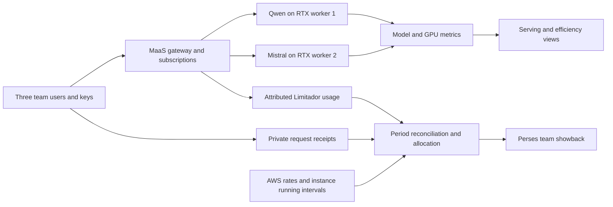

# Implementation plan: MaaS service offers and three-team showback

Status: **bounded demo implemented and tested offline on 2026-10-16; not deployed; model/runtime qualification deferred**. Scenario and accounting decisions: 2026-10-15. Qwen 70/30 token allowances and independent Mistral limits remain provisional calibration inputs. The user authorized repository implementation only; no deployment or inference is authorized.

**Service-offer implementation, 2026-10-16:** external pass-through, dedicated private managed capacity and shared private inference now have shell-based monthly accounting, scoped statement exports, financial dashboard candidates, correction/continuity indexing and task/sourcing analysis. Synthetic fixtures exercise these paths; real tariffs and observed inputs remain unpriced/unqualified. Native Loki and external-metering integration is limited to pinned source contracts, inert configuration candidates and an offline event importer. Matching downstream schemas/images and the metering backend are unresolved prerequisites, not completed deployment work. The original bounded allocator, subscriptions and workloads retain their behavior.

The implementation lives in this `showback-demo/` package. Candidate access/dashboard manifests are detached from active GitOps, the report publisher has zero replicas, and model candidates are stopped and separately packaged. The existing `../showback/` utilities and active platform resources are unchanged. See [README.md](README.md) for delivered behavior and [OPERATIONS.md](OPERATIONS.md) for offline verification and later execution gates.

## Conceptual foundation

The talk asks, “What did AI cost us this quarter?” Engineering, Marketing and Support consume two shared private models. The platform team must explain the service cost, attribute consumption, and produce a reconciled allocation with visible assumptions.

### Opening-slide hypothesis

“Three departments. Two shared models. One bill.” Use the following scenario for the design:

| Element | Agreed planning baseline |
|---|---|
| Engineering | Code reviews; Qwen only. |
| Marketing | Campaign creation; Mistral only. |
| Support | Customer questions; both models. |
| Shared model 1 | Qwen3.8 27B **FP8**, assumed for the scenario and opening slide. The inspected deployment uses NVFP4; aligning it with this assumption is later implementation work. |
| Shared model 2 | Mistral Small 4 119B NVFP4 (`RedHatAI/Mistral-Small-4-119B-2603-NVFP4`). **Assume it fits on one RTX PRO 6000 for planning.** Qualify it later. |
| Infrastructure | Two separate NVIDIA RTX PRO 6000 workers, one per model. Engineering and Support share Qwen; Marketing and Support share Mistral. |
| One bill | **$14,200**, charged to the platform team, is an illustrative opening-slide placeholder with no cost evidence behind it. |

The fit assumption lets scenario, metering and allocation design proceed now; it is not a claim of measured capacity or runtime qualification. Retain the research below for the later qualification step rather than reopening model selection during scenario design.

Keep $14,200 out of rate cards, accounting inputs and validated reports. During preparation, replace it with a figure derived from a named quarter, instance running hours, applicable rates and an explicit cost scope. Label a projection as a projection and an actual invoice as an invoice. Do not tune workload shares or cost assumptions to reproduce the placeholder.

Keep the existing OpenShift AI, MaaS, Connectivity Link, Prometheus/Thanos and Perses stack. A new monitoring product is not required. The first demonstration uses a measured, bounded observation window; quarterly figures are projections until retained evidence covers a complete quarter.

The deliverable is transparent **showback**, not a billing-grade ledger. The native MaaS observability dashboard is Technology Preview and documented for showback [R1]. Distinguish measured requests/tokens, price-derived infrastructure estimates, actual invoice amounts when available, and the allocation policy applied to them.

### What the two source articles establish

The September 10 article [R12] describes operating shared models through governed endpoints and scoped keys, with quotas and usage/performance visibility. It does not prescribe a cost-allocation formula or a 70/30 GPU reservation.

The September 18 article [R10] prices consumption using configured, model-specific input/output tariffs: `input_tokens / 1000 × input_rate + output_tokens / 1000 × output_rate`. Its idle-capacity discussion motivates right-sizing; it supplies no shared-idle allocation algorithm or derivation of tariffs from an AWS bill.

Our accepted policy below fills that accounting gap: allocate an evidenced hosting-cost pool and reconcile every cent. It is a local policy, not a formula mandated by either article. The separate tariff view needs calibrated rates and a visible under/over-recovery balance; it does not replace this policy. Collect input/output details for that analysis without inventing a weight today. Application tracing is optional for the bounded allocation demo; evaluating cost per accepted task requires additional application instrumentation.

## Three service offers and pricing policies

Keep **actual service cost**, **allocated cost** and **consumer charge** separate. Cost describes what the platform spends; allocation assigns responsibility; the charge follows the consumer's service agreement. Internal transfers are not additional enterprise expenditure. A fixed tariff can recover more or less than actual cost without changing either figure. These contracts are implemented in `offers/service-report.sh`, with USD and UTC calendar-month boundaries. They are reporting-layer contracts, not new MaaS API fields or a billing service. The observed-input template intentionally leaves real rates, capacity and consumer evidence unset.

| Offer | Consumer buys | Proposed charging policy | Idle-capacity owner |
|---|---|---|---|
| External provider pass-through | Governed access to an approved external model | Provider's applicable usage rates; separately disclose any platform fee | No local GPU idle charge. Unused provider commitments/minimum spend stay with their named purchaser unless explicitly allocated by contract. |
| Dedicated private managed model | Exclusive model capacity with an agreed workload and service level | Monthly attributable capacity and operations cost; an optional fixed monthly quote shows its actual-cost variance | Sponsoring team pays for contracted availability, including idle, loading, warm-up and agreed standby/headroom. |
| Shared private inference | Access to a pooled model service | Published per-model input/output token tariffs; optional reservation fee plus reduced usage tariff | Forecast idle/headroom is included in pricing. Demand shortfall stays with the platform unless an explicit reservation or true-up agreement assigns it. |

**Common contract:** record offer/model/checkpoint/serving profile, owner/cost center, permitted consumers, rate unit/currency/effective dates, cost inclusions, idle/commitment ownership, credits, retry/failure treatment and review/adjustment rules. Define availability, workload/context bounds, concurrency, latency targets and support hours separately from price. A 24/7 deployment alone does not prove availability or high availability.

Use MaaSSubscription plus MaaSAuthPolicy for ownership, model access and token limits [R1]. Preserve individual user or application identities under a team cost center; a shared team key cannot identify its individual users. Version membership mappings over time. One demo identity per team is sufficient only for the existing demonstration. A subscription is not a price card, monetary budget, invoice, GPU reservation or guaranteed throughput allocation. Multiple users' documented per-user limits must not be advertised as a pooled departmental quota without qualification.

### Offer 1 — external provider pass-through

For one consumer and calendar month, split usage at every effective price boundary:

```text
provider_charge = sum(model, billing_category, rate_period)
                    billable_tokens / 1,000,000 * effective_price_per_million
                  + attributable_non_token_fees - applicable_credits
consumer_charge = provider_charge + separately_disclosed_platform_fee
                + signed_policy_adjustments
```

Use provider-defined, non-overlapping billing quantities: uncached input, cached reads/writes and output where applicable. Reasoning tokens may already be included in output; never add overlapping fields twice. Preserve batch/service tier, context and region differences, contractual discounts and non-token charges where relevant. Provider usage is approximately linear only within a fixed price regime; do not apply a single blended rate to all traffic. Reconcile measured estimates with the provider invoice and retain unexplained or unattributed differences visibly.

Default policy: consumer-requested attempts follow provider billing; retries caused by a platform fault are recorded against the platform and shown as an adjustment rather than hidden in the consumer's charge. Credits and unused commitments need explicit owners. Missing usage/price is unresolved, not free. Token quotas remain consumption controls; dollar forecasts and alerts are separate, and hard monetary admission requires additional qualified metering/enforcement.

Produce a monthly user/model statement with subscription, cost center, billable categories, effective rates, provider charge, platform fee, adjustments, total, evidence coverage and reconciliation status. Show month-to-date estimates separately from finalized statements. Retain usage, identity and rate versions beyond a 31-day month plus invoice-close/correction time; create superseding statements for corrections rather than silently rerating history.

### Offer 2 — dedicated private managed model

```text
monthly_service_cost = sum(instance_running_hours * effective_full_instance_rate)
                     + attributable_storage_and_network + software_and_support
                     + operations_effort + allocated_shared_platform_cost
consumer_charge = monthly_service_cost                 # default: cost reimbursement
```

Use actual calendar-month hours and paid intervals, including loading, idle, maintenance and contracted standby. Include the replicas and headroom needed for the agreed SLO, model qualification/upgrades and operational support. Show one-off setup separately or amortize it explicitly over an agreed term. Allocate shared services once using a documented basis; keep unrelated workloads out. A fixed monthly service quote is an alternative contract, with actual cost and recovered amount still visible.

Cloud GPU rental is **OpEx**. Owned hardware instead needs depreciation/lease cost, power/cooling, facilities and maintenance; do not add these again to a cloud instance rate that already contains them. CPU/RAM included in the full GPU-instance price must not be charged twice. The saved AWS prices below are a compute-only estimate, not a complete managed-service quote.

The sponsoring team owns 100% of contracted dedicated availability, including a zero-use month. Do not apply the shared demo's `platform_idle` treatment to this offer. Recommend a smaller qualified model/GPU profile, fewer replicas, scheduled availability or migration to a shared service only when the team's quality and SLO remain satisfied. Necessary redundancy and latency headroom are not automatically avoidable waste. Another team's use requires an explicit change of service/cost ownership, not an undisclosed second charge for the same capacity.

### Offer 3 — shared private inference

Publish prospective model-specific tariffs from a realistic consumption forecast at the agreed SLO. For pure usage pricing, define `C_target` as the monthly recoverable service-cost target after an explicit subsidy, `I_forecast` and `O_forecast` as billable input/output tokens, and `w` as the calibrated output/input price weight:

```text
input_price_per_million  = 1,000,000 * C_target / (I_forecast + w * O_forecast)
output_price_per_million = w * input_price_per_million
consumer_charge         = input_tokens / 1,000,000 * input_price_per_million
                        + output_tokens / 1,000,000 * output_price_per_million
recovery_balance        = sum(consumer_charges) + explicit_subsidy - actual_service_cost
```

Include realistic paid idle, standby, operations and shared overhead in the target; disclose any contingency rather than hiding it in a token weight. Calibrate `w` against representative prefill/decode, context, caching and concurrency for each checkpoint/runtime/profile. Do not infer it from parameter count or copy an external provider's ratio. Uncalibrated equal weighting can be a labelled pricing assumption; it does not change the bounded demo's accepted equal-token allocation policy. Forecast delivered billable consumption, not maximum theoretical GPU throughput.

An optional two-part contract is `reservation_fee + metered_usage_charge - included_usage_credit`. With no included credits, its residual usage target is `gross_forecast_service_cost - explicit_subsidy - committed_reservation_revenue`. The implemented credit variant adds the forecast included-credit caps back to that target, because the corresponding credits reduce net usage revenue. Actual credits cannot exceed each team's metered usage; unused credits expire under this example contract. Report the reservation, gross usage, credit and net charge separately. If the residual target is negative, review the contract rather than invent a negative tariff. A reservation fee funds availability; a physical capacity or throughput promise needs separate serving/scheduling qualification. The existing 70/30 Qwen token allowance does neither.

Normal idle is priced into the forecast; unexpected under-recovery remains with the platform under the default fixed tariff. A zero-use month earns no usage revenue, so usage-only pricing cannot guarantee recovery. An empty forecast cannot define a tariff. Show surplus/shortfall honestly; do not force tariff revenue to equal the bill by rerating consumers retrospectively. A true-up is permissible only as a separately agreed contract. Review tariffs prospectively on a defined schedule, investigating demand, sizing, efficiency and planned capacity steps before increasing or reducing prices.

### Quality, efficiency and external-to-private advice

Evaluate **cost per accepted task**, not only tokens per dollar [R18]: all relevant workflow/service costs, including failed attempts, retries, fallbacks and attributable human rework, divided by unique accepted tasks. Define acceptance with the consumer: a test-passing code change, an accepted campaign or a resolved ticket. Zero accepted tasks means undefined unit cost, not zero. An inference HTTP success is not a successful business outcome; repeated turns may be legitimate work rather than corrective reprompts.

Instrument trusted user/subscription identity, task/session and attempt IDs, model/profile/prompt versions, retries/fallbacks and explicit outcomes. Use MLflow Traces/Sessions for diagnostic drill-down where instrumented [R17]; do not infer task outcomes from GPU metrics. Keep finance on complete reconciled usage records: sampled traces are not its denominator. Content capture is not required by default. Compare candidate quantizations and hardware on the same representative tasks, quality threshold, latency and concurrency.

For a matched workload, use a first-order break-even model, then validate it against measured capacity:

```text
external_monthly_cost(N) = F_external + e * N
private_monthly_cost(N)  = F_private + v * N
break_even_tasks        = (F_private - F_external) / (e - v)
```

`N` is accepted tasks/month, `e` the external variable cost per accepted task, `v` incremental private cost per accepted task, and each `F` the corresponding recurring fixed service cost. The displayed positive threshold assumes `e > v` and `F_private > F_external`; compare the cost curves directly in other cases. For pure usage-based external pricing, `F_external = 0`. Model minimum-spend commitments as floors and tiered rates as piecewise curves rather than disguising them as a constant token price. Keep platform costs on the correct side and include external fallback. Different model versions, tokenizers, output length and retries mean equal raw tokens need not represent equal work. Extra replicas create cost steps; monthly averages cannot establish peak-load capacity. There may be no feasible crossover.

Show low/base/high demand, quality/SLO results, capacity headroom, expected savings and one-off migration payback (`migration_cost / positive_recurring_monthly_savings`, without also amortizing that same migration cost in `F_private`). Advise after sustained evidence crosses the viable threshold; do not auto-migrate workloads. Compare an existing shared-private offer as an intermediate option as well as a new dedicated deployment.

## Layered architecture and current evidence

| Layer | Current baseline | Planned addition or gap |
|---|---|---|
| Infrastructure | Stage 020 has `g7e.2xlarge` MachineSets across Ohio zones, one 96 GB RTX PRO 6000 per node; no GPU time slicing. RTX queue permits 2 GPUs, 14 CPU and 112 GiB. | Two running model workers after authorization; host-memory contingency described below. |
| Serving | Stage 040 defines only `qwen3-8-27b`, NVFP4, with exclusive GPU allocation. | Align Qwen with the assumed FP8 scenario during later implementation; add one independently qualified Mistral deployment and MaaS model reference. |
| Governance | MaaS subscriptions/auth policies/API keys exist. Telemetry captures user, model and organization; group capture is disabled. Existing cost centers generally identify `ai-platform`. | Three subscription/auth-policy pairs: Engineering → Qwen; Marketing → Mistral; Support → both. Separate users/keys and matching team metadata. |
| Metrics | MaaS counters, serving metrics, DCGM collection, native RHOAI monitoring and Perses exist. | Prove four allowed team/model combinations and two denied combinations; reconcile canonical counters and client receipts. |
| Applications | GuideLLM is available through EvalHub; its default identity is `model-qualification`. | A bounded team scenario runner with independent receipts. Do not attribute three teams to the shared evaluation key. |
| Reporting | Custom cost/tokenomics dashboards and `export-maas-usage.sh` exist. | Add a consistent allocation calculation, correct dashboard assumptions, and retain period evidence. |

Guarded read-only inspection on 2026-10-15 found OCP 4.22.14, RHOAI 3.5.1 and Connectivity Link 1.4.3. Relevant Argo CD applications and monitoring pods reported healthy. All GPU MachineSets and Qwen inference replicas were zero; only its router/scheduler was running. Its resource still reported Ready, so Ready alone is not inference evidence. Existing attributed counters included older model routes; these are not proof of the proposed new model's metering. No inference was attempted.

The live Qwen Deployment and ServingRuntime reference:

```text
registry.redhat.io/rhaii/vllm-cuda-rhel9@sha256:c056e61672b6aea489ad5dde0bd2f8497230f5333e87f7cf6c494eba3bfdc808
```

Registry metadata inspected without pulling layers identifies RHAIIS 3.5.1 / CUDA 13.0.2; the selected linux/amd64 manifest digest is `sha256:82b6b3afd769ef6fbbef6a914ca49fc077835c2b94bf43c7d5f353e1c09234ff`. Historical local 2026-10-13 study logs report vLLM `0.24.0+rhaiv.13`; that log is not a fresh package-version or kernel check against this exact image. Record actual versions at qualification and refresh the digest if the operator changes it.

## Selected second model and deferred qualification

**Selected planning baseline: `RedHatAI/Mistral-Small-4-119B-2603-NVFP4`, assumed to fit on one RTX PRO 6000.** The user has deferred model qualification. The following prior research is background for that later step; a complete serving configuration on this installation is not yet proven. Qualification remains a gate before live rehearsal, not before continuing this design.

| Finding | Evidence and implication |
|---|---|
| Checkpoint | Pin Hugging Face revision `a7b11eb3bdf01f38077f6704e96cc1d9b83a4cfc`; model metadata and files were inspected without downloading weights [R2, R3]. |
| Weight storage | 13 safetensors files total **70,808,028,368 bytes = 70.808 GB = 65.945 GiB**. This is stored tensor size, not measured GPU-resident memory. |
| Architecture | 119B total parameters, approximately 6.5B active per token. All expert weights still require storage; the active count does not imply a 6.5B memory footprint [R2]. |
| GPU headroom | Conservatively interpreting 96 GB as decimal gives 89.41 GiB; a 90% GPU budget leaves about 14.52 GiB after the stored weights. Actual NVML capacity, repacking, activations, graphs and kernel workspaces determine usable headroom. |
| MLA cache estimate | Parameters describe 36 layers, latent KV rank 256 and rotary dimension 64 [R3]. A BF16 latent-cache estimate is `36 × (256 + 64) × 2 = 23,040 bytes/token`. Four 16,384-token sequences use about **1.406 GiB** before implementation overhead. This is an estimate, not measured runtime allocation. |
| Advertised context | The model advertises 256K; one such BF16 latent cache is approximately 5.625 GiB and four are 22.5 GiB. Do not start with the full window or claim advertised concurrency on one GPU. |
| Host memory | `g7e.2xlarge` has 64 GiB RAM, less than the checkpoint's stored size. Streaming/mapped loading can avoid holding all tensors in RAM, so this is a qualification risk rather than an automatic rejection. Measure cold-load peak RSS, page-cache/cgroup pressure and ephemeral storage. Do not copy Qwen's 24 GiB container limit. |
| Product provenance | The card names a Red Hat modelcar and earlier vLLM/RHOAI validation. The current support-matrix review did not establish this exact checkpoint on RTX PRO 6000/RHOAI 3.5.1 [R2, R4]. Do not turn a card's general validation claim into support for this exact combination. |
| Runtime compatibility | Qwen's successful dense NVFP4 path does not establish Mistral's NVFP4 MoE and MLA paths. Verify the installed image's architecture, tokenizer/loader, SM120 kernels and first decode. The card's older custom-image instructions are not a reason to replace the operator image. |

An upstream report identifies a first-decode `TRITON_MLA` problem with the model's 320-wide latent/rotary layout; upstream PR 41119 fixed that path [R5]. Confirm the installed image contains the applicable implementation. A separate upstream reproduction reports the Mistral publisher's NVFP4 target serving on one RTX PRO 6000 at TP=1/16K; its failure concerns an optional EAGLE drafter [R5]. This supports feasibility, not qualification of our RedHatAI artifact/image. Do not work around attention failure by disabling MLA without a new memory assessment: expanded attention KV can consume far more memory.

Proposed qualification profile, **not a ready-to-apply command**: one GPU, tensor parallelism 1, text-only, 16,384 maximum context, four concurrent sequences, 4,096 batched tokens, 0.90 GPU-memory target and no speculative decoding. The stopped candidate uses `--kv-cache-dtype=auto`; BF16 above is a memory-estimate assumption, not a forced or verified cache dtype. Disabling reasoning remains a qualification step: neither the candidate nor the client currently sets an unverified reasoning option. Confirm actual cache dtype, reasoning behavior and every flag/backend against the installed runtime. Preserve platform TLS and authentication settings. Do not copy Qwen's MTP, parser or hybrid-cache flags into Mistral. The card's TP=2 example is not proof that TP=2 is a hardware minimum, nor proof that TP=1 works here.

Prefer the existing `g7e.2xlarge`. If cold loading fails specifically because of host RAM, review a `g7e.4xlarge` for Mistral: it retains one 96 GB RTX PRO 6000 and increases RAM to 128 GiB. This requires explicit placement, MachineSet/resume-helper and queue-budget review; changing node RAM does not fix unsupported GPU kernels. Do not silently switch either model or instance size.

Deferred contingency only: if Small 4 later fails qualification within the installed supported runtime, the researched fallback shortlist is **Mistral Small 3.2 24B NVFP4**, then its FP8 build. These preserve the Mistral requirement with substantially more memory headroom. They are not part of the current scenario. Select a fallback only after reviewing its exact checkpoint, support posture and failed Small 4 gate; see the comparison below.

| Candidate | Stored safetensors | Role |
|---|---:|---|
| `RedHatAI/Mistral-Small-4-119B-2603-NVFP4` | 70.808 GB / 65.945 GiB | Selected planning baseline; qualify MoE/MLA and cold loading later. |
| `RedHatAI/Mistral-Small-3.2-24B-Instruct-2506-NVFP4` | 16.068 GB / 14.964 GiB | Smaller fallback if the Small 4 runtime gate fails [R6]. |
| `RedHatAI/Mistral-Small-3.2-24B-Instruct-2506-FP8` | 25.793 GB / 24.022 GiB | Fallback if the NVFP4 path is unsuitable; FP8 still needs RTX runtime qualification [R6]. |

Two identical nodes running for the same time cost the same regardless of model size. A smaller model's potential advantage is more useful work per dollar or shorter required running time, not an automatically lower hourly price.

## Verified AWS cost basis

The [saved public AWS pricing extract](showback-aws-pricing-2026-10-15.json) contains original selected fields, SKU/rate codes and retrieval provenance. Source: the AWS AmazonEC2 Ohio CSV [R7], published **2026-10-12T19:39:25Z**, version `20261012193925`, effective **2026-10-01**. Filters: `OnDemand`, `Linux`, `Shared`, `Pre Installed S/W=NA`, `CapacityStatus=Used`, `us-east-2`. No billing account access was used.

| Instance | GPUs / GPU memory | Host RAM / vCPU | USD per instance-hour |
|---|---|---|---:|
| `g7e.2xlarge` | 1 RTX PRO 6000 / 96 GB | 64 GiB / 8 | **3.36312** |
| `g7e.4xlarge` | 1 RTX PRO 6000 / 96 GB | 128 GiB / 16 | **3.99816** |
| `g7e.8xlarge` | 1 RTX PRO 6000 / 96 GB | 256 GiB / 32 | **5.26824** |

AWS specifications independently confirm those sizes retain one GPU [R8]. Illustrative running-time scenarios for **two `g7e.2xlarge` nodes**, not observed invoices:

| Running time per node | Combined compute estimate |
|---|---:|
| One hour | $6.73 |
| Twelve minutes | $1.35 |
| Eight hours/day × 20 days | $1,076.20 |
| Entire Q4 2026, 2,208 hours continuously | $14,851.54 |

Formula: `2 × 3.36312 × hours`. A Qwen `2xlarge` plus a Mistral `4xlarge` would instead cost **$7.36128/hour** in worker compute. Keep calculations in decimal USD; any currency conversion needs its own dated rate and source.

The continuous-Q4 example is a researched compute projection, not the agreed final slide amount or an observed bill. The opening slide retains its explicitly illustrative $14,200 until the reporting period, running schedule and included cost pools are selected.

### Cost scope and collection

1. **Required first view:** measured running intervals of the two GPU workers, priced at the recorded AWS rate. Call it a *GPU-worker compute estimate*. Each worker's CPU/RAM and included instance storage are already in this rate; do not charge them again.
2. **Service-cost extension:** add measured/attributable attached EBS, object storage, load balancer/network and shared CPU/control-plane/monitoring costs. Account for unrelated platform workloads rather than assigning the entire demo cluster bill to these models.
3. **Software/support:** include known applicable subscription charges, or mark them excluded/unknown. Do not add an assumed RHEL surcharge solely because these are OpenShift workers; verify the actual license arrangement.
4. **Account reconciliation:** actual CUR/invoice or approved effective rates supersede list estimates when available. Savings Plans, reservations, Spot, credits, taxes and discounts must not be silently equated to public On-Demand prices [R9].

Use AWS instance running intervals where accessible, including boot, model load, warm-up and idle time [R9]. Kubernetes Ready time alone omits billable intervals. If only cluster lifecycle observations are available, label the duration estimate and its coverage. Split intervals on model assignment, instance replacement, rate changes and reporting boundaries; never count an instance twice. Preparatory costs outside the measured run remain in a separate preparation/platform bucket. Shutdown stops compute accrual but does not establish that persistent storage costs stop.

Unknown overhead is not zero. A compute-only view must list exclusions; a full service-cost view cannot claim completeness until included pools have evidence.

## Accepted allocation policy for the bounded demo — unchanged

This section governs the implemented three-team shared-private demo. It allocates actual included cost; it does not implement the external pass-through, dedicated availability charge or shared published tariff described above. In particular, its fully-idle platform bucket must not override a dedicated team's contracted capacity ownership.

Use **subscription identity → team**, with one model cost pool per reporting period. For model `m`, let `C_m` be its evidenced cost and `T_t,m` be team `t`'s reconciled governed total tokens:

```text
allocated_model_cost[t,m] = C_m × T_t,m / total_metered_tokens[m]
team_cost[t] = sum_m(allocated_model_cost[t,m]) + allocated_shared_overhead[t]
```

The denominator includes all identified consumers of that model in the period. Non-demo consumers receive an `other_consumers` share. Access entitlements and quota percentages do not enter this formula. Engineering's Qwen cost share can therefore differ from its proposed 70% token allowance.

This policy allocates the full cost of model availability, including idle time inside the period, by observed usage. It is reproducible and uses the attribution dimension the platform already exposes. It does **not** claim to measure a team's GPU-seconds or marginal cost. GPU utilization is an efficiency indicator; multiplying the cloud bill by utilization would omit paid idle capacity.

### Idle-capacity and incomplete-data rules

| Condition for one model in one closed window | Allocation and dashboard treatment |
|---|---|
| Valid usage coverage and some tokens consumed | Allocate its entire hosting cost by actual token shares, including quiet time within that window. Show utilization separately. |
| One team consumes all tokens in an otherwise quiet window | That team receives the full window cost. This is an availability-cost policy, not the marginal cost of that request. |
| Valid coverage, no inference in flight and zero tokens | Put the model's entire cost in `platform_idle` (display: **Platform — idle capacity**). No team receives a fictional usage charge. |
| Missing usage, ambiguous identity, counter gaps or incomplete boundary evidence | Mark the affected model/window incomplete; conservatively hold its whole cost in `unresolved_allocation` until corrected. Do not infer idle or redistribute only among known teams. |
| A known non-demo subscription consumes tokens | Include it in the denominator and show its share as `other_consumers`. |
| A request is rejected before inference | Record the denial separately. Zero generated tokens requires evidence; the worker's running cost continues. Missing usage after a failure/abort remains unresolved. |

The bill does not fall when GPU utilization falls or a quota is reached. A utilization chart explains efficiency; it does not determine which fraction of the AWS bill exists. Record warm-up and preparation intervals outside the run separately, so the demo's bounded bill is not mistaken for the full preparation cost.

For the optional service-cost extension, propose allocating evidenced shared overhead proportional to each consumer's already allocated model cost, with a separate overhead column. With valid coverage but no consuming teams, retain it as `platform_shared_overhead`; with incomplete evidence, retain it as `unresolved_allocation`. This extension still requires a defined scope and cost evidence. The first view is compute-only.

**Period contract:** the proposed demo has three predeclared four-minute allocation windows: busy, quiet and fully idle. Its report sums those closed allocations. Sustained reporting instead allocates fixed UTC hourly windows; daily/monthly/quarterly reports sum finalized hourly allocations. Never recompute a rollup using period-wide token shares: that redistributes costs differently. Split cost intervals at boundaries, apply overhead within the same atomic windows, and store policy/rate versions. Disclose window size and version changes. Demo and hourly scopes must never be combined when paid intervals overlap. Short demo windows illustrate the policy, not an accelerated quarter of production evidence.

Input/output tokens remain separate in client receipts. Version 1 weights each governed token equally **within its model**. Do not invent an output-token multiplier. A later policy can use measured prefill/decode weights, versioned by checkpoint/runtime/profile, only after calibration addresses cache hits, context and concurrency. Do not price private models using commercial-provider aliases.

Required accounting rules:

- Use UTC half-open reporting windows `[start,end)` and retain scrape-boundary uncertainty.
- Record retries as separate attempts; a retry can consume tokens again. Keep pre-inference quota rejection separate from generated usage. Aborted/failed inference with missing usage is unresolved, not automatically zero.
- Calculate with decimal arithmetic. For the estimate, round the cumulative **combined included cost** once: each window's cents are `round(cumulative_total_at_end, 2) - round(cumulative_total_at_start, 2)`. Do not independently round each model or hour. First apportion those cents across model/overhead pools, then across their consumers/buckets, using deterministic largest remainders with stable-ID tie-breaking. Retain fractional rounding residuals between windows so repeated ties do not systematically favor one pool; require non-negative allocations and no invented share for a zero-cost pool. Record all adjustments and replay affected later windows after corrections. The authoritative grand total must equal the period's unrounded combined cost rounded once; pool presentation can differ from independently rounded raw pool costs by the disclosed rounding adjustment. An actual invoice's billed total, if used, replaces the estimate's total authority.
- Require `teams + other_consumers + platform_idle + platform_shared_overhead + unresolved_allocation = included priced cost pools` exactly in cents. The shared-overhead bucket is absent in compute-only mode. A missing price prevents a complete monetary total; never treat it as zero. An incomplete usage pool can conserve money in the unresolved bucket; conservation alone is not attribution success.
- Preserve `measured_zero`, `no_activity_with_valid_coverage`, `missing_usage`, `missing_price`, and `partial_period` as distinct states.

## Team access and workload design

| Team | User | Subscription | Allowed models / cost center |
|---|---|---|---|
| Engineering | `showback-engineering` | `team-engineering` | Qwen only / `engineering` |
| Marketing | `showback-marketing` | `team-marketing` | Mistral only / `marketing` |
| Support | `showback-support` | `team-support` | Qwen and Mistral / `support` |

Create users through the existing environment-provided Keycloak authority without adopting its base realm into GitOps. Extend the existing access workflow for group assignment. Add one MaaSSubscription/MaaSAuthPolicy pair per team, restricted to the model references above, with matching `tokenMetadata`/`meteringMetadata`. A subscription defines ownership and per-model token allowances; a matching authorization policy grants model access. Both gates must pass [R1]. Keep organization identity common and cost centers distinct. Mint one private API key per demo user, explicitly bound to its subscription. Subscription `priority` chooses a default at key creation; it is not inference scheduling priority. Never commit keys, passwords or identity-bearing receipts.

### Proposed Qwen 70/30 token allowances

Set a chosen Qwen token budget `Bq` for the same quota window in both subscriptions: Engineering receives `0.70 × Bq`, Support `0.30 × Bq`. For example only, `Bq = 1,000,000` tokens per hour gives 700,000 and 300,000. Calibrate the actual budget against the serving profile and latency target. Marketing and Support receive separate Mistral allowances; no Mistral ratio has been agreed.

Use `spec.owner.users/groups` and `spec.modelRefs[].tokenRateLimits[].limit/window` in MaaSSubscription, and matching `subjects`/`modelRefs` in MaaSAuthPolicy [R1]. Official documentation describes limits per user; one demo user per team makes the demo unambiguous. Do not claim a pooled departmental quota across multiple people until generated limiter semantics have been verified.

This is an allowance ratio, not reserved GPU memory, guaranteed throughput, a scheduling weight, automatic borrowing of unused quota, or a fixed bill split. If Engineering consumes 200,000 Qwen tokens and Support 300,000 in a complete allocation window, actual shares are 40%/60%, despite their 70%/30% allowances. Keep quota-window counters and accounting-window consumption distinct.

A fixed 70/30 financial reservation would be a different policy: Engineering would pay for its reserved availability even when unused. That is not selected here. A physical throughput guarantee requires a separate serving/scheduling design. Also, token admission checks previous consumption and response completion updates usage [R13]; accepted/in-flight requests can therefore overshoot a threshold. Treat quotas as consumption controls, not exact spend ceilings.

Provisional load profile, to be calibrated and then frozen before rehearsal:

| Team / synthetic task | Target input / maximum output tokens | Request spacing; per-team concurrency cap | Qwen / Mistral request mix |
|---|---|---|---|
| Engineering / code reviews | 4,096 / 512 | 12 seconds; 1 | 100% / 0% |
| Marketing / campaign creation | 1,024 / 1,024 | 20 seconds; 1 | 0% / 100% |
| Support / customer questions | 256 / 128 | 5 seconds; 1 | 20% / 80% |

These are offered workload parameters, not promised token/cost shares or achieved throughput. Use synthetic prompts, fixed seeds and measured token counts. Bound total requests, elapsed time, output size and retries; never retry 429 automatically. Prime the four allowed combinations outside measurement and verify Engineering→Mistral and Marketing→Qwen denials separately.

Proposed rehearsal sequence, fixed before each run:

1. Capture baselines after priming and verify complete coverage. Account for qualification/priming time separately.
2. **Busy, four minutes:** all teams use only their allowed models; Support exercises both. This establishes shared-model usage and actual cost shares.
3. **Quiet, four minutes:** sparse Engineering→Qwen and Marketing→Mistral traffic, with Support paused. Each sole consumer bears its model's full window cost even with low utilization.
4. **Fully idle, four minutes:** no offered traffic, models and workers remain running. Require no requests still in flight and valid coverage; both model costs go to Platform — idle capacity.
5. Run a separate bounded quota probe after the financial scenario, with its own evidence and cost scope. Demonstrate a rejection without implying the worker bill stops.

Stop admissions early enough for the measured latency envelope before each phase transition. Preserve fixed boundaries and trailing scrapes; do not move windows after seeing results. A request crossing into the intended idle phase or background traffic makes that phase fail its fully-idle assertion. Account for any in-flight boundary work explicitly or mark the affected allocation unresolved. Rehearse again instead of relabelling busy time as idle. Check prior quota consumption before each run; freeze calibrated limits so the financial phases are below quota and the separate probe reaches the intended limit within its time/request bounds.

Each private request receipt records run/request/attempt IDs, team, subscription, actual model ID and checkpoint/profile reference, timestamps, HTTP status, input/output/total usage, stream completion, latency and error category. Keep high-cardinality request IDs in receipts/traces, not Prometheus labels. Content capture and mandatory MLflow tracing are unnecessary for this demo.

## Metrics, accounting and dashboard design



Use native RHOAI Thanos as the proposed accounting datasource after proving it contains the required series. Inspect actual metric types/labels. Select exactly one token-limiter resource per subscription/model; preserve `limitador_namespace` in audit evidence. HA replica deduplication does not remove overlapping policy counters. Do not blindly sum every `authorized_hits_total`, or mask unknown collisions with `max()`.

Map MaaS model ID → serving `model_name` → pod UID → node/instance over time. DCGM proves model/node utilization, not per-team GPU consumption. Reconcile gateway totals against client receipts, then compare serving totals with all included/background consumers over the same window. Sampled Tempo traces are diagnostic evidence, not the financial denominator.

Keep raw usage export separate from finance: retain the existing unpriced `showback-ratecard.json` behavior, add an explicit infrastructure-cost configuration and allocator, and feed both reports and dashboards from the **same versioned allocation result**. A small demo-owned exporter/ServiceMonitor can expose the closed-run summary to Perses with bounded team/model labels; it must not recompute a different policy. Live usage panels remain native PromQL. Do not add a full cost-management stack for two workers.

The financial dashboard displays **one selected closed report**, initially the latest demo run, with immutable result ID, period start/end and coverage status. Publish its metrics atomically, replacing the previous selection. Query current gauges once; never `sum_over_time`, integrate, or use counter `increase` on repeated report values. A general dashboard time picker must not relabel that fixed report as a different period. Historical reports remain retained artifacts; a quarter view requires explicitly selecting a closed hourly-rollup report and verifying report-to-panel equality.

Legacy gaps recorded during planning:

- The earlier `export-maas-usage.sh` review found enumeration limited to series visible at period end. This package instead captures all range-observed series and flags resets/gaps without inventing epoch recovery or initial period usage.
- The earlier `gen-cost-dashboards.py` review found independent model/blended-user prices, request-filter gaps and aggregation across limiter resources. This package uses the reviewed allocation report and explicit canonical limiter mapping.
- Legacy L40S/two-worker wording and the old DCGM ServiceMonitor reference need separate cleanup if still present after the script refactor. Existing `../showback/` utilities are intentionally unchanged by this isolated implementation.
- Persist daily/window exports and receipts before retention expiry. Current RHOAI retention is 90 days/5 GiB, UWM and platform Prometheus are 7 days, and the helper allows only 89-day windows. Full-quarter reporting needs durable exports or reviewed longer retention, capacity and continuity checks. Do not fabricate past usage.

### Durable evidence handoff

Use the existing Stage 050 MLflow server's proxied artifact storage, backed by ODF bucket `rhoai-mlflow-artifacts`, for a proposed platform-owned `showback-accounting` experiment in an isolated `showback-reporting` project/workspace [R11]. This stores accounting artifacts, not mandatory application traces. Add only the namespace and reviewed MLflow access bindings; do not change the shared server, bucket or other experiments. The shell client uses the REST APIs with the workspace header and an existing authorized bearer token, without S3 keys or a Python SDK. Installed RHOAI authorization and artifact-path compatibility remain live gates.

The Stage 040 platform operator owns closing and uploading each demo run. For sustained quarterly operation, implement a stage-owned hourly close/upload job and daily continuity audit before claiming unattended coverage. Retain at least 400 days, subject to verified storage capacity and an explicit no-cleanup policy for this experiment. Each window artifact includes raw counter snapshots/epochs, request receipts where available, instance intervals, rate/mapping/policy versions, result JSON/CSV and hashes. Maintain an index with scope, window, revision and status; detect missing and overlapping windows. Corrections create a superseding revision with a reason and predecessor hash, and the index selects exactly one revision. Verify fresh-process download/hash parity and multi-window replay; a successful upload or retained bucket alone is not recovery proof.

Dashboard deliverables:

| View | Implemented candidate content |
|---|---|
| Bill allocation | Selected report ID, UTC boundaries, scope, price basis, rate/source date and policy version. Labeled statistics show costs by team/model and busy/quiet/idle window: Engineering/Qwen, Marketing/Mistral, Support/both, Other consumers, Platform — idle capacity, and Unresolved allocation. Excluded costs and coverage come from the retained report. Window detail never recomputes allocation at a new time range. |
| Usage and governance | Allowed/denied model matrix, actual team/model tokens and window shares, receipt input/output split, requests, errors and quota rejections. Retries are disabled by the runner. Qwen's configured 70/30 allowances appear beside actual consumption; they do not reserve GPU capacity or set cost shares. Remaining quota/reset is deliberately withheld until live window semantics are proven. Quota and report periods are explicit. |
| Model cost and efficiency | Paid instance-hours, recorded/effective worker rates, full model cost, GPU utilization and raw framebuffer memory, throughput, time to first token, inter-token latency and queue depth. Effective cost per million consumed tokens is `full model cost / tokens × 1,000,000`; idle is not applicable, missing data is unknown. Compare busy and quiet windows. Raw GPU memory keeps node/pod/GPU labels without a guessed model/team join. |

Financial views use the repository's existing StatChart plugin pattern. Stacked bars or a pivot table are presentation refinements pending renderer qualification; the underlying team/model/window values are implemented. End-to-end request latency and historical model-to-node placement require verified runtime series and mapping evidence before adding those panels.

The walk-through starts with bill reconciliation, drills into team/model usage and allowances, then explains efficiency on the underlying model worker. The quiet phase shows rising effective cost per token with unchanged instance rate; the fully idle phase shows a platform-owned cost. The quota probe shows a consumption control while infrastructure cost continues.

The documented native token counter carries the model label; request and rate-limit counters do not necessarily carry the same dimensions [R1]. Use private request receipts for the bounded demo's per-model request/error/denial views unless actual gateway metrics prove those labels. Do not manufacture per-team GPU utilization from model/node DCGM metrics. Trace-based drill-down is optional and cannot replace complete financial evidence.

## Required dashboard views for the service offers

Reuse native operational dashboards and add financial views backed by the same statements used for monthly reports. `service-views/` implements five detached platform dashboard candidates covering these six requirements, combining consumption and team statements in one view. User/team JSON, CSV and Markdown exports use operator-verified scopes. These exports are offline artifacts, not an authentication service; live user isolation, team-manager delivery and datasource permissions remain unqualified. Month-to-date monetary forecasts and automatic trace drill-down remain future work. Requests, allowances and serving/GPU details reuse native usage and LLM dashboards rather than duplicating them.

| View / audience | Required content | Decision supported |
|---|---|---|
| My consumption / individual consumer | Own user/application, subscription, model, requests, billable input/output/cache categories, applicable rates, charges/credits, month-to-date forecast, token allowance and explicit report status; downloadable monthly user/model statement | Understand consumption and cost, compare models, identify unexpected spend. |
| Team statement / authorized team owner | Users and applications rolled into the team's cost center; offer, model, usage charge, dedicated/reservation fee, idle ownership, adjustments and final total; original rate/policy versions | Explain the monthly charge and trace it back to evidence. |
| Dedicated service efficiency / team and platform | Actual full service-cost breakdown versus quote/recovery; paid instance-hours, contracted availability, utilization, memory, queue, TTFT/inter-token latency, throughput at SLO, errors and idle/headroom; accepted-task cost where measured | Right-size capacity or change model/quantization without violating quality and service targets. |
| Shared service economics / platform | Per-model actual cost, allocated cost, tariff revenue, reservation revenue, subsidy and recovery balance; forecast versus billable volume, paid idle/headroom, effective cost per million input/output-equivalent tokens with its declared weight, SLO and next capacity step | Decide whether sizing, demand, efficiency or future tariffs need changing. Show recovery ratios both before and after subsidy; undefined when cost is zero. |
| Workload quality and sourcing / team and platform | Accepted tasks, corrective retries versus planned turns, fallbacks, relevant human rework, workflow cost per accepted task; matched external/private low/base/high forecasts, break-even capacity validity and migration payback | Decide whether a larger model, another quantization, shared private access or dedicated private capacity gives better outcomes per dollar. |
| Accounting completeness / platform | Provider invoice versus metered estimate, rates and effective dates, missing/duplicate events, unresolved identity/price, credits, late adjustments, monthly/quarterly continuity and excluded costs | Establish what is complete enough to report and what still needs reconciliation. |

Use RHOAI's **LLM Traffic**, **LLM Performance** and **LLM Utilization** views for serving health, latency and capacity [R16]; add cost and contract context rather than duplicate every operational chart. MLflow provides task/session drill-down only for instrumented workflows [R17]. Keep request IDs and task IDs in records/traces, not Prometheus labels.

For all financial views, display the selected reporting period, offer, currency, price basis, cost scope, rate/policy version and completeness. Separate current estimates from closed statements. Filters must not silently recompute historical allocation. User/team visibility requires server-side authorization over queries and exports; a dashboard dropdown is not isolation. The documented self-only user view does not establish a team-manager view. Platform administrators need a separate fleet/reconciliation view. Validate cross-user access denial before presenting a consumer dashboard.

## RHOAI 3.5 native capabilities and remaining gaps

Product boundaries below come from the versioned documentation [R1, R14–R17]. Repository observations describe source configuration, not a fresh live inspection. No preview feature is enabled by this plan.

| Capability | Native capability / support boundary | Repository position and required work |
|---|---|---|
| Identity, model access and token limits | MaaS subscriptions, authorization policies and scoped keys; token controls rather than pricing or GPU reservation [R1] | Three detached demo pairs; versioned reporting-layer consumer/agreement/membership mapping. Real multi-user/application attribution still needs qualification. |
| Metrics-based MaaS usage | User/subscription/model total tokens, request information and CSV; documented showback, not billing-grade accounting [R1] | User/model/organization telemetry is configured; group capture is off. Preserve canonical limiter selection. Combined total tokens cannot reconstruct provider input/output/cache charges. |
| User-scoped showback | **Technology Preview:** Loki structured-log pipeline, 30-day object-storage retention and self-only read-only usage views; separate admin fleet view [R14] | `native/` holds inert ConfigMap candidates and pinned source provenance [R19]. No Loki instance is enabled. Exact downstream CRDs/images, storage ownership, fields, export shape and access isolation are unverified. Thirty days cannot cover every month plus close, or a quarter. |
| Detailed monetary metering | **Developer Preview:** IPP plugin/PostgreSQL service with token categories, balances, CloudEvents and pricing; release notes also describe BBR credit checks and usage webhooks for internal/external models [R15] | Source-pinned plugin candidates and a replay-aware CloudEvent importer exist. Backend product/artifact and installed compatibility remain unresolved. The upstream-linked development backend is not asserted to be a Red Hat product. Delivery/recovery, billing semantics and any admission behavior require qualification. |
| External provider formats | External-model routing/passthrough have preview boundaries. Native Messages/Responses passthrough is not covered by existing subscription token metering [R1, R14] | Existing external definitions use `openai-chat`. Prove the selected API exposes all provider billing categories; do not change formats or claim monetary/token enforcement without testing that path. |
| Model and GPU operations | Native LLM Traffic/Performance/Utilization dashboards [R16] | Metrics and custom Perses views exist in source. Add paid lifecycle, cost scope and SLO targets. DCGM does not attribute GPU-seconds to individual requests/teams. |
| Application quality and tracing | MLflow GenAI Traces/Sessions for instrumented workflows [R17] | Stage 050 provides MLflow; current Stage 060 documentation does not establish generic client task tracing. Add application IDs, outcome/feedback and retry semantics. Configured 10% Tempo sampling cannot provide complete financial usage. |
| Monthly charges and service economics | Native usage/preview pricing do not establish our dedicated TCO, idle policy, shared recovery model or invoice reconciliation | `offers/` implements effective rates, supplied full-cost inputs, corrections and recovery analysis; `service-views/` renders that same result. Actual invoices/rates and authorization are still operator evidence. Editable dashboard defaults are not financial authority. |
| Historical evidence | Monitoring/log retention supports operational views; a complete financial history needs its own continuity checks | Offline archives and monthly correction/continuity indexing exist. Source declares 90-day/5 GiB metrics retention; enforced 400-day archive retention, automatic close and recovery remain unproven. A complete synthetic quarter is not an observed quarter. |

Technology Preview features lack production SLA support; Developer Preview is unsupported and not production-ready [R14, R15]. For this demo they are evaluation options, not silently adopted dependencies. Prefer a qualified native capability over duplicate custom infrastructure. Retain the existing Bash-based reporting approach until its replacement has equivalent evidence, accounting and access behavior.

Current upstream `Config.spec.usageLogging: false` selects the DSCI collector and is **not a logging stop switch**; older downstream documentation has different semantics. Therefore the native renderer emits only ConfigMaps containing review data, never an active Config, tenant, LokiStack or metering workload. Saved CRD/artifact checks are targeted compatibility checks, not admission or runtime proof. The guarded 2026-10-16 inspection stopped before schema reads because login/API availability could not be confirmed; installed-version evidence remains unavailable.

## Implemented source and remaining live work

All new source is contained in `stages/040-governed-models-as-a-service/showback-demo/`. Only the Stage 040 README and BACKLOG navigation/status entries change outside it. The existing `showback/` directory remains a platform utility; renaming it would disturb existing callers.

| Delivered source | Status / remaining evidence |
|---|---|
| `scenario.json`, `render-access.sh`, `manifests/team-*.yaml` | Three user-owned subscription/auth-policy pairs, one resource per file; four allowed paths and two denials. User creation, key minting and real policy enforcement remain live gates. |
| `run-workload.sh` | Default offline preview; bounded foreground workload with fixed busy/quiet/idle windows, leading/trailing scrape buffers, streaming support and separate access/quota probes. Never starts workers or changes limits. |
| `collect-usage.sh`, `metering.json` | Explicit future raw range capture and offline reconciliation. Actual limiter identities are null until verified. Missing baselines, resets, gaps or ambiguous epochs remain unresolved; no invented reset recovery. |
| `costs.json`, `instance-intervals.example.json`, `allocate.sh` | Dated public price, required instance evidence, guarded exact hosting-cost arithmetic and reconciled JSON/CSV. Consumer carry uses documented 1e-9-cent increments with explicit error bounds. Empty lifecycle evidence cannot produce a report. Optional shared overhead is not implemented. |
| `publish-report.sh`, `generate-dashboards.sh`, `manifests/` | Three Perses views and a zero-replica report publisher. Empty selected report fails closed. Current gauges and report identity prevent repeated-scrape financial double counting; live rendering/scraping still requires proof. |
| `archive.sh`, `manifests/archive-namespace.yaml`, `manifests/archive-rolebinding.yaml` | Private immutable-by-overwrite-policy local evidence bundles and explicit optional MLflow REST upload/readback. No server/bucket changes. Installed REST authorization/artifact paths, RBAC, live recovery and retention enforcement remain unqualified. |
| `model-drafts/mistral/`, `model-drafts/qwen-fp8/` | Stopped Mistral service/reference candidate and Qwen FP8 plus stop component. No active deployment change. Runtime qualification, registry publication and replica delegation are future reviewed integration work. |
| `fixtures/`, `tests/`, `validate.sh` | Synthetic accounting and scrape/receipt fixtures; unit checks, default Kustomize rendering, stopped-state checks and an end-to-end offline close. Synthetic output is never live evidence. |
| `offers/service-report.sh`, `offers/month.example.json` | External category/rate-period pricing and invoice differences; dedicated reimbursement/fixed quote; shared prospective tariffs, reservation credits, subsidies and recovery. Immutable monthly JSON/CSV and corrections use exact bounded rational arithmetic. Observed template remains unpriced/incomplete. |
| `native/` | Source provenance, two inert configuration-input ConfigMaps, saved-schema/artifact checks and an offline CloudEvent importer. Replay deduplication, identity quarantine and explicit final/stream billing coverage are tested. No Loki export parser, metering backend, live collector or activation is claimed. |
| `service-views/` | Five detached platform dashboards, same-report metric snapshots, private user/team statement exports. Reuses the existing stopped publisher. Live query isolation and renderer integration remain gates. |
| `analysis/` | Supplied task outcomes, corrective/planned/fallback attempts, model/profile/prompt identities and full-cost economics; qualified-capacity sourcing scenarios and payback. Automatic application instrumentation and real comparative evaluation are absent. |
| `archive-index.sh` | Verifies recoverable monthly inputs, hashes and correction chains; selects one revision per month and exposes missing periods and invoice differences. Does not enforce retention or prove unseen request completeness. |
| `README.md`, `OPERATIONS.md` | Package architecture, operations, failure handling, provenance and deployment boundaries. Global operations remain unchanged because no active platform behavior is changed. |

Both the bounded rehearsal and three-offer accounting are implemented offline. Full-cost inputs accept separately evidenced operations, software, storage and overhead; they do not discover or import an AWS invoice. The original bounded allocator remains compute-only. Automated collection/close/upload, enforced retention, native backend/artifact selection, real outcome instrumentation and live access/rendering proof remain follow-on work. No observed quarter or unattended reporting is claimed.

## Implementation sequence and deployment gates

The source portion of work packages 1–4 is implemented offline. Work packages 5–6 remain gated live work. The file matrix above defines the actual implementation locations; it supersedes earlier proposals to edit active stage components directly.

| Order | Work package and deliverable | Exit evidence |
|---|---|---|
| 1 | Freeze the scenario/config schema: team-model map, explicit subscription binding, quota windows, closed allocation windows, rate provenance, cost scope and policy version. Implement the allocator against offline fixtures first. | Accepted idle rules, exact cent reconciliation, quota percentage independent of cost share, and unknown states remain distinct. |
| 2 | Prepare stopped Mistral resources and the Qwen FP8 alignment, then the three access pairs and scoped user-onboarding instructions. Preserve existing model/consumer identities. | Rendered manifests and validators cover four allowed and two denied combinations; no secrets; new model remains stopped. |
| 3 | Implement the bounded runner, canonical usage export and receipts, with a validated input contract for operator-supplied instance intervals. Add explicit boundary, reset and missing-series handling. | Offline fixtures and dry configuration checks exercise busy, quiet, idle, quota and incomplete-evidence cases without sending inference. AWS lifecycle collection remains an operator prerequisite. |
| 4 | Prepare and offline-test the archive client, selected-report publisher and three Perses dashboard definitions against the same immutable result. Deploy these components and perform real uploads/readback only after the live gate. | Offline report/dashboard parity, atomic replacement and repeated-scrape fixtures. Monthly indexing now exists for service-offer statements; bounded hourly automation and live readback/hash checks remain future work. |
| 5 | After separately authorized live work, qualify both serving profiles and the four access paths; verify denials, isolated token deltas and quota behavior. Calibrate/freeze workloads and budgets. | Gates 2–3 below pass on the actual runtime and identities; readiness alone cannot pass inference or metering. |
| 6 | Rehearse the fixed busy/quiet/idle scenario, close and retain evidence, validate all dashboard views, then clean up only owned load/keys/capacity. | Gates 4–5 pass, every priced pool reconciles, idle is demonstrated with valid coverage, and projections are distinct from measured results. |

Implement the bounded demo first. Unattended quarterly closes and retention are a follow-on deliverable; do not present short-run evidence as an observed quarter.

### Service-offer work packages — source delivered and qualification remaining

Operator tooling stays in this package, using Bash and existing repository tools. No generic billing platform or new dashboard engine is added. The existing `scenario.json`/`costs.json` contract and bounded report remain valid; service offers use a separate versioned input/report contract. Cross-stage instrumentation or preview-component deployment needs a separate reviewed scope.

| Order | Required change | Completion evidence |
|---|---|---|
| A | Define versioned service agreements, consumer/cost-center mappings, rate cards, provider billing categories and cost-pool ownership. Select billing timezone/currency, monthly close and adjustment rules. | Each offer has an unambiguous idle owner and example statement; quotas are separate from prices and reservations. No capacity interval or overhead enters two cost pools. |
| B | Assess native Loki showback and external-metering paths against required usage fields, API formats, access and retention. Propose reuse or the smallest gap-filling adapter; record preview posture. | Exact artifacts/configuration and a later bounded qualification plan covering event delivery/replay/deduplication, balance overshoot and metering-service failures. No invented CR fields, assumed installation or parallel financial authorities. |
| C | Add complete normalized usage records and effective-rate pricing, durable close/revision index, provider invoice reconciliation and authorized user/team monthly statements. Extend shell fixtures before live integration. | Streaming/abort/retry/cache/category tests, rate-boundary and identity changes, missing/duplicate/late evidence, 31-day month and quarter continuity, replay and correction checks. Unknowns remain visible; sampled traces cannot complete missing usage. |
| D | Add dedicated service-cost inputs and shared tariff/recovery calculations as separate report modes. Build the consumption, team, dedicated, shared and completeness views from those same results. | Full-cost/charge distinction, idle and zero-demand checks, prospective rate changes, fixed-quote variance, reservation credits/no double recovery, statement-to-panel equality and cross-user query/export denial. |
| E | Add accepted-task/outcome instrumentation, representative model/profile evaluations and sourcing forecasts. Reuse native performance views and MLflow where qualified. | Equivalent-workload quality/SLO comparison, failed/retried/fallback cost coverage, undefined zero-success case, valid and infeasible break-even cases including a replica cost step. |

Source status: A, C and D are implemented for offline inputs/reports/exports; B delivers source-backed inert candidates and the captured-event adapter, with downstream artifacts/backend unresolved; E delivers analysis of supplied evidence, with automatic instrumentation and representative evaluation still pending. The table describes the full target, including live evidence not yet obtained. No preview component, credential, model or load has been enabled.

Acceptance scenarios for the extension:

- [x] **External, offline:** separate user/category/rate-period charges, retry adjustments, credits, duplicates, missing coverage and invoice differences.
- [x] **Dedicated, offline:** sponsor-owned zero-use availability, supplied full-cost inputs and fixed-quote variance; overlapping instance costs rejected.
- [x] **Shared, offline:** normal/low/zero demand, subsidy, reservation/credit combinations, prospective tariffs and visible recovery; no fabricated zero-denominator price or retrospective rerating.
- [x] **Reporting, offline:** same-report metrics and scoped exports, denied scope fixtures, exact cent reconciliation, incomplete evidence, correction chains and synthetic quarter continuity.
- [x] **Advice, offline:** explicit outcomes and turn kinds, zero-success unit cost, quality/SLO and capacity gates, commitment floors, capacity steps and no-crossover cases.
- [ ] **Live acceptance:** trusted identity/data authorization, native delivery/retention, measured billing categories, provider invoice close, rendered dashboards and real outcome/capacity evidence. Offline assertions do not satisfy these gates.

## Implementation checklist and validation gates

### Gate 0 — agreed scope

- [x] Adopt Engineering/code reviews, Marketing/campaign creation and Support/customer questions; assume Qwen3.8 27B FP8 plus Mistral Small 4 119B NVFP4 on separate RTX PRO 6000 workers; assume Small 4 fits for planning and defer qualification. Treat $14,200 as a placeholder only (user decision, 2026-10-15).
- [x] Adopt actual token-share allocation of each model's full window cost, Platform — idle capacity for proven zero-use windows, and Unresolved allocation for incomplete evidence. Engineering uses only Qwen; Marketing only Mistral; Support both (user decision, 2026-10-15).
- [ ] Calibrate the proposed Qwen 70/30 token allowances and separate Mistral allowances. Do not interpret this as a physical capacity or fixed-cost reservation.
- [ ] Choose compute-only versus the optional evidenced service-cost extension, plus quarter and running schedule, before replacing the slide's placeholder amount. Overhead allocation remains proposed.
- [ ] Before later live work, approve a bounded qualification separately, including maximum elapsed time and compute budget. Scaling, model load, credential provisioning and inference remain outside this planning change; public price verification is not deployment authorization.

### Gate 1 — source and offline accounting

- [x] Implement the bounded package locally; keep all new serving/publisher resources stopped and detached from active GitOps. No source publication, sync, image pull or live inference was performed.
- [x] Run `python3 .agents/tools/check-doc-links.py --brief` (zero failures), `./scripts/validate-stage-flow.sh` (static pass), affected Kustomize builds and syntax checks. No live validation was run.
- [x] Replace the Python implementation and tests with Bash and the existing repository tools. The shell regression suites and complete samples → receipts → allocation → metrics → archive workflow pass, with real HTTP/cluster transport blocked. Coverage includes unequal costs, team mixes, idle, other consumers, missing price/usage, resets, duplicate/disappearing series, partial-query warnings, instance/rate transitions and cent rounding with carry. Combined estimates reconcile to $6.73/hour and $1.35/twelve minutes, including $0.45 idle in the integration fixture. Quarter-length replay with changing token shares also reconciles exactly. All fixture usage stays labelled synthetic.
- [x] Exercise quiet/idle accounting, incomplete identity, boundary handling and an actual token share different from the 70/30 allowance. Offline access tests cover four allowed/two denied combinations; current quotas and historical report periods are separate. Missing counters cannot pass as idle. Actual enforcement remains Gate 3.
- [x] Validate report/financial-metric parity, atomic report replacement, unknown-state handling and repeated-scrape/range-change safeguards. Generated files match source; manifests render with stopped model/publisher candidates and no active GitOps references. Inputs contain placeholders and synthetic identities, with no real credentials.
- [x] Review the bounded package against project rules and the accepted plan. Split candidate resources into one YAML resource per file with functional ownership labels; use distinct team workload prompts; reject missing planned phases, wrong metric/model identities, ambiguous JSON and mismatched archive identity. Keep model cache/reasoning assumptions and quarterly continuity work explicit. Remove unused configuration and redundant hashing paths; retain the exact-money arithmetic needed for reconciliation.
- [ ] Before promotion, verify live replica/registry-label delegation and actual dashboard rendering/scraping. Before unattended bounded-allocation reporting, add hourly/window revision indexing and automation. The separate monthly service-offer index is implemented; neither establishes complete unobserved traffic.

### Gate 2 — single-GPU Mistral qualification (deferred; later authorized live work)

- [ ] Run repository `load_env`/`check_oc_logged_in` guards; capture current checkpoint, image digest, package versions, driver/CUDA, GPU VRAM and host allocatable resources.
- [ ] Validate candidate CPU/memory requests and limits against node allocatable capacity after daemon overhead, the RTX HardwareProfile's 7 CPU/56 GiB maximum, and the shared queue's 14 CPU/112 GiB budget. Include Qwen and serving helpers in scheduling checks. If using `4xlarge`, require placement that cannot put Mistral on a `2xlarge`; the existing ResourceFlavor selects accelerator family only. Review profile/queue changes together with any larger-host option.
- [ ] Start one RTX worker for the candidate without changing Qwen's checkpoint/profile. Use the pinned artifact or a verified digest of its modelcar, measured storage capacity and reviewed pod resources.
- [ ] Verify architecture/tokenizer, SM120 NVFP4 MoE kernel and MLA path, including the first generated token and the applicable upstream fix. Fail visibly on unsupported kernels; no unreviewed nightly image or hidden CPU offload.
- [ ] Cold-load successfully twice; record peak CPU RAM, GPU weights/workspace/cache allocation, cold-start time and storage use. Require no host/GPU OOM or eviction.
- [ ] Pass bounded non-streaming and SSE requests with trustworthy usage, then one and four concurrent 8K-input requests within the proposed 16K cap. Exercise near-cap input plus output reserve. Record correctness, time to first token, throughput and errors; set rehearsal load from these measurements.
- [ ] Keep Small 4 only if it passes on one GPU with operational headroom. A failure triggers review of profile, same-GPU larger host RAM, or the Mistral fallback; no automatic multi-GPU expansion.

### Gate 3 — access and metering

- [ ] During later implementation, align Qwen with the assumed FP8 scenario and qualify its exact checkpoint/runtime/profile. Resume it and prove both private models serve simultaneously on separate RTX GPUs. Readiness and functional inference are separate assertions; prior NVFP4 evidence does not qualify FP8.
- [ ] Verify three genuine user-owned keys explicitly bound to their subscriptions and matching auth policies. Prove Engineering→Qwen, Marketing→Mistral and Support→both; prove Engineering→Mistral and Marketing→Qwen denied before inference, plus unauthenticated denial. Record receipt/status and serving evidence rather than assuming every denial has a token series.
- [ ] Prime only the four allowed combinations and capture window-start baselines after scraping. Record actual canonical labels/resources, not expected labels alone.
- [ ] For each isolated team/model request, wait for baseline and trailing scrapes with no overlapping request on that series; require a positive exact cumulative token delta matching its completed response usage. A missing request cannot pass using a one-request tolerance. For the longer workload only, begin with a proposed 1% aggregate tolerance, track boundary requests separately, and reject unexplained differences or missing attempts. Any change to tolerance needs recorded justification. Serving-counter differences need an explicit explanation, including background and caching semantics.
- [ ] Prove independent per-user/model quota accounting, explicit subscription selection, rejection, streaming completion and failed/aborted request handling. Record admitted-request overshoot if present; do not treat missing usage as zero or quotas as exact GPU reservations.

### Gate 4 — workload and accounting close

- [ ] Freeze scenario, quotas and model profiles after calibration. Run the three fixed four-minute busy/quiet/idle windows and close each after trailing scrapes/stream completion. Reject an intended idle phase with in-flight/background work; keep any boundary uncertainty unresolved. Run the separate bounded quota probe under a separate cost scope.
- [ ] Export all relevant series/epochs, private receipts, AWS rate provenance and instance intervals. Identify background traffic; keep it in the denominator and its own allocation bucket.
- [ ] Reconcile every included cost pool exactly in cents. Require complete identity/coverage for the claimed team allocations; mark partial results honestly. Verify paid idle/warm-up intervals and excluded overhead are visible.
- [ ] Preserve run ID, source revision, model/runtime identities, policy/rate versions, UTC boundaries and hashes of evidence files. Keep identity-bearing evidence outside Git.
- [ ] Upload the closed evidence to the designated MLflow workspace; independently download and verify hashes. Replay the bounded run's atomic windows, including incomplete and corrected evidence, and require identical rollup allocations. A reset must leave the affected window unresolved. Hourly/window revision indexing and automation for this bounded allocation remain follow-on work; monthly service-offer indexing is available offline.

### Gate 5 — presenter acceptance and cleanup

- [ ] Using the intended presenter account, open all three views; verify current model names, four allowed cells/two denials, configured allowances versus actual shares, Platform — idle capacity, Unresolved allocation, explicit periods and report/dashboard parity. No-data must not appear as zero cost.
- [ ] Reproduce the allocation from retained inputs. Demonstrate that a quota limits consumption but does not itself stop an instance's bill.
- [ ] Capture a rehearsed report/screenshots as fallback presentation evidence, explicitly dated. Label quarterly projections separately from the measured run.
- [ ] Revoke only demo-run keys when appropriate, stop owned load, restore reviewed replica counts and park only owned capacity. Preserve evidence and persistent data. Record any residual storage cost.

## Risk and rollback

The principal risks are Mistral's unqualified MoE/MLA path, host-memory pressure, live series gaps/overlap, background consumption and a dashboard that recomputes different financial totals. The gates above isolate each claim before the talk.

Offline implementation rollback removes this package and its navigation/status links; active resources are unaffected. Later implementation rollback stops owned load, revokes the demo credentials, restores prior dashboard source and removes the new team/model resources through reviewed GitOps changes. Preserve Qwen and existing consumers; avoid broad stage sync or all-pool shutdown as a shortcut. Record pre-change resource identities/replicas and reverse only the owned changes. A running instance continues to cost money until its lifecycle is actually stopped/terminated.

## Remaining review before deployment

Accepted scenario: the three named teams and workloads share Qwen3.8 27B FP8 and Mistral Small 4 119B NVFP4, with one RTX PRO 6000 per model. Qwen FP8 and Small 4 fit are working assumptions; qualification is deferred. The $14,200 opening bill is a placeholder to replace during preparation.

Accepted accounting policy: allocate each full model/window cost by actual governed total tokens, retain Other consumers, assign proven fully idle windows to Platform — idle capacity and incomplete evidence to Unresolved allocation. Engineering/Qwen, Marketing/Mistral and Support/both is the accepted access matrix. Use the existing Perses stack. This bill-reconciliation policy extends the articles' examples; it is not their configured-token-tariff formula.

Proposed implementation details: begin with a labelled two-worker compute estimate; calibrate Qwen token allowances in a 70/30 ratio, separate Mistral allowances, and the three four-minute demo phases. Optional evidenced overhead uses allocated model-cost shares. None of these allowances reserves GPU throughput.

Open decisions: final included cost scope; calibrated quota values; quarter and running schedule for the final slide figure; how to obtain effective account costs for an actual-invoice comparison. Later qualification decisions include maximum budget/duration and whether to authorize a `g7e.4xlarge` contingency or require fallback if `2xlarge` fails. These do not block the delivered offline source; they gate dependent execution.

Before a real monthly close, finalize actual agreements: external fee/commitment/retry ownership; dedicated reimbursement versus quote and workload/SLO; shared forecast/weight, reservation/credit/subsidy and any true-up. The implemented baseline is USD and UTC calendar months; other currencies/timezones require a reviewed contract change. Supply actual-cost evidence, close dates and retention ownership. Resolve native downstream artifacts/backend and live user/team visibility. Define task outcomes and collect representative evaluation evidence before giving sourcing advice. Real numeric tariffs remain unset; fixture prices are synthetic.

## References

- **R1 — product contract:** [OpenShift AI 3.5 MaaS guide](https://docs.redhat.com/en/documentation/red_hat_openshift_ai_self-managed/3.5/pdf/govern_llm_access_with_models-as-a-service/Red_Hat_OpenShift_AI_Self-Managed-3.5-Govern_LLM_access_with_Models-as-a-Service-en-US.pdf), sections on subscriptions, authorization, telemetry and observability; [llm-d deployment](https://docs.redhat.com/en/documentation/red_hat_openshift_ai_self-managed/3.5/html-single/deploy_models_using_distributed_inference_with_llm-d/index).
- **R2 — publisher model card:** [RedHatAI Mistral Small 4 NVFP4, pinned revision](https://huggingface.co/RedHatAI/Mistral-Small-4-119B-2603-NVFP4/blob/a7b11eb3bdf01f38077f6704e96cc1d9b83a4cfc/README.md). Modelcar named there: `oci://registry.redhat.io/rhai/modelcar-mistral-small-4-119b-2603-nvfp4:3.0`; availability/digest and exact hardware support remain qualification checks.
- **R3 — checkpoint metadata:** [Pinned file metadata with sizes](https://huggingface.co/api/models/RedHatAI/Mistral-Small-4-119B-2603-NVFP4/revision/a7b11eb3bdf01f38077f6704e96cc1d9b83a4cfc?blobs=true), [architecture parameters](https://huggingface.co/RedHatAI/Mistral-Small-4-119B-2603-NVFP4/blob/a7b11eb3bdf01f38077f6704e96cc1d9b83a4cfc/params.json). Byte sums and cache calculations above are derived estimates. [Upstream lazy safetensors loading](https://github.com/vllm-project/vllm/blob/v0.18.0/vllm/model_executor/model_loader/weight_utils.py#L790-L860) explains why checkpoint size alone is not a host-RAM minimum; verify actual loader behavior in our image.
- **R4 — support boundary:** [Red Hat validated model matrix](https://docs.redhat.com/en/documentation/red_hat_ai/3/html/validated_models/model-support-matrix_validated-models). A listed model is not evidence for an unlisted hardware/runtime combination.
- **R5 — upstream compatibility evidence:** [vLLM issue 45031](https://github.com/vllm-project/vllm/issues/45031), [MLA fix PR 41119](https://github.com/vllm-project/vllm/pull/41119), [single-RTX target serving report / optional EAGLE failure, issue 44846](https://github.com/vllm-project/vllm/issues/44846). Upstream fixes/reproductions are not proof of inclusion or success in the installed Red Hat image.
- **R6 — fallback checkpoint files:** [Small 3.2 NVFP4](https://huggingface.co/RedHatAI/Mistral-Small-3.2-24B-Instruct-2506-NVFP4/tree/5102662a785ad4f2c47eb54624bf3132ee620a58), [Small 3.2 FP8](https://huggingface.co/RedHatAI/Mistral-Small-3.2-24B-Instruct-2506-FP8/tree/9bc507cf77b5045acd65c8c76b49cf081fe8e985).
- **R7 — price authority:** [AWS public Ohio EC2 price CSV](https://pricing.us-east-1.amazonaws.com/offers/v1.0/aws/AmazonEC2/current/us-east-2/index.csv); compact selected-row evidence is stored beside this plan.
- **R8 — hardware authority:** [AWS G7e specifications](https://aws.amazon.com/ec2/instance-types/g7e/).
- **R9 — charging semantics:** [AWS On-Demand billing](https://docs.aws.amazon.com/AWSEC2/latest/UserGuide/ec2-on-demand-instances.html), [EC2 pricing and additional charges](https://aws.amazon.com/ec2/pricing/on-demand/).
- **R10 — narrative inspiration only:** [Red Hat article](https://developers.redhat.com/articles/2026/09/18/what-did-ai-cost-you-this-quarter), [demo-chargeback at reviewed revision](https://github.com/suhasvkashyap/demo-chargeback/tree/959b6829c3d71fa2c8dc8ad041ba4dac812e0ac6). Its sample prices and commercial model aliases are not our accounting inputs.
- **R11 — existing artifact infrastructure:** [Stage 050 MLflow component](../../../gitops/stages/050-model-evaluation/050-mlflow/README.md), [OpenShift AI 3.5 MLflow SDK authentication](https://docs.redhat.com/en/documentation/red_hat_openshift_ai_self-managed/3.5/html-single/working_with_mlflow/index#installing-and-authenticating-mlflow-sdk_mlflow). New report workspace access, retention and readback remain implementation gates.
- **R12 — shared-service narrative:** [From token consumer to token provider](https://developers.redhat.com/articles/2026/09/10/from-token-consumer-to-token-provider-building-your-orgs-ai-api). Governance and observability motivation; no infrastructure reconciliation or fixed GPU-share contract. For current implementation fields use the [OpenShift AI 3.5 MaaS chapter](https://docs.redhat.com/en/documentation/red_hat_openshift_ai_self-managed/3.5/html/govern_llm_access_with_models-as-a-service/deploy-and-manage-models-as-a-service).
- **R13 — token admission semantics:** [Connectivity Link 1.4 deployment guide](https://docs.redhat.com/en/documentation/red_hat_connectivity_link/1.4/html-single/deploying_red_hat_connectivity_link/index), section 1.9.1: consumption checked before forwarding and response usage counted afterward. Possible overshoot from accepted requests is an inference from that mechanism.
- **R14 — preview showback scope:** [OpenShift AI 3.5 Technology Preview release notes](https://docs.redhat.com/en/documentation/red_hat_openshift_ai_self-managed/3.5/html/release_notes/technology-preview-features_relnotes), section 3.1, Loki-based showback and user-scoped dashboards; also external-provider passthrough and preview support boundaries.
- **R15 — preview metering options:** [OpenShift AI 3.5 Developer Preview release notes](https://docs.redhat.com/en/documentation/red_hat_openshift_ai_self-managed/3.5/html/release_notes/developer-preview-features_relnotes), section 4.1, external-metering and credit-check/usage-webhook integration. Release-note availability is not installed or billing-grade qualification evidence.
- **R16 — operational dashboard contract:** [OpenShift AI 3.5 Manage observability](https://docs.redhat.com/en/documentation/red_hat_openshift_ai_self-managed/3.5/html/managing_openshift_ai/managing-observability_managing-rhoai), dashboards overview and metrics beyond built-in dashboards.
- **R17 — application evidence:** [OpenShift AI 3.5 Track and compare MLflow experiments](https://docs.redhat.com/en/documentation/red_hat_openshift_ai_self-managed/3.5/html/working_with_mlflow/track-and-compare-mlflow-experiments_mlflow), GenAI Overview, Traces and Sessions. Consumer outcome definitions and instrumentation remain our responsibility.
- **R18 — economic framing:** [FinOps Foundation unit economics](https://www.finops.org/framework/capabilities/unit-economics/). Accepted-task definitions, tariff equations and idle rules in this plan are proposed local policies, not RHOAI product defaults.
- **R19 — native implementation contracts:** [Pinned provenance](native/provenance.json) and [integration notes](native/README.md) identify exact MaaS and IPP source commits, source-version differences and unresolved downstream/backend artifacts. Upstream code is not installed-product evidence.
