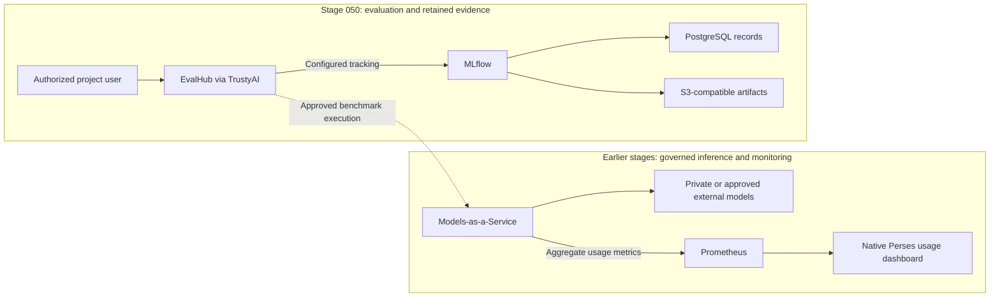

# Stage 050: Model Evaluation And Observability

## Why This Matters

Stage 040 establishes who may use a model. This stage asks whether it helps developers complete useful work, how reliably it responds, and how much governed usage that work consumes.

Evaluation and observability connect **task success, rework, latency and consumption**. Teams can use that evidence to choose models, investigate repeated retries and plan capacity. Red Hat's [What did AI cost you this quarter?](https://developers.redhat.com/articles/2026/09/18/what-did-ai-cost-you-this-quarter) frames showback as a way to improve the service teams receive. Here, usage is measured and costs remain **unpriced** until actual approved rates are supplied.

## Architecture

- **New in this stage:** native EvalHub and project-scoped evaluation access, alongside retained MLflow tracking and separate evaluation and tracking databases.
- **Already available:** governed model endpoints, GPU/model monitoring, native MaaS usage attribution and optional GenAI Studio tracing from earlier stages.
- **Value of the integration:** connect task results with operational evidence before changing a model or capacity allocation.

## Demo

Explore **Develop & train → Evaluations** for native evaluation discovery, and MLflow for experiment records and artifacts. Submit a governed run from the dashboard, through the documented EvalHub REST API, SDK or CLI (below), or with the [evaluation task scripts](evaluation/README.md) (`submit.sh`, `record.sh`); it appears in the Evaluations list and its metrics in the MLflow experiment. In the dashboard, **Start evaluation run** lists only `InferenceService` deployments of the selected project, so pick **Other (External endpoint)** with the MaaS gateway URL, the MaaS model id and the `evalhub-model-auth-maas` secret; the [troubleshooting entry](../../docs/TROUBLESHOOTING.md#start-evaluation-run-offers-no-model-to-choose) carries the exact values and benchmark parameters.

**Coding v1** is the native `coding-v1` collection: one benchmark, lighteval `lcb:codegeneration_v6` (LiveCodeBench v6, 1,055 competitive-programming problems, execution-scored `codegen_pass@1`, pass threshold 0.25). Three platform facts size a run on 3.5.1: lighteval samples 16 generations per problem in a single request, the evaluation sidecar allows 30 seconds per model request, and the lighteval adapter stops a benchmark after one hour. A run therefore uses a code-only system prompt and a 512-token generation cap (Qwen answers then average about 300 tokens), and its number of examples bounds the job to the hour. A 16-sample request also needs the model to admit at least 16 concurrent sequences; the Stage 040 Qwen 3.8 profile does, and a request then took about 14 seconds in the 2026-10-09 runs, so 120 examples fit the hour. The Qwen profiles serve instruct (non-thinking) mode with the model cards' non-thinking sampling by default, which the adapter relies on because it cannot set the mode per request.

First results (2026-10-09, 16 samples per problem, code-only non-thinking answers, 512-token cap, logged as FINISHED MLflow runs and recorded on each model's registry version): Qwen 3.8 27B INT4 scored `codegen_pass@1` 0.242 on the first 120 LiveCodeBench v6 problems in 22 minutes; Qwen 3.6 27B FP8 scored 0.21 on the first 100 in 41 minutes (its 16-sample requests take about 25 seconds, so 100 problems is the hour-safe bound). Both sit below the suite's 0.25 threshold. Qwen 3.6 was retired on 2026-10-13; its result stays on its registry version as history.

**Providers and their parameters.** The three built-in providers used here are registered in the EvalHub CR and reach the governed models through the same Secret-referenced MaaS key and the tenant Kueue queue; each needs its own benchmark parameters (qualified 2026-10-12 on Qwen 3.8, details in [TROUBLESHOOTING](../../docs/TROUBLESHOOTING.md#evalhub-provider-jobs-fail-or-never-finish-against-maas-models)):

| Provider | Use it for | Benchmark parameters |
|---|---|---|
| `lighteval` | Coding v1 (LiveCodeBench), math and reasoning generation tasks | `provider: endpoint`, a code-only `system_prompt` and `generation_parameters.max_new_tokens: 512` so each 16-sample request finishes inside the sidecar's 30 s; `num_examples` to stay within the adapter's hour |
| `lm_evaluation_harness` | Log-likelihood benchmarks (ARC, HellaSwag, MMLU, TruthfulQA MC) | `tokenizer`: the Hugging Face repository of the served model (`RedHatAI/Qwen3.8-27B-NVFP4` for production, `RedHatAI/Qwen3.8-27B-INT4` for the candidate); generative tasks such as IFEval and GSM8K exceed the sidecar's 30 s per generation on 3.5.1 |
| `guidellm` | Latency and throughput (TTFT, ITL, tokens/s) | `max_seconds` or `max_requests`, plus `rate` for `concurrent` and `constant`; catalog entries such as `quick_perf_test` carry no bound |

**Programmatic and agent access.** Beside the dashboard and REST, the 3.5 guide's SDK/CLI (2.4) and MCP server (chapter 4) are configured for the tenant. The `evalhub-automation` ServiceAccount in `evaluated-models` is the ServiceAccount principal (2.29) for the CLI, SDK, CI pipelines and MCP clients; issue a token with `oc create token evalhub-automation -n evaluated-models` and follow 2.4 (`pip install "eval-hub-sdk[cli]"`, `evalhub config set base_url|tenant|token`, `evalhub health`). The EvalHub CR enables the MCP server (`spec.mcp`), which the operator publishes as Route `evalhub-mcp` (re-encrypt, kube-rbac-proxy); register it in an MCP client with the same token and `x-tenant: evaluated-models`. The MCP server calls EvalHub as `evalhub/evalhub-mcp-client` (CRD `spec.mcp.authSecret`), pinned to tenant `evaluated-models`. Jobs can also export their result artifacts and evaluation card to the internal registry as immutable OCI artifacts (2.19, chapter 5): repository `evaluated-models/evaluation-results` through the registry's default route, with credentials in the `evalhub-oci-registry` Secret (Stage 050 `050-oci-export/`); the job's `results.benchmarks[].artifacts` carries the digest and reference. Jobs can carry MLflow experiment tags (`model`, `benchmark`, `access_path`, `submitted_by`) so runs can be queried by model and benchmark (2.20).

Record a completed job on the model's registry entry as model version properties (dashboard **Edit** on the version's Properties, or [`evaluation/record.sh`](evaluation/README.md)): the dashboard renders a model version's custom properties, so each benchmark metric, the job, the experiment and the MLflow reference belong there (`evalhub.*` keys). The registry API also accepts metric artifacts and experiment runs, but the 3.5 dashboard does not render them.

**SWE-bench** has no working built-in path in 3.5.1: the Inspect AI provider lists `inspect/swe-bench`, but its adapter image ships without the `swe_bench` extra (the task asserts on start) and offers only the `local` sandbox on Kubernetes, so the per-instance repository environments cannot run. The `swebench/` directory stages the community adapter (`evalhub-provider-swebench` ConfigMap in the operator namespace, documented custom-provider procedure), the tenant Role its grading Jobs need, the `swebench-agent` ServiceAccount and ConfigMap for patch generation (mini-swe-agent inside each SWE-bench instance image, talking to the MaaS gateway with the evaluation key), and the `evalhub-s3-test-data` Secret for the documented S3 test-data mount. Its run driver was retired with the operator helpers (git history, 82092e01). The provider is listed in the EvalHub CR and the `anyuid` SCC is bound to `evaluated-models/evalhub-evalhub-job` and `evaluated-models/swebench-agent` (operator approval 2026-10-09). Patch generation works (five Verified instances on Qwen 3.8, 2026-10-12), but grading cannot run inside EvalHub on 3.5.1: the community adapter creates one grading Job per instance and needs Kubernetes API credentials, while EvalHub runs adapters with `automountServiceAccountToken: false` by design ([troubleshooting entry](../../docs/TROUBLESHOOTING.md#swe-bench-grading-job-fails-with-invalid-kube-config-file)). The instance images come from Docker Hub, which rate-limits anonymous pulls.

**Model qualification pipeline.** Onboarding a model runs as an AI pipeline in the **Evaluated Models** project (`evaluated-models`, its own EvalHub tenant), following [Add automated AI evaluations to your CI/CD pipeline](https://developers.redhat.com/articles/2026/06/11/add-automated-ai-evaluations-your-cicd-pipeline). Register the candidate in the model registry, deploy it as an `InferenceService` in the project (such as `qwen3-8-27b-int4`), then in **Develop & train → Pipelines** create a run of **Agentic coding model qualification** with two required parameters: `model_name` (the InferenceService) and `model_version_id` (its registry version). Six switches skip an evaluation: `skip_latency`, `skip_throughput`, `skip_livecodebench`, `skip_python_tasks`, `skip_security` and `skip_risk_assessment`; every evaluation runs by default. Steps 1 to 4 each submit one `agentic-coding-*` collection with the EvalHub CLI and wait for it; step 5 submits the `garak-kfp` `avid_security` benchmark and step 6 the `garak-kfp` `intents` risk assessment (which needs the abliterated `gemma-2-9b-abliterated` model running in the project), each with the candidate's URL in its `kfp_config`. Every evaluation also appears under **Evaluations** for the project. The run graph is one straight chain like the garak-kfp pipeline (`validate`, `latency`, `throughput`, `livecodebench`, `python-tasks`, `security`, `risk-assessment`, `verdict`, `report`). As garak's steps hand on their datasets, each step hands the next a results ledger (`candidate`, then `results`), so the intermediate results can be opened between the steps while the run goes on. `verdict` judges this run's jobs against their gates (QUALIFIED only when every evaluation ran and passed, plus the weighted capability gate) and attaches the verdict, each benchmark's result and links to the evaluation pages, MLflow runs and pipeline runs to the model registry version; the last step, `report`, publishes the HTML report and summary metrics like garak's `write-kfp-outputs`. Choose the MLflow experiment `models-onboarding` in the run form (the pipeline server's default): the run, its steps, every EvalHub job and the garak-kfp pipeline runs land there. The project is set up like AI Coding Sandbox, with **Models**, **Workbench** and **Pipelines** connections and cluster storage. Its pipeline server is configured the way the dashboard's **Configure pipeline server** does it from the **Pipelines** connection (bucket `evaluation-models-pipelines`). The pipeline source is `stages/050-model-evaluation/qualification/`, compiled to Kubernetes-native Pipeline and PipelineVersion objects. The `qwen3-8-27b-int4` candidate is an onboarding demonstration; the developer tools keep using the production `qwen3-8-27b` (NVFP4).

As a platform administrator, open **Observe & monitor → Dashboard → Usage**. Filter consumption by user, subscription and model, then inspect or export the native usage table.

## What This Stage Adds

This stage provides the evidence foundation for model and developer-workflow decisions:

- **EvalHub** coordinates evaluations through compatible native providers and collections.
- **TrustyAI** manages the native evaluation service and tenant integration.

The model catalog's **Safety and security insights** tab is an Eval Hub dashboard extension: the dashboard asks the Eval Hub BFF for the catalog's pre-computed safety data with the catalog namespace (`rhoai-model-registries`) as the request namespace, and that BFF applies the documented tenant authorization (`get` on the virtual resource `evaluations.trustyai.opendatahub.io` there) before proxying. The `tenant/catalog-insights-*` manifests grant exactly that read to `rhods-admins` and `rhoai-developers`; the namespace is not an Eval Hub tenant and gets no job, collection or provider permission.
- **MLflow** retains experiments, metrics and artifacts for later review.
- **Governed model authentication for evaluations.** Evaluation jobs reach models through the MaaS gateway with the `model-qualification` subscription (Stage 040). The `provision-evalhub-model-auth` Sync hook mints that key as the owning ServiceAccount and stores it in the tenant Secret `evalhub-model-auth-maas` under the documented `api-key` key; jobs reference it through `model.auth.secret_ref`, and the evaluation sidecar resolves it so adapters never see the credential. Candidates served in the project use the tenant Secret `garak-kfp-model-auth` instead (hook `provision-candidate-model-auth`): a scoped ServiceAccount token and the service CA for every adapter, plus the pipeline, Kubernetes and helper-model keys `garak-kfp` needs.
- **The agentic coding qualification pipeline** (AI Pipelines, project **Evaluated Models**) evaluates one candidate per run against versioned criteria, including Garak security and risk assessment, and records the verdict on its model registry version.
- **One evaluation project.** Every evaluation, from the qualification pipeline, the REST API, the CLI or the dashboard, runs in the **Evaluated Models** EvalHub tenant with its MaaS key, Kueue queue and MLflow experiments. The project is admin-only (`rhods-admins`): onboarding a model is a platform decision, and developers consume promoted models through MaaS.
- **A combined quality and usage view** reuses Stage 040 showback without moving gateway or monitoring ownership into Stage 050.

EvalHub and MLflow are generally available in OpenShift AI 3.5. The evaluation dashboard, MaaS observability and GenAI Studio tracing retain their feature-specific Technology Preview boundaries.

## What To Notice And Why It Matters

A benchmark result applies to its task, dataset and model configuration. For a coding agent, a useful outcome is a repository change that passes independent tests. Retaining those results alongside latency, retries and consumption helps distinguish a cheaper response from a more effective development workflow.

Native MaaS counters show aggregate total-token and call usage. They do not provide the input/output token split or internal tool trajectory, and missing history stays unknown. Showback helps identify questions to investigate; it does not turn usage into an invoice.

**Future engineering planning:** [ConfigIQ](https://configiq.xyz/) is a public [Red Hat Performance Engineering project](https://github.com/redhat-performance/configiq) for inference sizing, GPU comparison and cost modeling. Engineers can explore how model size, context, quantization, batching and workload shape affect memory and capacity tradeoffs. It is a future planning reference for this workshop: compare its estimates with measured behavior and actual local rates before making a sizing decision.

## How Red Hat And Open Source Make It Work

OpenShift AI's native TrustyAI component manages EvalHub, and its MLflow Operator manages the shared tracking service. EvalHub coordinates provider-backed evaluation work; PostgreSQL and OpenShift Data Foundation retain records and artifacts. GitOps manages customer configuration while the operators manage service workloads.

MaaS, Red Hat Connectivity Link, Prometheus and Perses provide the existing aggregate usage view. GenAI Studio offers an opt-in session tracing capability with an embedded MLflow viewer, complementing aggregate metrics; this is not automatic capture of every MaaS, MCP or agent interaction.

## Trust Boundaries

Evaluation uses existing OpenShift identities, project permissions and governed model access. Approved external models still process requests outside the cluster. Records, artifacts and identity-bearing usage exports require appropriate access and retention controls. Session traces can contain prompts, code and tool outputs: agree the content, redaction and storage policy before opting in. Credentials remain outside Git; showback is internal evidence, not billing-grade metering.

## Red Hat Products Used

- **[Red Hat OpenShift AI](https://www.redhat.com/en/technologies/cloud-computing/openshift/openshift-ai)** supplies EvalHub, TrustyAI, MLflow and their dashboard integration.
- **Red Hat OpenShift Container Platform and Cluster Observability Operator** provide the monitoring platform reused for operational visibility.
- **Red Hat OpenShift Data Foundation** provides S3-compatible artifact storage.
- **Red Hat OpenShift GitOps** keeps platform configuration reproducible.

## Open Source Projects To Know

EvalHub coordinates evaluations; MLflow organizes experiment evidence; PostgreSQL stores durable records. Prometheus and Perses provide aggregate usage queries and dashboards. ConfigIQ is a future sizing reference, separate from these deployed services.

## Deploy And Validate

The evaluation foundation uses the platform, serving and governed-access stages; it does not deploy another model or allocate another GPU. An actual evaluation requires its selected endpoint to be available.

The stage is deployed as five Argo CD Applications at one reviewed revision: `050-mlflow` (tracking service, its data and the curated prompts project), `050-model-qualification` (the Evaluated Models project, candidate serving and the qualification pipeline), `050-evalhub` (EvalHub and its database), `050-evaluation-content` (collections and SWE-bench) and `050-oci-export`. A stopped candidate model shows `050-model-qualification` as Suspended; the other components stay Healthy.

Use the [operations guide](../../docs/OPERATIONS.md) for deployment and validation. Validation separates service readiness from completed results and retained MLflow evidence.

## References

- [What did AI cost you this quarter?](https://developers.redhat.com/articles/2026/09/18/what-did-ai-cost-you-this-quarter) — business context for attributed usage and service improvement.
- [Evaluating LLMs with EvalHub](https://docs.redhat.com/en/documentation/red_hat_openshift_ai_self-managed/3.5/html/evaluating_ai_systems/evaluating-llms-with-evalhub_evaluate)
- [Working with AI pipelines](https://docs.redhat.com/en/documentation/red_hat_openshift_ai_self-managed/3.5/html-single/working_with_ai_pipelines/index)
- [Working with MLflow](https://docs.redhat.com/en/documentation/red_hat_openshift_ai_self-managed/3.5/html/working_with_mlflow/index)
- [MaaS observability and internal showback](https://docs.redhat.com/en/documentation/red_hat_openshift_ai_self-managed/3.5/html/govern_llm_access_with_models-as-a-service/deploy-and-manage-models-as-a-service)
- [Feature-specific Technology Preview boundaries](https://docs.redhat.com/en/documentation/red_hat_openshift_ai_self-managed/3.5/html/release_notes/technology-preview-features_relnotes)
- [ConfigIQ public project](https://github.com/redhat-performance/configiq) — future inference-sizing and GPU/cost comparisons.

## Next Stage

[Stage 060: Agent Runtime and AgentOps](../060-agent-runtime-and-agentops/README.md) adds the isolated agent execution layer; Stage 070 adds developer workspaces, portal and delivery tooling.
