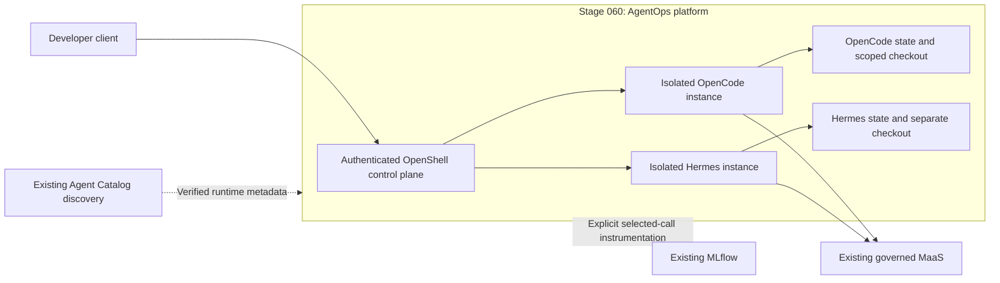

# Stage 060: Agent Runtime And AgentOps

## Why This Matters

An AI coding agent does more than answer a prompt: it edits files, runs programs and calls services. Platform teams need a way to let developers bring useful agents without giving those agents unrestricted access to code, credentials or infrastructure.

AgentOps provides that operating boundary: controlled execution, identity, policy, lifecycle and evidence. Red Hat's [kernel-level agent security story](https://www.redhat.com/en/blog/beyond-container-boundaries-kernel-level-agent-security-red-hat-openshift-ai-35) explains why runtime enforcement complements model guardrails. Here, a standalone agent can retain its work while the developer closes the IDE, with access and background execution governed by the platform.

## Architecture



- **New in this stage:** standalone agent hosting, policy-controlled execution and persistent lifecycle outside the IDE.
- **Already available:** model/agent discovery, governed model access, existing MCP services, evaluation and tracking.
- **Value of the integration:** a repeatable execution boundary for both OpenCode and Hermes, with project-scoped evidence and consumption.

## What This Stage Adds

The platform provides:

- **Bring-your-own agents:** reproducible images and toolchains for standalone OpenCode and Hermes.
- **Controlled access:** runtime filesystem, process and network policies, with authenticated changes and approvals.
- **Persistent work:** logical agent state survives IDE restarts; approved background jobs remain bounded and cancellable.
- **Project isolation:** separate credentials, state and Git checkouts, with reviewed changes exchanged through Git.
- **Operational evidence:** security audit events and explicit selected-call MLflow tracing alongside existing MaaS usage.

OpenCode and Hermes both run in the AI Agents project.

The stage is five Argo CD Applications. Each component folder has a README with its object inventory, configuration choices and checks:

| Application | Purpose | Component README |
|---|---|---|
| `060-openshell-identity` | `openshell` realm in Red Hat build of Keycloak; the OIDC issuer the OpenShell gateway trusts | [openshell-identity](../../gitops/stages/060-agent-runtime-and-agentops/060-openshell-identity/README.md) |
| `060-openshell-runtime` | Agent Sandbox operator, authenticated OpenShell gateway, workspace projects and agent images | [openshell-runtime](../../gitops/stages/060-agent-runtime-and-agentops/060-openshell-runtime/README.md) |
| `060-mcp-platform` | Turns on the OpenShift AI MCP Lifecycle Operator | [mcp-platform](../../gitops/stages/060-agent-runtime-and-agentops/060-mcp-platform/README.md) |
| `060-agent-tools` | OpenShift MCP Server 0.4 as read-only and read-write native MCPServers | [agent-tools](../../gitops/stages/060-agent-runtime-and-agentops/060-agent-tools/README.md) |
| `060-agent-console` | AgentOps view in the OpenShift AI dashboard, read-only per persona | [agent-console](../../gitops/stages/060-agent-runtime-and-agentops/060-agent-console/README.md) |

## What To Notice And Why It Matters

A policy written in a prompt is different from a denied operation enforced by the runtime. Demonstrate both allowed and denied actions, and connect them to their audit evidence. A stopped IDE is also different from a stopped agent: background work needs an explicit lifetime and cancellation policy.

Agent discovery does not host an agent, and aggregate model usage does not reveal every tool or planning step. Keep those responsibilities distinct when assessing safety and task success.

The OpenShell control plane stays in `openshell`. The **AI Agents** project (`ai-agents`) is a separate, administrator-managed hosting boundary, mapped one-to-one to the native `ai-agents` workspace. Its OpenShift project administrators are `rhods-admins`; only the verified `ai-admin` identity receives native workspace administration. `deploy.sh` also creates the native `openshell-developer` workspace with `ai-developer` as its only (user) member, for the developer's own OpenCode sandbox; the `openshell-admin` and `openshell-developer` projects give each persona read-only discovery of its own workspace. OpenCode and Hermes run there with separate retained state and dedicated Qwen3.8-only subscriptions.

## How Red Hat And Open Source Make It Work

OpenShift supplies the execution and identity platform. NVIDIA OpenShell supplies sandbox controls and policy interfaces, while OpenCode and Hermes supply the agent workflows. Existing Models-as-a-Service governs inference, and existing MLflow retains explicitly instrumented evidence.

RHOAI 3.5 Agent Catalog and OpenShell integration are Developer Preview. The deployed gateway runs a pinned upstream OpenShell development build (0.1.3-dev, the merge commit of upstream PR 4150), not a tagged release; that choice does not make the project integration a production-supported RHOAI feature. Broader semantic guardrails, red-team campaigns and VM isolation are separate extensions.

## Trust Boundaries

The runtime must restrict each agent to its approved checkout, tools and service access. Validation must prove that an agent cannot approve its own permission expansion or read provider credentials from its runtime context. Independent verification remains outside its writable boundary. Traces require scoped access and redaction; no automatic capture of every MaaS, MCP or internal agent interaction is implied.

## Red Hat Products Used

- **Red Hat OpenShift Container Platform** provides the execution, identity and network foundations.
- **Red Hat OpenShift AI** supplies existing catalog discovery, governed inference, evaluation and tracking.
- **Red Hat OpenShift GitOps** reconciles the reviewed runtime configuration from Git.

## Open Source Projects To Know

OpenShell controls sandbox execution and access. OpenCode and Hermes run the development workflows; MLflow records selected instrumented evidence. These components have separate version and support boundaries.

## Demo: OpenCode In An OpenShell Sandbox

The preferred demo runs the OpenCode terminal UI inside the developer's own OpenShell sandbox, driven from a laptop
terminal. The developer gets the same coding agent as in Dev Spaces, while the platform enforces what it may touch:
its files, its network and its model credential.

**One-time setup (platform team).** Deploy `060-openshell-runtime`, then follow
[sandboxes/README.md](sandboxes/README.md#developer-access): sign `ai-developer` in with `sandboxes/login.sh` and create the
sandbox with `sandboxes/create.sh opencode --owner ai-developer --apply`. The sandbox `opencode` in workspace
`openshell-developer` persists across demos; its MaaS key lasts 30 days.

**Run the demo (laptop terminal, as `ai-developer`).** Use the pinned CLI and the developer's profile:

```bash
export XDG_CONFIG_HOME=~/.config/rhoai3-openshell-ai-developer OPENSHELL_GATEWAY_INSECURE=true RUST_LOG=error
alias os='~/.local/share/rhoai3-demo/openshell-v0.1.3/bin/openshell --gateway openshell --workspace openshell-developer'
```

1. Show the sandbox: `os sandbox list` lists `opencode` as `Ready`. The same sandbox appears in the OpenShift AI
   dashboard under **AI hub → Agents** for `ai-developer`.
2. Bring code in: `os sandbox upload opencode ./my-project /sandbox/workspace`.
3. Start OpenCode in the sandbox:

   ```bash
   os sandbox exec opencode --tty --workdir /sandbox/workspace/my-project -- opencode
   ```

   The terminal UI runs on the cluster, inside the sandbox. Ask it to change the code; it uses Qwen3.8 through MaaS.
4. Take the result back: `os sandbox download opencode /sandbox/workspace/my-project ./my-project-out`.

**What to point out.** Open a shell next to the agent (`os sandbox exec opencode --tty -- bash`) and show:

- `echo $MAAS_API_KEY` prints a placeholder (`openshell:resolve:env:…`): the gateway holds the real key and injects it
  only into OpenCode's model calls.
- `curl https://github.com` is refused: egress is denied by default, and only the OpenCode binary may reach MaaS.
- `touch /etc/x` is refused: the agent writes only under `/sandbox`.
- Model usage is metered on the developer's own subscription, `opencode-developer-qwen38`.

Quit OpenCode with `ctrl+c`; the sandbox keeps running. `os sandbox stop opencode` stops it and keeps its files.

## Deploy And Validate

`deploy.sh` deploys the five components in order: `060-openshell-identity`, `060-openshell-runtime` (including the native `ai-agents` and `openshell-developer` workspaces, which runs the pinned OpenShell CLI from `~/.local/share/rhoai3-demo/openshell-<cliRelease>/bin/openshell` or `RHOAI_STAGE060_OPENSHELL_CLI`), `060-agent-console`, `060-mcp-platform` and `060-agent-tools`; `deploy.sh --component NAME` deploys one of them. It takes an optional `--revision REF` (default `GIT_REPO_BRANCH`, then `HEAD`), selects the reviewed published commit, runs each component's read-only preflight, pins its Application to the commit, starts a hook-strategy sync and waits, through `scripts/stage-apps.sh`. The five components sync manually by design (`.agents/rules/gitops.md`). `validate.sh` reports full-stage acceptance as pending by design; `validate.sh --component NAME` checks the console, the MCP platform or the agent tools alone.

Enable the native MCP Lifecycle Operator prerequisites with `bash ./stages/060-agent-runtime-and-agentops/deploy.sh --component 060-mcp-platform`; validate with `bash ./stages/060-agent-runtime-and-agentops/validate.sh --component 060-mcp-platform`. The MCP Catalog is Developer Preview; this separate Technology Preview lifecycle component exposes the native MCPServer API through the RHOAI operator.

The catalog's **OpenShift MCP Server 0.4** uses a pinned Red Hat image and a project-scoped native MCPServer. Its deployment policy retains the catalog's read-only core/config tools and denies Secret resources; it is token-less and in-cluster only (a request without a bearer acts as the bounded ServiceAccount `openshift-mcp-server-ro`, a caller's OpenShift token is forwarded and acts as the caller), while the read-write companion on its HTTPS Route requires each caller's token. The approved boundary is HTTPS at the public entrypoint and HTTP inside the cluster, including forwarded tokens; the operator's generated ingress policy permits cluster peers. Registry metadata is registered through the installed, version-coupled native MLflow API because this RHOAI 3.5.1 catalog does not include the adjacent Register action. A callable HTTPS endpoint is advertised only after runtime and caller-authorization checks pass. The earlier MCP service was retired on 2026-10-09.

For a protected Gen AI Studio connection, the native workflow is **Playground → MCP**, enter your own session access token, choose **Authorize**, then **View tools**. No shared token is stored in the Registry or server configuration. Use the **OpenShift-MCP** entry (no token needed) or **OpenShift-MCP-ReadWrite** (your token) in project **AI Coding Sandbox** (`demo-sandbox`); the legacy **OpenShift-MCP** entry was retired on 2026-10-09. Enter your own OpenShift token, not a model MaaS key.

The owner-only client and selected-task MLflow tracing milestone completed on 2026-10-09: with the runtime at `07a29a29…` (tags `stage060-client-traces-20261009` and `stage060-client-traces-k8s-pin-20261009`), `owner-client.py --check` and `--trace` passed for both agents, creating experiment `agent-runtime-traces` (id 3, workspace `ai-agents`) with one verified trace per agent. The full-stage validator still reports pending by design. `deploy.sh` and `validate.sh` cover the platform components. The agent sandboxes and their qualification are task scripts: [sandboxes/](sandboxes/README.md) (`create.sh` provisions or checks the OpenCode or Hermes sandbox; `qualify.sh` runs the host, inference, OpenCode, Hermes and owner-client suites, the last as `qualify.sh client --check`) and [images/](images/README.md) (`build-opencode.sh`, `build-hermes.sh`). The selected-task MLflow tracing mode of the former owner client (`--trace`, MLflow Python SDK) was not restored; it is in git history at `82092e01`.

The catalog server is registered with native version **0.4.0** (catalog version **0.4**) and deployed with 13 read-only core/config tools. A second native MCPServer, `openshift-mcp-server-rw`, serves the same catalog image with `read_only = false` for callers who need to create, update, scale or delete resources; it keeps caller-token passthrough, the Secret denial and the HTTPS edge boundary, is published to Studio as **OpenShift-MCP-ReadWrite**, and every action is bounded by the caller's own RBAC. As `ai-admin`, browse it under **AI hub → MCP servers → Registry** or **Deployments** in **MCP servers**. `ai-developer` has no access to this hosting project; developer Studio consumption uses the direct HTTPS endpoint with the developer's own session token and workload-project permissions. The read-write HTTPS endpoint requires your OpenShift token; the read-only endpoint is in-cluster and token-less. Direct Studio publication uses the documented global discovery ConfigMap and per-session authorization. MCP Gateway aggregation and governance remain separately blocked; this direct connection does not use MaaS API keys or model quotas.

For console discovery only, deploy the separate `060-agent-console` component with `bash ./stages/060-agent-runtime-and-agentops/deploy.sh --component 060-agent-console`, then run `bash ./stages/060-agent-runtime-and-agentops/validate.sh --component 060-agent-console`. It enables the Developer Preview AgentOps view and permits each persona to read Services and Sandboxes in its own workspace. Launch and lifecycle remain in the authenticated OpenShell CLI. The generic console creation wizard is not qualified and receives no Sandbox creation permission from this component.

The authenticated control plane and native sandbox controller are available. A workspace owner can start an OpenCode sandbox with no model provider, reach its HTTP and event-stream endpoints through the authenticated gateway, and stop, restart and delete it; file, interface-binding and network-egress attempts outside the policy are denied, and another owner's workspace is refused. The persistent OpenCode slice uses a dedicated Qwen3.8-only MaaS subscription, protected provider credentials and an independently authenticated loopback service. OpenCode passed a bounded coding-tool task with governed model streaming, application cancellation, stop/start persistence and negative access checks. Hermes also passed a real coding-tool task, governed streaming, protected API authentication, active-run cancellation and retained session history after restart. Its native approvals apply to commands flagged by Hermes; they do not require approval for every shell command. Separate no-model checks also passed for denied filesystem access, metadata/internet connections and disallowed request methods/paths. The owner confirmed both OpenCode and Hermes Ready/Sandboxed under **AI hub → Agents → Deployments → AI Agents** as `ai-admin`. Reviewed owner-client access and selected-call MLflow tracing passed on 2026-10-09 (above).

## References

- [Red Hat: kernel-level agent security](https://www.redhat.com/en/blog/beyond-container-boundaries-kernel-level-agent-security-red-hat-openshift-ai-35)
- [RHOAI 3.5 Developer Preview features](https://docs.redhat.com/en/documentation/red_hat_openshift_ai_self-managed/3.5/html/release_notes/developer-preview-features_relnotes)
- [NVIDIA OpenShell](https://github.com/NVIDIA/OpenShell)
- [OpenCode server](https://opencode.ai/docs/server/)
- [Hermes agent API](https://hermes-agent.nousresearch.com/docs/user-guide/features/api-server)

## Next Stage

[Stage 070: Advanced Application Platform](../070-advanced-app-platform/README.md) provides developer workspaces, portal and delivery services, including the GitLab integration. The AgentOps runtime can be qualified independently, then integrated with these developer clients.

After the catalog runtime is ready, publish its Studio entries by running Stage 040 again (an idempotent redeploy at its revision), and check them with its validator:

```bash
./stages/040-governed-models-as-a-service/deploy.sh
./stages/040-governed-models-as-a-service/validate.sh
```

The Stage040 Application delegates the exact `OpenShift-MCP` and `OpenShift-MCP-ReadWrite` data fields in Git. No other discovery fields or playground state change. The private ownership journal is keyed by the current ConfigMap UID; keep it for idempotent repeat publication. Regular Stage040 deployment defers when the separately owned catalog runtime is absent.

For catalog publication or qualification, supply the reviewed immutable deployed revisions as `RHOAI_STAGE040_EXPECTED_REVISION` and `RHOAI_STAGE060_EXPECTED_REVISION` (or the helpers' explicit revision arguments). Helper-only source publication does not require moving either live Application. Metadata connection and tool listing prove bearer-header transport; the server's opaque-token mode validates caller authority when an actual Kubernetes resource is requested. A nonempty invalid bearer must be denied on that resource call, not inferred invalid from metadata discovery.

Operator installation uses native Automatic approval on the selected channels. Historical CSVs shown here are qualified baselines, not immutable future installation pins. See [Fresh operator deployment](../../docs/OPERATIONS.md#fresh-operator-deployment) for compatible-version checks, rolling-channel limits and the standard cluster-credential prerequisite.
